<p align="center">
  
</p>

<p align="center">
  <a href="https://github.com/eiler2005/slidecraft/actions/workflows/ci.yml"></a>
  <a href="https://www.npmjs.com/package/@eiler2005/slidecraft"></a>
  <a href="LICENSE"></a>
  <a href="#install"></a>
  <a href="https://eiler2005.github.io/slidecraft/"></a>
  
</p>

<p align="center">
  <b>Describe the goal. Pick a look. Ship a partner-ready deck.</b><br>
  <a href="#install">Install</a> · <a href="docs/tutorials/first-deck-in-10-minutes.md">First deck in 10 minutes</a> · <a href="https://eiler2005.github.io/slidecraft/">Gallery site</a> · <a href="docs/README.md">Docs</a> · <a href="ROADMAP.md">Roadmap</a> · <a href="CHANGELOG.md">Changelog</a>
</p>

---

**SlideCraft** turns a goal into a consulting-grade presentation. You say what the deck must achieve and for whom. SlideCraft proposes templates for the task, builds the storyline and a ghost deck of action titles for you to approve, then writes the slides and renders them to an **editable PowerPoint, an accessible vector PDF and a self-contained HTML deck** — plus a one-pager and a Word memo when readers read rather than watch. A partner-style review closes the loop.

It works with **any AI agent or LLM that can run a command**:
- **Claude Code** — a plugin with skills and model-tiered agents;
- **OpenAI Codex** — installable skills;
- **Claude Desktop, Cursor, VS Code, Windsurf, Gemini CLI** — an MCP server, connected with one `install` command;
- **Aider or your own scripts** — through [`AGENTS.md`](AGENTS.md) and a JSON CLI.

It works from **your material**: numbers come from your Excel or CSV files and are written once, sources cite the page of the report they come from, and text a colleague edits in PowerPoint flows back into the deck.

Underneath is one **zero-install CLI**. Every layout is measured with metric-compatible fonts, so text that fits in SlideCraft fits in PowerPoint — verified line by line against real PowerPoint output.

## See it in action

This deck explains SlideCraft — and SlideCraft made it from [one `deck.yaml`](examples/slidecraft-overview/deck.yaml):

<p align="center"><a href="docs/showcase/slidecraft-overview.pdf"></a></p>

<p align="center"><b><a href="docs/showcase/slidecraft-overview.pdf">PDF</a></b> · <b><a href="docs/showcase/slidecraft-overview.pptx">PowerPoint</a></b> · <a href="docs/showcase/slidecraft-overview-onepager.pdf">one-page summary</a> · <a href="docs/examples.md">all examples</a></p>

New here? [**Start here**](docs/start-here.md) — your first deck in ten minutes · [**What you can do**](docs/features.md) — capabilities by job to be done · [**Example library**](docs/examples.md) — six finished decks to copy

## Why it exists

SlideCraft is built by **[Denis Ermilov](https://github.com/eiler2005)**. Denis has 20 years in B2B FinTech and enterprise platforms and is Director of Product at Cinimex Group. Much of that time went into decks for joint projects with consulting firms such as **McKinsey & Company, Accenture and IBM**: board papers, strategy recommendations, steering-committee updates, proposals. That work taught a short list of rules: answer first, one claim per slide, every number sourced, never shrink text until it is unreadable. Most of those rules are mechanical, so this project turns that consulting practice into software an AI agent follows every time.

Denis also writes about AI beyond the hype: *Digital Bank* (2023) and *When Intelligence Became Cheap* (2026), part of a three-book series on people, companies and trust once intelligence becomes cheap. → [Books on Amazon](https://www.amazon.de/-/en/stores/author/B0HGYCXBVP/about) · [GitHub profile](https://github.com/eiler2005)

## 60 seconds

```text
you     › Make a deck: the board should approve a partner-led entry into Germany
agent   › Brief: board of 5, decision = €6M phase-1 budget, deck goes out as PDF.
          Outputs: PPTX (pptxgenjs) + PDF rendered by PowerPoint, because readers get the PDF.   ✅ CP1
agent   › Three templates — opened picker.html:
          A  Strategy recommendation · Consulting Classic   (answer first, 3 reasons, plan, ask)
          B  Strategy recommendation · Executive
          C  Executive update · Corporate Blue
you     › A                                                                                      ✅ CP2
agent   › Governing thought: "Entering Germany now captures a €40M window before two rivals scale"
          01 Entering the German mid-market can add €40M revenue by 2028
          02 Entering Germany now captures a €40M window before two rivals scale
          03 The UK business is profitable, growing and ready to fund a second market  …     ✅ CP3
agent   › Built 11 slides. Review: 0 blockers, 2 majors fixed, 1 minor left.                    ✅ CP4
          slidecraft/northwind-germany/dist/northwind-germany.pptx · .pdf · previews/ · manifest.json
```

## How it works

```mermaid
flowchart LR
  B["1 · Brief<br/>goal, audience, ask,<br/>what you'll do with it"] -->|✅ CP1| P["2 · Pick<br/>3 templates as<br/>contact sheets"]
  P -->|✅ CP2| S["3 · Storyline<br/>governing thought,<br/>SCR, key line"]
  S --> G["4 · Ghost deck<br/>action-title chain,<br/>exhibit sketches"]
  G -->|✅ CP3| W["5 · Build<br/>slides written in parallel,<br/>rendered by engines"]
  W --> R["6 · Review<br/>checks, copy-fit,<br/>partner review"]
  R -->|✅ CP4| D["7 · Deliver<br/>PPTX · PDF · HTML<br/>+ manifest"]
  classDef opus fill:#5B3FD1,color:#fff,stroke:#5B3FD1;
  classDef sonnet fill:#1F5FBF,color:#fff,stroke:#1F5FBF;
  classDef main fill:#0B1F3A,color:#fff,stroke:#0B1F3A;
  class S,G opus; class W sonnet; class B,P,D,R main;
```



You approve four checkpoints; everything between them is automated. Work is tiered by difficulty:
- the strongest model does the storyline and the partner review;
- faster models write slides in parallel and fit copy.

In Claude Code that is Opus, Sonnet and Haiku. In Codex or any other agent, it is whatever models you configure. See [workflow](docs/explanation/workflow.md).

## Template gallery

A template is **a storyline (the shape of the argument for a task) × a theme (the look)**. Any storyline works in any theme. Fourteen storylines × six themes (or your own brand theme), built from forty layouts. The [gallery site](https://eiler2005.github.io/slidecraft/) shows every storyline in every theme and the example decks in every format.

<table>
  <tr>
    <td width="33%" valign="top"><a href="docs/reference/storylines.gen.md#strategy-recommendation"></a><br><sub><b>Strategy recommendation</b> · Consulting Classic — answer first, three reasons, plan, ask</sub></td>
    <td width="33%" valign="top"><a href="docs/reference/storylines.gen.md#executive-update"></a><br><sub><b>Executive update</b> · Executive — steerco, board, QBR: plan vs actual vs forecast, decisions needed</sub></td>
    <td width="33%" valign="top"><a href="docs/reference/storylines.gen.md#narrative-story"></a><br><sub><b>Narrative story</b> · Midnight — keynotes and talks: hook, journey, turning point, insight</sub></td>
  </tr>
  <tr>
    <td width="33%" valign="top"><a href="docs/reference/storylines.gen.md#pitch-deck"></a><br><sub><b>Pitch deck</b> · Modern Pitch — problem, solution, market, traction, team, ask</sub></td>
    <td width="33%" valign="top"><a href="docs/reference/storylines.gen.md#research-readout"></a><br><sub><b>Research readout</b> · Editorial — question, method, findings, implications</sub></td>
    <td width="33%" valign="top"><a href="docs/reference/storylines.gen.md#client-proposal"></a><br><sub><b>Client proposal</b> · Corporate Blue — understanding, approach, plan, team, commercials</sub></td>
  </tr>
</table>

<p align="center"><a href="docs/reference/storylines.gen.md">All storylines →</a> · <a href="docs/reference/themes.gen.md">All themes →</a> · <a href="docs/reference/layouts.gen.md">All layouts →</a></p>

Storyline is the task, theme is the look: **14 storylines × 7 themes**, independently selectable. Within each slide, route the message through `slidecraft exhibits`, reuse native library components with `slidecraft components`, and combine them using `layout: composition`. Shared design elements and content feed HTML and editable PowerPoint engines through one Scene IR. [Constructor guide](docs/how-to/compose-components.md) · [Architecture diagrams and verification limits](docs/explanation/architecture.md).

Also included: **business case**, **product overview**, **case study**, **project kickoff**, **post-mortem**, **training / workshop**, **sales / customer QBR**, **investment memo**. Bring your own outline and SlideCraft maps it onto layouts.

Small and quick: [`examples/europe-first-trip`](examples/europe-first-trip/deck.yaml) — a five-slide travel guide (2×2 value map, Harvey-ball fit by traveller type, budget chart, "who should go where" table), produced in a live end-to-end run with the plugin agents and with Codex, then curated.

**Your brand:** `slidecraft theme import brand.potx --id contoso --font-dir ./fonts` creates a theme with your colours, fonts and logo; `slidecraft calibrate --theme ./slidecraft-theme/contoso.json` checks line breaks against real PowerPoint ([apply your brand](docs/how-to/apply-brand.md)). The template's pictures stay in place, its title band and slide size become the deck's frame (4:3 works too), and its Office theme travels into every PPTX.

**Your old decks:** `slidecraft import old.pptx --render` extracts text, tables, chart data, pictures and notes into a draft `deck.yaml`; `/slidecraft:import` then redesigns it slide by slide from the rendered original ([import a PPTX](docs/how-to/import-pptx.md)).

## Outputs and engines

One spec, several engines — you choose, SlideCraft recommends based on what you will do with the deck.

| Engine | Output | Editable | When to use | Install | License |
|---|---|---|---|---|---|
| `pptxgenjs` *(default)* | PPTX | ✅ native text, tables, charts, notes | Decks you or your team will edit | bundled | MIT |
| `native` *(default)* | PDF | — | Vector PDF with selectable text; CI and automation | bundled | MIT |
| `pptx-convert` | PDF | — | PDF goes to readers — rendered by PowerPoint/LibreOffice itself, pixel-identical | your office suite | — |
| `html` | HTML + PDF | in browser | Present from a browser, share a link, storytelling with rich decor | Chrome for PDF | MIT |
| `artifact-tool` | PPTX | ✅ | Explicit local evaluation of the OpenAI adapter | Codex runtime | proprietary, evaluation/testing only — never bundled |
| `onepager` | PDF (A4) | — | The argument on one page: every slide as a thumbnail with its action title | bundled | MIT |
| `docx` | DOCX | ✅ | Pre-reads and memos: titles as headings, editable text and tables, exhibits as images | bundled | MIT |

**Recommended:** `pptxgenjs` for anything that leaves your team; `artifact-tool` only for explicit internal evaluation/testing in Codex (not production, commercial use or benchmarking); always a PDF — `native` for speed, `pptx-convert` when the PDF is the deliverable; HTML when you present from a browser.

`slidecraft doctor` shows what is available on your machine. Pros and cons of every engine: [engines compared](docs/explanation/engines-compared.md) · [choose an output engine](docs/how-to/choose-output-engine.md) · [engine reference](docs/reference/engines.gen.md).

## Install

Pick your agent. All of them drive the same CLI, the committed bundle `dist/slidecraft.mjs` (Node ≥ 22.12, no `npm install`).

| You use | Set up | Then |
|---|---|---|
| **Claude Code** | `/plugin marketplace add eiler2005/slidecraft` then `/plugin install slidecraft@slidecraft` | `/slidecraft:new <what the deck must achieve, for whom>` |
| **OpenAI Codex** | `npm i -g @eiler2005/slidecraft` then `slidecraft codex install` (skills in `~/.codex/skills/slidecraft*`) | `codex "Using SlideCraft, make a 5-slide deck that …"` |
| **Cursor, Gemini CLI, Aider, Copilot agents, any LLM with a shell** | `npm i -g @eiler2005/slidecraft`, or clone; point the agent at [`AGENTS.md`](AGENTS.md) | "Follow AGENTS.md and make a deck that …" — see [use with any agent](docs/how-to/use-with-any-agent.md) |
| **Claude Desktop, Cursor, VS Code, Windsurf, Gemini CLI** — or all of the above | `npx @eiler2005/slidecraft install` connects every AI app it finds (MCP server + Claude Code plugin + Codex skills) | "Use SlideCraft to make a deck that …" — see [use with MCP apps](docs/how-to/use-with-mcp.md) |
| **No agent, or any script** | `npx @eiler2005/slidecraft` — no clone needed ([npm](https://www.npmjs.com/package/@eiler2005/slidecraft)) | `npx @eiler2005/slidecraft build deck.yaml` |

```sh
git clone https://github.com/eiler2005/slidecraft && cd slidecraft
node dist/slidecraft.mjs build examples/strategy-recommendation/deck.yaml
open examples/strategy-recommendation/dist/northwind-germany.pptx
```

Write `deck.yaml` by hand: [tutorial](docs/tutorials/cli-without-agent.md) · [deck spec](docs/reference/deck-spec.md) · [CLI reference](docs/reference/cli.gen.md).

## What you get

| File | What it is |
|---|---|
| `<id>.pptx` | Editable PowerPoint: native text boxes, tables and charts, speaker notes, slide masters per theme |
| `<id>.pdf` | Tagged, accessible vector PDF: headings, alt text, table headers, source links (or PowerPoint-rendered with `pptx-convert`) |
| `<id>.html` | One self-contained file: keyboard navigation, presenter notes (`N`), print to PDF |
| `<id>-onepager.pdf` | A4 one-page summary: the title chain with slide thumbnails |
| `<id>.docx` | Word memo: action titles as headings, editable text and tables, exhibits as images, notes |
| `previews/NN-<slide>.png` | Slide previews for review and sharing |
| `manifest.json` | Engines and versions, sha256 of inputs, data files and outputs, every fact's value, check results, limitations, `visual_review: false` until a human signs off |

Builds are **deterministic**: the same deck produces byte-identical PPTX and PDF.

## Principles

- **Answer first.** The recommendation is on slide 2; everything after proves it.
- **Action titles.** Every title is a full-sentence claim; read top to bottom, the titles argue the case.
- **One message per slide.** The exhibit proves the title; detail goes to notes or backup.
- **Every number has a source.** Illustrative data is labelled. Nothing is invented.
- **Editable, not raster.** Text, tables and charts stay native objects.
- **Never truncate.** If text does not fit, SlideCraft says how many characters to cut instead of shrinking it into illegibility.

Methodology: [writing standard](library/references/writing-standard.md) · [visual standard](library/references/visual-standard.md) · [exhibit selection](library/references/exhibit-selection.md) · [storytelling](library/references/storytelling.md) · [review](library/references/review.md).

## Layout library

| Group | Layouts |
|---|---|
| Frame | `title` (cover, closing) · `agenda` (agenda, section-divider) |
| Message | `exec-summary` (SCR, key messages) · `key-points` · `big-statement` (statement, quote, hero number) · `text-image` · `text` · `before-after` · `freeform` (HTML/CSS, checked like any slide) |
| Numbers | `kpi-tiles` · `chart-takeaway` (bar, column, stacked, line) · `waterfall` · `bubble-chart` (bubble, scatter, growth-share portfolio) · `marimekko` · `tornado` · `football-field` · `funnel` (funnel, pyramid) · `data-table` |
| Decide | `options-comparison` (text, Harvey-ball rating, up to 5 options) · `matrix-2x2` · `swot` · `five-forces` · `pestel` · `business-model-canvas` · `issue-tree` (issue, driver) · `maturity-model` (grid, staircase) · `coverage-map` · `architecture` (zones + register) · `evidence-chain` · `risk-matrix` |
| Sequence | `process-steps` (chevrons, numbered) · `timeline` (milestones, gantt) · `gate-matrix` · `process-compare` (current vs proposed) · `cadence` (role calendar) · `callout` (numbered callouts on a screenshot) |
| People · Close | `team-cards` · `org-chart` · `raci` · `next-steps` (decision, actions) |

Contracts, limits and thumbnails: [layouts reference](docs/reference/layouts.gen.md). Add your own: [add a layout](docs/how-to/add-layout.md).

## Roadmap

Shipped in 0.5:
- **your numbers, once:** `facts:` with `{{id}}`, and charts and tables read straight from Excel and CSV;
- **the same number everywhere:** a check flags a metric that shows different values on different slides;
- **page-level sources:** `ingest` reads PDF, Word, PowerPoint and Excel material; slides cite `report#p14`;
- **edits flow back:** `sync` brings text edited in PowerPoint back into the deck;
- **frameworks and charts:** SWOT, five forces, PESTEL, business model canvas, bubble and portfolio charts, marimekko, tornado, football field (40 layouts);
- **every AI app:** an MCP server and a one-line `install` for Claude Desktop, Cursor, VS Code, Windsurf, Gemini CLI, Claude Code and Codex.

Next: stock photos, icons, live preview. See [ROADMAP.md](ROADMAP.md).

## Contributing

Issues and PRs welcome — new layouts, themes and storylines especially. Start with [CONTRIBUTING.md](CONTRIBUTING.md); `npm run check` runs lint, types and 780+ tests, including pixel-hash visual regression of every layout.

## License and acknowledgements

[MIT](LICENSE). Bundled fonts are SIL OFL ([fonts/SOURCES.md](fonts/SOURCES.md)). The consulting methodology generalises the author's earlier internal work. See [NOTICE](NOTICE).
