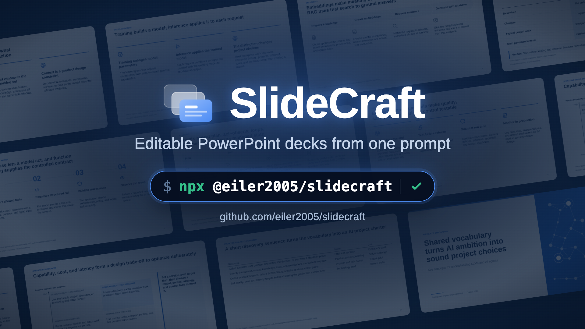
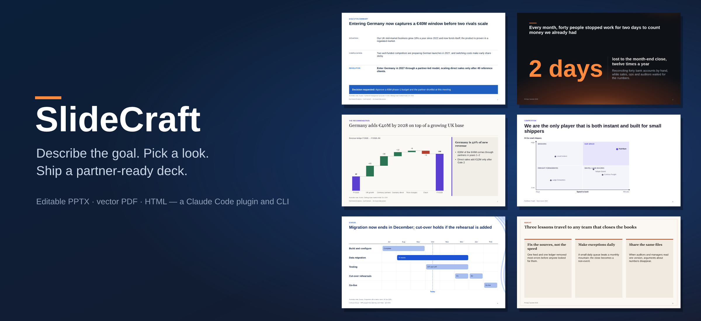
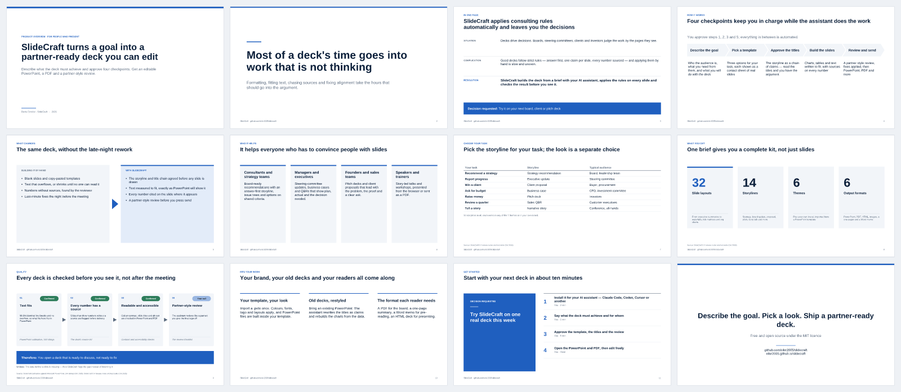
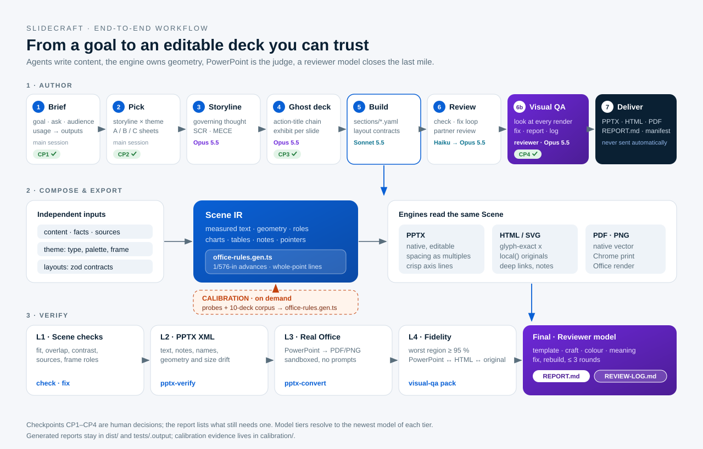
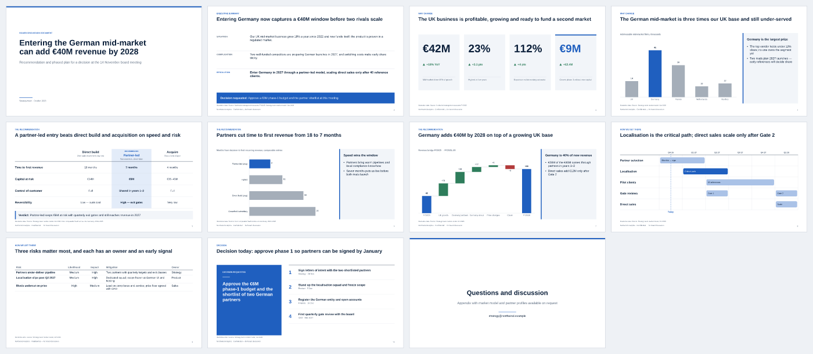
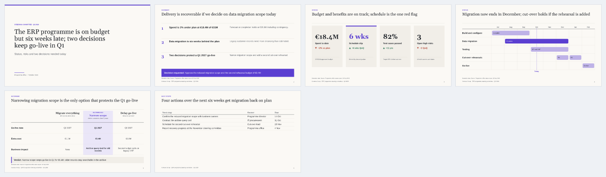
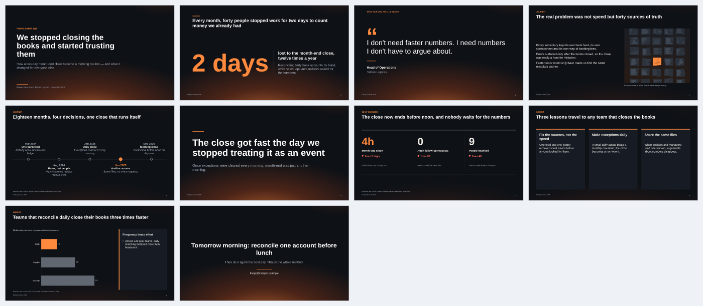
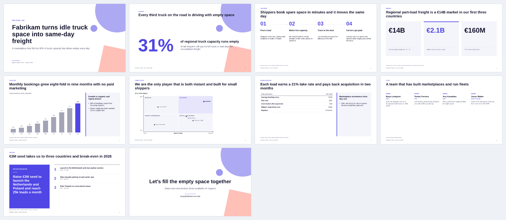
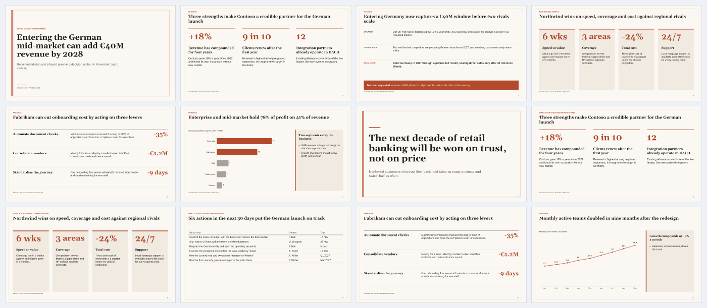
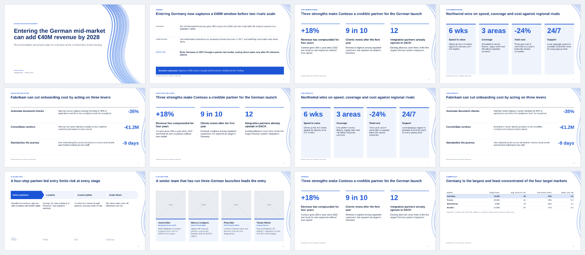

<p align="center"><a href="https://www.youtube.com/watch?v=vNpDca4648Q"></a></p>

<p align="center"><b><a href="https://www.youtube.com/watch?v=vNpDca4648Q">▶ Watch the 65-second demo</a></b> · <a href="https://github.com/eiler2005/Storygro/releases/download/slidecraft-launch-2026-10-18/slidecraft-launch.mp4">MP4</a> · made with <a href="https://github.com/eiler2005/Storygro">Storygro</a></p>

<p align="center">
  <a href="https://github.com/eiler2005/slidecraft/actions/workflows/ci.yml"></a>
  <a href="https://www.npmjs.com/package/@eiler2005/slidecraft"></a>
  <a href="#license"></a>
  <a href="#install"></a>
  <a href="https://eiler2005.github.io/slidecraft/"></a>
  
</p>

<p align="center">
  <b>Editable PowerPoint decks from one prompt.</b> Describe the goal, pick a look, ship a partner-ready deck.<br>
  <a href="#the-easiest-way-one-prompt">One prompt</a> · <a href="#install">Install</a> · <a href="docs/tutorials/first-deck-in-10-minutes.md">First deck in 10 minutes</a> · <a href="https://eiler2005.github.io/slidecraft/">Gallery site</a> · <a href="docs/README.md">Docs</a> · <a href="ROADMAP.md">Roadmap</a> · <a href="CHANGELOG.md">Changelog</a>
</p>

---

Paste [one prompt](#the-easiest-way-one-prompt) into ChatGPT, Claude or Codex and get an **editable PowerPoint** — action titles, sourced numbers and a review before hand-off. Not a picture of slides.

## The easiest way: one prompt

No install, no YAML. Paste this into **ChatGPT (agent mode), Codex, Claude or Claude Code** — any assistant that can run code and open a link — and fill in the brackets:

```text
Study the repository https://github.com/eiler2005/slidecraft (read AGENTS.md first) and use
SlideCraft to make me an editable PowerPoint deck.

Topic: [what the deck is about]
For whom and why: [who will read it and what they should decide or do]
Length: 15–20 slides
Language: [English / Russian / …]
Content: [your notes, key points, numbers with their sources, links or files]
Style: [e.g. calm consulting look, dark keynote, or "match the colours of https://…"]

Follow the SlideCraft workflow: show me the action-title chain and 2–3 cover options before
building, cite a source for every number, then give me the .pptx and a PDF.
```

The assistant runs `npx @eiler2005/slidecraft` on its side, writes the deck, checks it and hands you an editable PowerPoint. **Tested with Codex and Claude Code** on exactly this prompt — see what each made, unedited, with an independent review: [Codex](examples/llm-concepts/README.md) · [Claude Code](examples/llm-concepts-claude/README.md). ChatGPT in agent mode made a five-slide deck end to end from a shorter version of this prompt; the tool errors it hit on the way are fixed in 0.7.5. Claude.ai with code execution follows the same `AGENTS.md`; we have not run it ourselves yet. The content can be in any language. A chat without code execution can still write the `deck.yaml`; build it yourself with `npx @eiler2005/slidecraft build deck.yaml`. For repeat work, install it into your assistant ([install](#install)).

## What SlideCraft is

<p align="center">
  
</p>

**SlideCraft** turns a goal into a consulting-grade presentation. You say what the deck must achieve and for whom. SlideCraft proposes templates for the task, builds the storyline and a ghost deck of action titles for you to approve, then writes the slides and renders them to an **editable PowerPoint, an accessible vector PDF and a self-contained HTML deck** — plus a one-pager and a Word memo when readers read rather than watch. A partner-style review closes the loop.

It works with **any AI agent or LLM that can run a command**:
- **Claude Code** — a plugin with skills and model-tiered agents;
- **OpenAI Codex** — installable skills;
- **Claude Desktop, Cursor, VS Code, Windsurf, Gemini CLI** — an MCP server, connected with one `install` command;
- **Aider or your own scripts** — through [`AGENTS.md`](AGENTS.md) and a JSON CLI.

It works from **your material**: numbers come from your Excel or CSV files and are written once, sources cite the page of the report they come from, and text a colleague edits in PowerPoint flows back into the deck.

Underneath is one **zero-install CLI**. Every layout is measured with metric-compatible fonts, so text that fits in SlideCraft fits in PowerPoint — verified line by line against real PowerPoint output.

## Why an editable PowerPoint from one prompt

Most AI deck tools end in a web page or a picture of slides, so someone rebuilds the deck in PowerPoint — where boards, clients and brand teams actually work. SlideCraft ends in a **`.pptx` whose text, tables, charts, notes and icons are native objects**, from one prompt in the assistant you already use. The model brings the words. SlideCraft brings what the model lacks:
- the consulting method;
- layouts with measured limits;
- PowerPoint's own text rules;
- source and number checks;
- a final visual review.

The deck is right the first time, and stays editable for the next round.

**The honest limits.**
- "One click" needs an assistant that can run code (ChatGPT agent mode, Codex, Claude with code execution, Claude Code).
- The quality comes from a few short approvals, not from skipping them.
- The content is only as good as the numbers and sources you give.
- PowerPoint is the reference; Keynote and Google Slides differ slightly.
- Editable decks are becoming standard in Copilot and Gemini. SlideCraft's lasting edge is the method and the checks, not the file format.

Full analysis: [why an editable PowerPoint matters — and where the claim stops](docs/explanation/why-editable-pptx.md).

## See it in action

This deck explains SlideCraft — and SlideCraft made it from [one `deck.yaml`](examples/slidecraft-overview/deck.yaml):

<p align="center"><a href="docs/showcase/slidecraft-overview.pdf"></a></p>

<p align="center"><b><a href="docs/showcase/slidecraft-overview.pdf">PDF</a></b> · <b><a href="docs/showcase/slidecraft-overview.pptx">PowerPoint</a></b> · <a href="docs/showcase/slidecraft-overview-onepager.pdf">one-page summary</a> · <a href="docs/examples.md">all examples</a></p>

New here? [**Start here**](docs/start-here.md) — your first deck in ten minutes · [**What you can do**](docs/features.md) — capabilities by job to be done · [**Example library**](docs/examples.md) — eleven finished decks to copy

**See the results yourself:** a full run in every format with its review report in [`docs/showcase/orchestration-run/`](docs/showcase/orchestration-run/) · one deck in English and Russian made through the whole workflow in [`docs/showcase/fde-engineer/`](docs/showcase/fde-engineer/) ([example](examples/fde-engineer-en/README.md)) · originals next to SlideCraft's rebuilds and HTML, slide by slide, with `npm run comparison` → `comparison/index.html` · [where to find what](docs/how-to/see-results.md)

## Why it exists

SlideCraft is built by **[Denis Ermilov](https://github.com/eiler2005)**. Denis has 20 years in B2B FinTech and enterprise platforms — payment systems at national scale, a cross-border payment hub with direct links to China, India and Southeast Asia, a dealer-network platform with Volkswagen Group's team in Berlin — and is Director of Product at Cinimex Group. Much of that time went into decks for joint projects with consulting firms such as **McKinsey & Company, Accenture and IBM**: board papers, strategy recommendations, steering-committee updates, proposals. That work taught a short list of rules: answer first, one claim per slide, every number sourced, never shrink text until it is unreadable. Most of those rules are mechanical, so this project turns that consulting practice into software an AI agent follows every time.

Denis also writes about AI beyond the hype: *Digital Bank* (2023) and *When Intelligence Became Cheap* (2026), part of a three-book series on people, companies and trust once intelligence becomes cheap. → [Books on Amazon](https://www.amazon.de/-/en/stores/author/B0HGYCXBVP/about) · [GitHub profile](https://github.com/eiler2005)

## 60 seconds

```text
you     › Make a deck: the board should approve a partner-led entry into Germany
agent   › Brief: board of 5, decision = €6M phase-1 budget, deck goes out as PDF.
          Outputs: PPTX (pptxgenjs) + PDF rendered by PowerPoint, because readers get the PDF.   ✅ CP1
agent   › Three templates — opened picker.html:
          A  Strategy recommendation · Consulting Classic   (answer first, 3 reasons, plan, ask)
          B  Strategy recommendation · Executive
          C  Executive update · Corporate Blue
you     › A                                                                                      ✅ CP2
agent   › Governing thought: "Entering Germany now captures a €40M window before two rivals scale"
          01 Entering the German mid-market can add €40M revenue by 2028
          02 Entering Germany now captures a €40M window before two rivals scale
          03 The UK business is profitable, growing and ready to fund a second market  …     ✅ CP3
agent   › Built 11 slides. Review: 0 blockers, 2 majors fixed, 1 minor left.                    ✅ CP4
          slidecraft/northwind-germany/dist/northwind-germany.pptx · .pdf · previews/ · manifest.json
```

## How it works

<p align="center"></p>

**What a deck is made of.** Four independent layers, all plain files you can read and diff:

| Layer | File | What it holds |
|---|---|---|
| Brief | `brief.yaml` | goal, ask, audience, how the deck will be used → which outputs |
| Storyline × theme | chosen from 14 × 7 | the shape of the argument for the task, and the look |
| Content | `deck.yaml` (+ `sections/*.yaml`) | action titles and slide content against 46 layout contracts; `sources:`, `facts:` from Excel/CSV, cover visual, `language:` |
| Your material | `materials/`, `assets/` | reports cited by page, data files, pictures |

Layouts turn the content into one **Scene IR**; engines translate it into editable PPTX, PDF,
HTML, a one-pager and a Word memo. Text is laid out with PowerPoint's measured rules, so the
HTML and the PPTX break lines the same way.

**How it is assembled** — eight stages, four checkpoints you approve (the top row of the picture above): brief → pick a template → storyline → ghost deck of action titles → build → review → visual QA → deliver.

**How it is checked.** Automatic checks after every build (fit without truncation, sources for
every number, the same number everywhere, contrast, geometry); a copy-fit loop and a partner
review; then a reviewer model looks at every slide as PowerPoint and the browser draw it and
writes `REPORT.md` — a verdict and what needs your attention. Every change made while checking
lands in `REVIEW-LOG.md`.

The strongest model does the storyline and the reviews; faster models write slides in parallel
and fit copy (Opus, Sonnet and Haiku in Claude Code; whatever you configure elsewhere).

Full process: [workflow](docs/explanation/workflow.md) · [architecture](docs/explanation/architecture.md) · [final visual QA](docs/how-to/visual-qa.md) · [design the cover](docs/how-to/design-the-cover.md) · [decks in Russian and other languages](docs/how-to/deck-language.md) · [orchestration templates and a full run](examples/orchestration/README.md)

## Template gallery

A template is **a storyline (the shape of the argument for a task) × a theme (the look)**. Any storyline works in any theme. Fourteen storylines × six themes (or your own brand theme), built from forty-two layouts. The [gallery site](https://eiler2005.github.io/slidecraft/) shows every storyline in every theme and the example decks in every format.

<table>
  <tr>
    <td width="33%" valign="top"><a href="docs/reference/storylines.gen.md#strategy-recommendation"></a><br><sub><b>Strategy recommendation</b> · Consulting Classic — answer first, three reasons, plan, ask</sub></td>
    <td width="33%" valign="top"><a href="docs/reference/storylines.gen.md#executive-update"></a><br><sub><b>Executive update</b> · Executive — steerco, board, QBR: plan vs actual vs forecast, decisions needed</sub></td>
    <td width="33%" valign="top"><a href="docs/reference/storylines.gen.md#narrative-story"></a><br><sub><b>Narrative story</b> · Midnight — keynotes and talks: hook, journey, turning point, insight</sub></td>
  </tr>
  <tr>
    <td width="33%" valign="top"><a href="docs/reference/storylines.gen.md#pitch-deck"></a><br><sub><b>Pitch deck</b> · Modern Pitch — problem, solution, market, traction, team, ask</sub></td>
    <td width="33%" valign="top"><a href="docs/reference/storylines.gen.md#research-readout"></a><br><sub><b>Research readout</b> · Editorial — question, method, findings, implications</sub></td>
    <td width="33%" valign="top"><a href="docs/reference/storylines.gen.md#client-proposal"></a><br><sub><b>Client proposal</b> · Corporate Blue — understanding, approach, plan, team, commercials</sub></td>
  </tr>
</table>

<p align="center"><a href="docs/reference/storylines.gen.md">All storylines →</a> · <a href="docs/reference/themes.gen.md">All themes →</a> · <a href="docs/reference/layouts.gen.md">All layouts →</a></p>

Storyline is the task, theme is the look: **14 storylines × 7 themes**, independently selectable. Within each slide, route the message through `slidecraft exhibits`, reuse native library components with `slidecraft components`, and combine them using `layout: composition`. Shared design elements and content feed HTML and editable PowerPoint engines through one Scene IR. [Constructor guide](docs/how-to/compose-components.md) · [Architecture diagrams and verification limits](docs/explanation/architecture.md).

Also included: **business case**, **product overview**, **case study**, **project kickoff**, **post-mortem**, **training / workshop**, **sales / customer QBR**, **investment memo**. Bring your own outline and SlideCraft maps it onto layouts.

Small and quick: [`examples/europe-first-trip`](examples/europe-first-trip/deck.yaml) — a five-slide travel guide (2×2 value map, Harvey-ball fit by traveller type, budget chart, "who should go where" table), produced in a live end-to-end run with the plugin agents and with Codex, then curated.

**Your brand:** `slidecraft theme import brand.potx --id contoso --font-dir ./fonts` creates a theme with your colours, fonts and logo; `slidecraft calibrate --theme ./slidecraft-theme/contoso.json` checks line breaks against real PowerPoint ([apply your brand](docs/how-to/apply-brand.md)). The template's pictures stay in place, its title band and slide size become the deck's frame (4:3 works too), and its Office theme travels into every PPTX.

**Your old decks:** `slidecraft import old.pptx --render` extracts text, tables, chart data, pictures and notes into a draft `deck.yaml`; `/slidecraft:import` then redesigns it slide by slide from the rendered original ([import a PPTX](docs/how-to/import-pptx.md)).

## Outputs and engines

One spec, several engines — you choose, SlideCraft recommends based on what you will do with the deck.

| Engine | Output | Editable | When to use | Install | License |
|---|---|---|---|---|---|
| `pptxgenjs` *(default)* | PPTX | ✅ native text, tables, charts, notes | Decks you or your team will edit | bundled | MIT |
| `native` *(default)* | PDF | — | Vector PDF with selectable text; CI and automation | bundled | MIT |
| `pptx-convert` | PDF | — | PDF goes to readers — rendered by PowerPoint/LibreOffice itself, pixel-identical | your office suite | — |
| `html` | HTML + PDF | in browser | Present from a browser, share a link, storytelling with rich decor | Chrome for PDF | MIT |
| `artifact-tool` | PPTX | ✅ | Explicit local evaluation of the OpenAI adapter | Codex runtime | proprietary, evaluation/testing only — never bundled |
| `onepager` | PDF (A4) | — | The argument on one page: every slide as a thumbnail with its action title | bundled | MIT |
| `docx` | DOCX | ✅ | Pre-reads and memos: titles as headings, editable text and tables, exhibits as images | bundled | MIT |

**Recommended:** `pptxgenjs` for anything that leaves your team; `artifact-tool` only for explicit internal evaluation/testing in Codex (not production, commercial use or benchmarking); always a PDF — `native` for speed, `pptx-convert` when the PDF is the deliverable; HTML when you present from a browser.

**Fidelity:** text is laid out with PowerPoint's own measured rules, so HTML and the editable PPTX match; every deck ends with a reviewer-model check and a report of what needs your attention ([rules](docs/explanation/office-rendering-rules.md) · [visual QA](docs/how-to/visual-qa.md) · [calibration report](calibration/REPORT.md)).

`slidecraft doctor` shows what is available on your machine. Pros and cons of every engine: [engines compared](docs/explanation/engines-compared.md) · [choose an output engine](docs/how-to/choose-output-engine.md) · [engine reference](docs/reference/engines.gen.md).

## Install

Pick your agent. All of them drive the same CLI, the committed bundle `dist/slidecraft.mjs` (Node ≥ 22.12, no `npm install`).

| You use | Set up | Then |
|---|---|---|
| **Claude Code** | `/plugin marketplace add eiler2005/slidecraft` then `/plugin install slidecraft@slidecraft` | `/slidecraft:new <what the deck must achieve, for whom>` |
| **OpenAI Codex** | `npm i -g @eiler2005/slidecraft` then `slidecraft codex install` (skills in `~/.codex/skills/slidecraft*`) | `codex "Using SlideCraft, make a 5-slide deck that …"` |
| **Cursor, Gemini CLI, Aider, Copilot agents, any LLM with a shell** | `npm i -g @eiler2005/slidecraft`, or clone; point the agent at [`AGENTS.md`](AGENTS.md) | "Follow AGENTS.md and make a deck that …" — see [use with any agent](docs/how-to/use-with-any-agent.md) |
| **Claude Desktop, Cursor, VS Code, Windsurf, Gemini CLI** — or all of the above | `npx @eiler2005/slidecraft install` connects every AI app it finds (MCP server + Claude Code plugin + Codex skills) | "Use SlideCraft to make a deck that …" — see [use with MCP apps](docs/how-to/use-with-mcp.md) |
| **No agent, or any script** | `npx @eiler2005/slidecraft` — no clone needed ([npm](https://www.npmjs.com/package/@eiler2005/slidecraft)) | `npx @eiler2005/slidecraft build deck.yaml` |

```sh
git clone https://github.com/eiler2005/slidecraft && cd slidecraft
node dist/slidecraft.mjs build examples/strategy-recommendation/deck.yaml
open examples/strategy-recommendation/dist/northwind-germany.pptx
```

**MCP server:** `npx @eiler2005/slidecraft mcp` (stdio). Listed in the official [MCP Registry](https://registry.modelcontextprotocol.io/v0.1/servers?search=io.github.eiler2005/slidecraft) as `io.github.eiler2005/slidecraft`, so registry-aware clients can find and install it.

Write `deck.yaml` by hand: [tutorial](docs/tutorials/cli-without-agent.md) · [deck spec](docs/reference/deck-spec.md) · [CLI reference](docs/reference/cli.gen.md).

## What you get

| File | What it is |
|---|---|
| `<id>.pptx` | Editable PowerPoint: native text boxes, tables and charts, speaker notes, slide masters per theme |
| `<id>.pdf` | Tagged, accessible vector PDF: headings, alt text, table headers, source links (or PowerPoint-rendered with `pptx-convert`) |
| `<id>.html` | One self-contained file: keyboard navigation, presenter notes (`N`), print to PDF |
| `<id>-onepager.pdf` | A4 one-page summary: the title chain with slide thumbnails |
| `<id>.docx` | Word memo: action titles as headings, editable text and tables, exhibits as images, notes |
| `previews/NN-<slide>.png` | Slide previews for review and sharing |
| `manifest.json` | Engines and versions, sha256 of inputs, data files and outputs, every fact's value, check results, limitations, `visual_review: false` until a human signs off |

Builds are **deterministic**: the same deck produces byte-identical PPTX and PDF.

## Principles

- **Answer first.** The recommendation is on slide 2; everything after proves it.
- **Action titles.** Every title is a full-sentence claim; read top to bottom, the titles argue the case.
- **One message per slide.** The exhibit proves the title; detail goes to notes or backup.
- **Every number has a source.** Illustrative data is labelled. Nothing is invented.
- **Editable, not raster.** Text, tables and charts stay native objects.
- **Never truncate.** If text does not fit, SlideCraft says how many characters to cut instead of shrinking it into illegibility.

Methodology: [writing standard](library/references/writing-standard.md) · [visual standard](library/references/visual-standard.md) · [exhibit selection](library/references/exhibit-selection.md) · [storytelling](library/references/storytelling.md) · [review](library/references/review.md).

## Layout library

46 layouts in six groups.

| Group | Layouts |
|---|---|
| Frame | `title` (cover, closing) · `agenda` (agenda, section-divider) |
| Message | `exec-summary` (SCR, key messages) · `key-points` (columns, cards, list) · `big-statement` (statement, quote, hero number) · `text-image` · `text` · `before-after` · `composition` (several exhibits in regions) · `native-canvas` (bespoke, editable shapes) · `freeform` · `freeform-canvas` (HTML/CSS, checked like any slide) |
| Numbers | `kpi-tiles` · `chart-takeaway` (bar, column, stacked, line, combo bar + line) · `evidence-panorama` · `waterfall` · `bubble-chart` (bubble, scatter, growth-share portfolio) · `marimekko` · `tornado` · `football-field` · `funnel` (funnel, pyramid) · `data-table` |
| Decide | `options-comparison` (text, Harvey-ball rating, up to 5 options) · `matrix-2x2` · `swot` · `five-forces` · `pestel` · `business-model-canvas` · `value-chain` · `seven-s` (McKinsey 7S) · `issue-tree` (issue, driver) · `maturity-model` (grid, staircase) · `coverage-map` · `architecture` (zones + register) · `evidence-chain` · `risk-matrix` |
| Sequence | `process-steps` (chevrons, numbered) · `timeline` (milestones, gantt) · `gate-matrix` · `process-compare` (current vs proposed) · `cadence` (role calendar) · `callout` (numbered callouts on a screenshot) |
| People · Close | `team-cards` · `org-chart` · `raci` · `next-steps` (decision, actions) |

Contracts, limits and thumbnails: [layouts reference](docs/reference/layouts.gen.md). Add your own: [add a layout](docs/how-to/add-layout.md).

## Roadmap

Shipped in 0.5:
- **your numbers, once:** `facts:` with `{{id}}`, and charts and tables read straight from Excel and CSV;
- **the same number everywhere:** a check flags a metric that shows different values on different slides;
- **page-level sources:** `ingest` reads PDF, Word, PowerPoint and Excel material; slides cite `report#p14`;
- **edits flow back:** `sync` brings text edited in PowerPoint back into the deck;
- **frameworks and charts:** SWOT, five forces, PESTEL, business model canvas, bubble and portfolio charts, marimekko, tornado, football field (40 layouts);
- **every AI app:** an MCP server and a one-line `install` for Claude Desktop, Cursor, VS Code, Windsurf, Gemini CLI, Claude Code and Codex.

Shipped in 0.7:
- **pictures and icons:** licensed stock photos (Openverse, Pexels, Pixabay) with credits on the slide, in the notes and the manifest; 114 editable icons;
- **a theme from a sample:** colours, fonts and margins from a PDF, a screenshot or a website;
- **more frameworks:** value chain, McKinsey 7S, combo bar + line chart (46 layouts now);
- **numbers that add up:** totals, periods and units checked across the deck;
- **covers you choose:** 2–3 cover options compared before building; a cover without a visual is flagged;
- **sharp, well-cropped photos:** Wikimedia Commons and Openverse without a key, download sizes measured, `imageFocus` keeps the subject in view;
- **tested from one prompt:** the README prompt run unedited in Codex and Claude Code, with an independent review of each.

Shipped in 0.6:
- **PowerPoint-exact text:** measured Office rules shared by HTML and PPTX, a calibration mode and a 10-deck corpus gate;
- **final visual QA:** a reviewer model checks every slide in PowerPoint and the browser and writes a report and a review log;
- **covers that stand out:** a topic motif or a picture on the cover;
- **any language:** labels, numbers, typography and proofing follow `language:`; sources in the speaker notes.

Next: live preview, table sync, presenter tools. See [ROADMAP.md](ROADMAP.md).

## Privacy and network access

SlideCraft runs on your machine, or in your assistant's sandbox. It has no account and no telemetry, and it sends your deck content nowhere. It goes online only for what you ask for:

- `npx @eiler2005/slidecraft` downloads the package from npm;
- **stock photos** (`imageQuery`, `slidecraft images --stock`) search and download from Openverse and Wikimedia Commons, or from Pexels and Pixabay when you set `PEXELS_API_KEY` / `PIXABAY_API_KEY`; the search words leave your machine;
- **generated pictures** (`imagePrompt`, `slidecraft images`) send the prompt to an OpenAI-compatible API with your `OPENAI_API_KEY`;
- `slidecraft theme from https://…` opens that page in your local Chrome to read its colours and fonts.

`--dry-run` lists every prompt or search before anything is sent. Rendering uses your local PowerPoint, LibreOffice or Chrome. Your material stays in `slidecraft/`, which is git-ignored.

## Contributing

Issues and PRs welcome — new layouts, themes and storylines especially. Start with [CONTRIBUTING.md](CONTRIBUTING.md); `npm run check` runs lint, types and 1,200+ tests, including pixel-hash visual regression of every layout.

## License

SlideCraft is **source-available** (not OSI open source) under the [PolyForm Shield License 1.0.0](LICENSE):

- **Free for individuals and companies** — personally, at work, in a company or for clients: make decks, change the code, build it into your own workflow, share copies with the licence attached. The decks you make are yours, for any purpose.
- **Don't compete with it** — you may not offer SlideCraft, or a product built from it, as a product or service that competes with SlideCraft.
- **Commercial licence** — to sell, host, white-label or embed SlideCraft in a competing product, or for enterprise terms and support, write to [denis.ermilov@gmail.com](mailto:denis.ermilov@gmail.com). Details: [COMMERCIAL.md](COMMERCIAL.md).
- **The name** — "SlideCraft" and its logo are not licensed under PolyForm; a fork needs a different name.

**Using SlideCraft at a company?** [Teams & brand-kit early access](mailto:denis.ermilov@gmail.com?subject=SlideCraft%20Teams%20early%20access) — your corporate template set up for you, shared brand kits for a team.

Versions up to and including 0.6.0 were released under the MIT License and stay under it. Bundled fonts are SIL OFL ([fonts/SOURCES.md](fonts/SOURCES.md)), icons are Tabler Icons (MIT), and third-party libraries keep their own licences ([NOTICE](NOTICE)). The consulting methodology generalises the author's earlier internal work.
