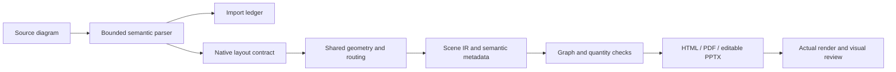

# ADR 0008 — Native diagrams share geometry, semantics and export paths

**Status:** accepted · **Date:** 2026-10-25

## Context

Diagram Design research identified missing quantitative and structural exhibits. Importing complete HTML/SVG pages as slide pictures would bypass measured text, themes and editable PowerPoint. Counting visual types alone also obscures useful variants of existing charts.

## Decision

1. Register native diagrams in the existing layout catalogue, with bounded Zod contracts and examples. A `diagram` tag is a catalogue facet, never a separate renderer or registry.
2. Reuse `PathNode` M/L/C/Z geometry, measured text, theme tokens and the standard frame. Preserve fill opacity in SVG, native PDF and pptxgenjs custom geometry. The optional evaluation adapter explicitly rejects unsupported paths rather than silently omitting them.
3. Share numeric geometry, label spreading and orthogonal routing. Retain node/edge identities and unrounded route metadata for graph QA. Quantitative marks retain value/scale metadata; QA independently measures area, height and both ribbon ends. Data curves are not graph connectors.
4. Use explicit `textContainer: false` for plot backdrops whose boundaries do not constrain labels. Ordinary panel containment remains checked. Select a reachable black/white endpoint when correcting text contrast on mid-tone fills.
5. Represent paired and distribution views as variants of existing charts. Distinguish editable shape-based charts from Office chart worksheets in documentation.
6. Import bounded semantic subsets of Mermaid/draw.io/Excalidraw into those same contracts. Do not execute input or reproduce source styling. Write an explicit loss ledger; reject unsupported syntax and unreadable budgets. Do not silently invent components or truncate labels.
7. Support report/presentation readability at deck level without mutating themes. Exact Office text metrics remain calibrated data; this feature does not change them.

## Consequences

New exhibits receive the same all-theme harness and public contracts. Generic negative tests cover corrupted quantities, invalid endpoints, mismatched dimensions, unsupported imports and real PPTX custom geometry/opacity. Light/dark synthetic decks serve as visual and website examples. The upstream work is credited as design research; the TypeScript implementation is original and no upstream code, fonts or assets are bundled.

The router is bounded, not a universal graph layout engine. Semantic examples do not certify every possible dense input. Automatic connector attachment in Office, full UML/Mermaid conformance and manual-edit round trips require separate evidence. Visual QA reports the actual renderer and outstanding findings rather than treating Scene previews as PowerPoint proof.
