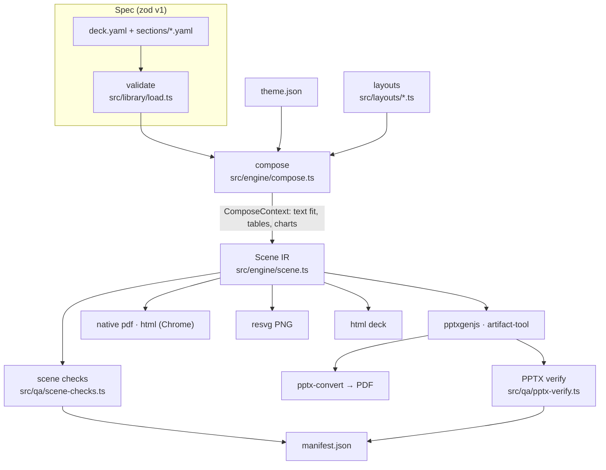

# Architecture

> **Audience:** contributors · **Prerequisites:** [concepts](concepts.md) · **Last reviewed:** 2026-10-10

## Modules

| Path | Responsibility |
|---|---|
| `src/spec/` | zod schemas (deck, brief, theme, storyline) → JSON Schemas in `schemas/` |
| `src/library/` | loading and validating library files; ranking (`rank.ts`), output recommendation (`recommend.ts`), library checks, generated docs |
| `src/engine/fonts.ts`, `text.ts` | fontkit measurement, greedy line breaking, copy-fitting |
| `src/engine/charts.ts` | chart geometry: nice axes, highlight trick, waterfall decomposition across zero, vector primitives |
| `src/engine/context.ts` | the `ComposeContext` API layouts use |
| `src/engine/compose.ts` | masters, frame (tracker, title, lead, source line), ghost slides, title/source checks |
| `src/layouts/` | 16 layouts: contract + compose |
| `src/backends/` | engines and registry; `svg.ts` shared by PNG and HTML |
| `src/qa/` | diagnostic codes, scene checks, PPTX verification |
| `src/build.ts` | orchestrates check → engines → verify → manifest |
| `src/gallery.ts` | contact sheets, layout thumbnails, picker page, hero |
| `src/cli/` | commander commands (`commands.ts`, `workflow.ts`) |

## Key mechanisms

- **Measurement parity.** Text is laid out with metric-compatible fonts at exact line spacing and zero insets; PPTX boxes use the same geometry so PowerPoint wraps identically ([ADR 0005](../adr/0005-metric-compatible-fonts.md)).
- **Charts.** One computation yields native chart parameters (series, explicit axis, manual plot area) and vector primitives. Single-series highlights become two stacked series so native charts colour per category; waterfalls become six stacked series (invisible base, up/down above and below zero, totals).
- **Determinism.** Fixed epoch (`SOURCE_DATE_EPOCH`); PPTX zips re-packed with fixed timestamps and renumbered chart parts (pptxgenjs uses a process-global counter); PDFs embed each image once.
- **Diagnostics.** Collected during compose (fit, spec), after compose (geometry, contrast, density) and after PPTX write (text presence, image ppi), sorted by severity.
- **Zero install.** esbuild bundle with an inline plugin for pdfkit's standard fonts ([ADR 0002](../adr/0002-typescript-zero-install-bundle.md)).

## Extending

[Add a layout](../how-to/add-layout.md) · [add a theme](../how-to/add-theme.md) · [add a storyline](../how-to/add-storyline.md) · engines: implement `Engine` in `src/backends/types.ts` and register in `extra.ts`.
