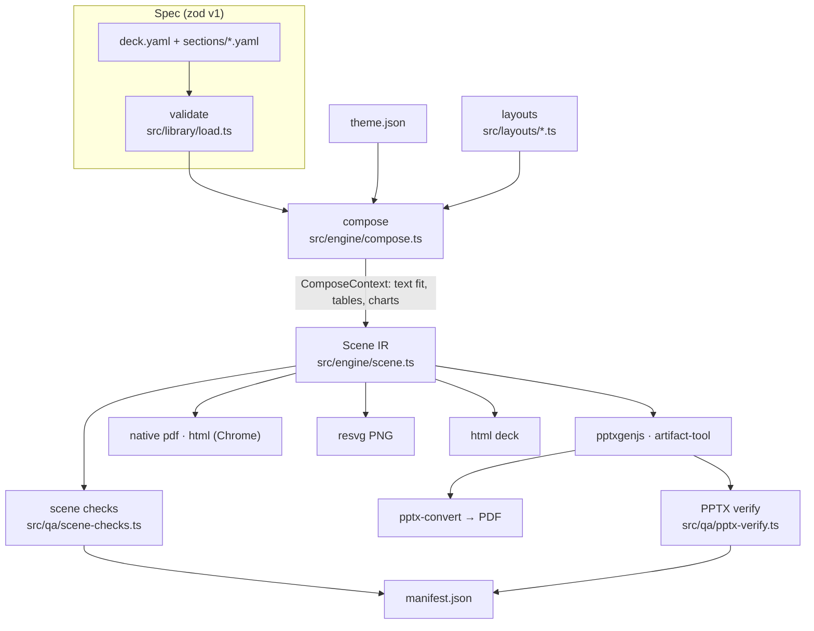

# Architecture

> **Audience:** contributors · **Prerequisites:** [concepts](concepts.md) · **Last reviewed:** 2026-10-11

SlideCraft is a component constructor, not an HTML screenshot generator. Argument, content, visual relationship, reusable components, theme and output engines are separate decisions.

[Editable diagram source](../assets/architecture/slide-constructor.html).

## Storylines × themes × components

The **storyline** is the deck's task and argument; the **theme** is its look. All installed pairs are allowed. `storyline.themes` ranks recommendations, not compatibility restrictions. There are currently **14 storylines × 7 themes**. Generated catalogue pages derive counts from the library.

`tests/composition.test.ts` scaffolds and composes every pair. `tests/layouts.test.ts` separately composes all layout examples in all themes. This establishes functional compatibility, not that arbitrary content fits every layout or that each combination is visually identical in PowerPoint.

For an approved client presentation, preserve the argument and exact wording. Do not impose a new storyline merely to fill a template.

1. **Content:** exact text, facts/data, references and speaker notes.
2. **Semantic routing:** `src/library/exhibits.ts` maps comparison, process, architecture, trend, bridge and other relationships to existing layouts and variants. `slidecraft exhibits --json` exposes this mapping.
3. **Reusable components:** the actual `src/layouts/` contracts, not a second disconnected catalogue. `slidecraft components --json` lists composable native body exhibits.
4. **Composition:** `src/layouts/composition.ts` invokes existing layouts inside bounded regions of one body. Child contexts retain nested field pointers for diagnostics and PowerPoint sync. Unknown contracts, recursive/canvas/HTML components, invalid data, overlapping regions and escaped geometry fail explicitly.
5. **Theme and common design:** type/palette are independent of semantic composition. `src/spec/chrome.ts` and `src/engine/chrome.ts` own the section marker, side rail, title rule, page badge, sources and bottom-line band. The frame is drawn once, not duplicated inside every component.
6. **Scene IR:** measured text, geometry, roles, pointers, tables/charts and notes feed interchangeable engines.

Prefer a complete existing exhibit when it fits. If one message needs complementary exhibits, use `composition`. If vocabulary is missing, add a reusable layout with a schema, examples and native primitives, then extend the same semantic routes. `evidence-panorama` adds a metric plus four explanations; `waterfall` remains the bridge component.

See [the constructor contract and example](../how-to/compose-components.md).

## Rendering and verification

[Editable diagram source](../assets/architecture/render-and-verify.html).

Native layouts compose into a shared Scene; HTML/SVG and editable PPTX independently consume that geometry. PPTX does not flatten HTML into a slide image. Imported freeform HTML remains an escape hatch: Chromium measurement lowers supported elements into native objects, or an authored `ppt` bridge supplies an editable analogue. Unsupported features require an analogue or a clear error, never silent omission or an implicit raster fallback. See [HTML bridge](../how-to/html-editable-ppt.md).

`pptxgenjs` is the portable default, including in Codex. The explicit `artifact-tool` adapter uses a locally available OpenAI runtime only under its licence: the inspected runtime allows internal evaluation, not production, commercial use, benchmarking or redistribution. No proprietary runtime/assets ship with SlideCraft.

Verification has distinct levels:

1. Contract, text-fit, geometry, overlap and contrast checks before export.
2. Actual PPTX XML checks after export, including text, named chrome/native alternatives, slide/layout/master relationships and speaker notes.
3. `--png-engine pptx-convert` renders the **actual PPTX** through PowerPoint or LibreOffice and Poppler into `previews-office/`; the manifest records the renderer. `resvg` previews only Scene IR and cannot certify Office output.
4. Compare actual Office pages with frozen HTML references at identical dimensions; inspect wrapping, positioning and missing elements, then review each page.

**95%+ fidelity is an acceptance target, not a certified blanket guarantee.** The Digital Ruble integration runner now combines original-text/note checks, native-object counts and 4×4 region RGB/detail differences against both frozen and current HTML. It records fonts and renderer provenance and fails on any damaged slide, not only the deck average. This is an initial diagnostic gate, not a calibrated perceptual 95% score. Manual review and metric calibration remain necessary; a background-dominated pixel score is insufficient.

The owner explicitly authorised the 22-slide Digital Ruble corpus as a public regression fixture. `tests/fixtures/digital-ruble/` contains the immutable original PPTX, a font-externalised historical HTML reference, hash locks and candidate input. `npm run test:digital-ruble` checks content, editability and actual Office output; generated reports stay ignored. This is a specific consent exception, not permission to commit other client content. See [regression instructions](../../tests/fixtures/digital-ruble/README.md) and [generation principles](presentation-generation-principles.md).

[Confirmed defects, fixes and remaining acceptance work](editable-fidelity-audit.md).

## Modules

| Path | Responsibility |
|---|---|
| `src/spec/` | zod schemas (deck, brief, theme, storyline) → JSON Schemas in `schemas/` |
| `src/library/` | loading and validating library files; ranking (`rank.ts`), output recommendation (`recommend.ts`), library checks, generated docs |
| `src/engine/fonts.ts`, `text.ts` | fontkit measurement, greedy line breaking, copy-fitting |
| `src/engine/charts.ts` | chart geometry: nice axes, highlight trick, waterfall decomposition across zero, vector primitives |
| `src/engine/context.ts` | the `ComposeContext` API layouts use |
| `src/engine/compose.ts`, `chrome.ts` | masters, common design/frame, body reservation, ghost slides, title/source checks |
| `src/layouts/` | registered layout contracts, reusable native exhibits and component composition |
| `src/backends/` | engines and registry; `svg.ts` shared by PNG and HTML |
| `src/qa/` | diagnostic codes, scene checks, PPTX verification |
| `src/build.ts` | orchestrates check → engines → verify → manifest |
| `src/gallery.ts` | contact sheets, layout thumbnails, picker page, hero |
| `src/cli/` | commander commands (`commands.ts`, `workflow.ts`) |

## Key mechanisms

- **Measurement parity.** Text is laid out with metric-compatible fonts, shared geometry and zero insets. Font substitution and Office behaviour still require actual-render verification ([ADR 0005](../adr/0005-metric-compatible-fonts.md)).
- **Charts.** One computation yields native chart parameters (series, explicit axis, manual plot area) and vector primitives. Single-series highlights become two stacked series so native charts colour per category; waterfalls become six stacked series (invisible base, up/down above and below zero, totals).
- **Determinism.** Fixed epoch (`SOURCE_DATE_EPOCH`); PPTX zips re-packed with fixed timestamps and renumbered chart parts (pptxgenjs uses a process-global counter); PDFs embed each image once.
- **Diagnostics.** Collected during compose (fit, spec), after compose (geometry, contrast, density) and after PPTX write (text presence, image ppi), sorted by severity.
- **Zero install.** esbuild bundle with an inline plugin for pdfkit's standard fonts ([ADR 0002](../adr/0002-typescript-zero-install-bundle.md)).

## Extending

[Add a layout](../how-to/add-layout.md) · [add a theme](../how-to/add-theme.md) · [add a storyline](../how-to/add-storyline.md) · engines: implement `Engine` in `src/backends/types.ts` and register in `extra.ts`.
