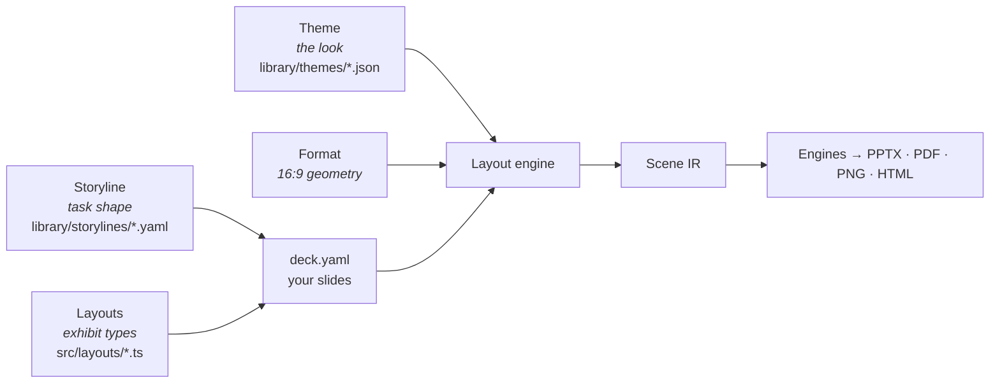

# Concepts

> **Audience:** everyone new to SlideCraft · **Prerequisites:** none · **Last reviewed:** 2026-10-10

SlideCraft separates *what you argue* from *what you show* from *how it looks*. Four independent layers, combined at build time:

| Layer | Answers | Example | Changes how often |
|---|---|---|---|
| **Storyline** | How should this kind of deck argue? Which slides, in what order, proving what? | `strategy-recommendation`: SCR → answer → reasons → plan → ask | Rarely — one per task type |
| **Layout** | How do we show this kind of message? What content fits? | `waterfall` with a takeaway panel; ≤ 12 steps, labels ≤ 24 chars | When a new exhibit type is needed |
| **Format** | Where do title, body, source line and footer sit? | `wide-16x9`, 13.333 × 7.5 in | Almost never |
| **Theme** | Colours, fonts, type scale, decor | `midnight`: dark, orange accent, glow | Per brand or mood |

A **template** — what you pick at checkpoint 2 — is simply *storyline × theme*. Because the layers are independent, any storyline works in any theme and every layout works in every theme. The test harness checks every layout example in every theme.

## The deck spec

`deck.yaml` is the single source of truth: deck metadata, a `sources:` registry, output preferences, and a list of slides. Each slide names a `layout` (and `variant`), carries the common fields (`id`, `title`, `tracker`, `sources`, `notes`, …) and the content fields that layout's contract defines. See [deck spec](../reference/deck-spec.md).

## Ghost slides

Before content exists, slides are **ghosts**: an action title plus `ghost: { exhibit, data, confidence }`. They render as dashed sketches. The title chain is agreed while slides are still cheap to change; content is written only after that ([ghost-deck-skeleton](../../skills/ghost-deck-skeleton/SKILL.md)).

## Scene IR and engines

The layout engine turns `deck.yaml` + theme + format into a **Scene IR** — positioned primitives with text already broken into lines by a measurer that matches PowerPoint. **Engines** translate the IR into files. Because all engines draw the same IR, a slide looks the same as PPTX, PDF, PNG and HTML ([ADR 0001](../adr/0001-scene-ir-pluggable-engines.md)).

## Diagnostics

Everything that can be checked mechanically is: schema, fit, titles, sources, geometry, contrast, density, PPTX text presence, image resolution. Each problem is a **diagnostic** with a stable code, a JSON pointer into `deck.yaml`, measured vs limit and a fix hint — so agents can fix decks without guessing ([codes](../reference/error-codes.gen.md)).
