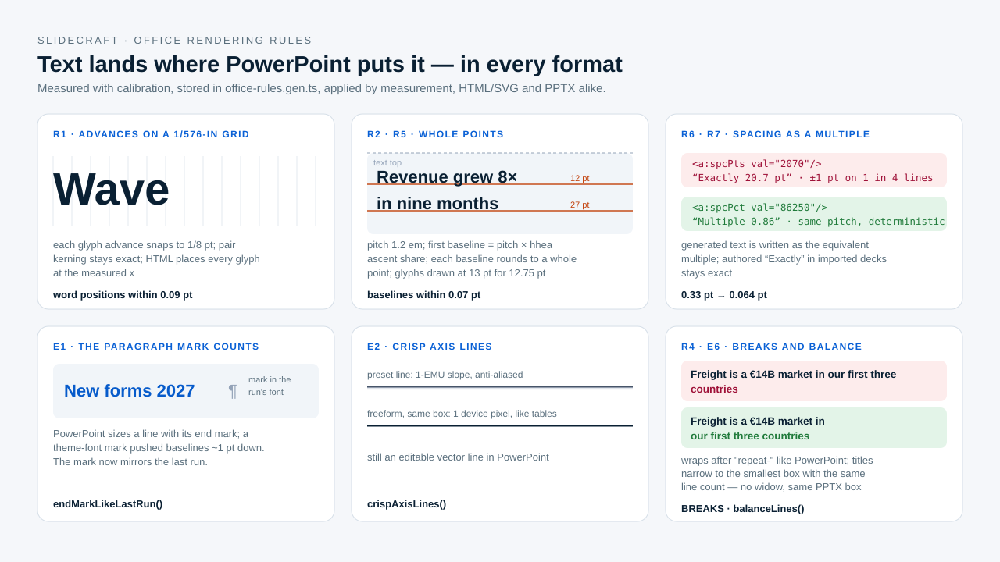

# Office rendering rules

> **Audience:** contributors and agents changing composition, measurement, export or QA · **Prerequisites:** [architecture](architecture.md) · **Last reviewed:** 2026-10-11

SlideCraft's promise is that the editable PPTX, the HTML and the PDF show the same slide.
PowerPoint lays text out with its own rules, so every engine must reproduce them. These
rules were found by measuring PowerPoint itself, are stored as data in
[`src/engine/office-rules.gen.ts`](../../src/engine/office-rules.gen.ts), regenerated by
[calibration](../how-to/calibrate-rendering.md), and apply to **every** deck — generated or
imported. A client deck that reveals a defect is only evidence; the fix always lands here.

## Text measurement and placement

| # | Rule PowerPoint follows | Evidence (PowerPoint for Mac 16.113, PDF export) | Implemented in |
|---|---|---|---|
| R1 | Each glyph advance snaps to a master unit of **1/576 in (1/8 pt)**; pair kerning stays exact | 8 300 word positions, mean error 0.09 pt (raw font units: 0.19 pt; per-glyph earlier fit: 0.025 pt) | `glyphAdvancesPt`, `TextStyle.metrics` |
| R2 | Glyph outlines are drawn at the **nearest whole point** (12.75 → 13, 13.5 → 14, 23.25 → 23) while advances follow the nominal size | 2 196 lines, 0 mismatches | `drawSize` (SVG/HTML font-size) |
| R3 | Spaces are kept as typed; runs of spaces are measured | sources line "A   B" | `tokenize` |
| R4 | A line wraps when it does not fit; breaks at spaces **and after a hyphen between letters** ("repeat-/driven") | visual QA finding, synthetic test | `BREAKS` in `text.ts` |
| R5 | **Automatic spacing:** line pitch = **1.2 em for every font**; first baseline = pitch × the font's hhea ascent share; every baseline on a **whole point** below the text top | 168 lines, mean 0.066 pt, max 0.12 pt (PDF grid noise) | `layoutText` |
| R6 | **Multiple spacing m:** pitch = 1.2 em × m; m ≤ 1 keeps the descent (first baseline = pitch − (1 − ascent share) × 1.2 em); m > 1 puts it at **0.75 × pitch** for every font | 1 176 lines, mean 0.064 pt | `layoutText`, `spacingMultiple` |
| R7 | **Exact spacing ("Exactly N pt")** is quantised unpredictably (±1 pt on ~25 % of lines). Generated text is therefore **exported as the equivalent multiple**; authored exact spacing from imported decks stays exact and uses the typo-ascent model | 672 lines: multiples 0.064 pt vs points 0.33 pt | `exactSpacing.export`, `lineSpacingExact` |
| R8 | Middle/bottom anchoring centres the **ink height** (last baseline + the real font's descent), not n × pitch | 180 anchored lines, mean 0.18–0.29 pt | `anchorHeight`, `descentEmByFamily` |
| R9 | Substitute measuring fonts (Gelasio for Georgia) keep the substitute's widths but take the **original's vertical shares** from calibration | Georgia auto spacing 2.0 pt → 0.07 pt | `ratioByFamily`, `descentEmByFamily` |

## Export details PowerPoint takes into account

| # | Rule | Why | Implemented in |
|---|---|---|---|
| E1 | The **paragraph mark** (`a:endParaRPr`) mirrors the last run's font and weight | PowerPoint sizes the line with the mark; a theme-font mark pushed baselines down ~1 pt | `endMarkLikeLastRun` |
| E2 | Horizontal/vertical lines are written as one-segment **freeforms**, not preset lines | PowerPoint gives preset lines a 1-EMU slope, so renderers anti-alias them over 2–3 px; native table borders stay crisp | `crispAxisLines` |
| E3 | Fonts resolve the way Office does: **Office's bundled fonts first**, then user and system folders, for any family | PowerPoint used its newer Calibri (with ₽); the system copy lacked it | `findFontFiles` |
| E4 | HTML prefers the **installed metric-compatible original** (`local("Arial")`) and falls back to the bundled file; nothing licensed is embedded | same advances, PowerPoint's glyph shapes | `fontFaceCss` |
| E5 | Slide-number placeholders use automatic spacing, top-anchored, through the shared layout | the HTML number sat 3.6 pt lower | `masterSvg` |
| E6 | Headlines never end on a widow: **balanced wrapping** narrows the title box to the smallest width with the same line count; PowerPoint receives the same box | visual QA finding on six titles | `balanceLines` |

Known traps that still hold: PptxGenJS shape margins are `[left, right, bottom, top]`
but table margins `[top, right, bottom, left]`; `kern="0"` disables kerning, so the
backend writes 100 (on) or 400000 (off); hyperlinks keep the run colour through an
explicit extension.

## Office automation

| # | Rule | Implemented in |
|---|---|---|
| A1 | Every conversion job runs in a fresh folder **inside PowerPoint's sandbox container** (`~/Library/Containers/com.microsoft.Powerpoint/Data/tmp/slidecraft`), so macOS never asks to grant folder access; `SLIDECRAFT_OFFICE_TMP` overrides | `conversionRoot` |
| A2 | A fresh PDF is required; an old output is never reused | `convertToPdf` |
| A3 | Unattended runs may set `SLIDECRAFT_OFFICE_RECOVER=1` to restart a stuck PowerPoint once; never by default | `viaPowerPoint` |

## Open items (measured, not yet modelled)

- Native chart text (axis and data labels) is placed by PowerPoint's chart engine and sits
  up to ~1 px away from the Scene primitives.
- Authored exact spacing in imported decks: the typo-ascent model leaves ±1 pt on some
  lines (mean 0.33 pt).
- Sub-pixel glyph-edge differences between Chrome and PowerPoint PDF output remain and
  dominate the strict worst-region score on text-dense and dark pages.

## Adding a rule

1. Reproduce the difference on a synthetic probe or a small unrelated deck — never key a fix
   to one client deck, slide or title.
2. Add the candidate models to the calibration probe, let calibration choose and record the
   evidence in [`calibration/RULES.md`](../../calibration/RULES.md).
3. Apply the rule in shared code so Scene, SVG/HTML and PPTX agree; add a unit test.
4. Run the corpus stage and record the result in [`calibration/REPORT.md`](../../calibration/REPORT.md).
