# Presentation generation principles

## Separate meaning from appearance and delivery

Content owns wording, numbers, citations and speaker notes. A storyline organises
the argument across the deck. An exhibit expresses a relationship within a slide:
comparison, trend, process, architecture, contribution bridge or supporting evidence.
The theme supplies typography, colour and common slide chrome. An output engine
renders the resulting shared Scene; it must not reinterpret the argument.

Choose from the **existing** storyline, theme and component registries. Storyline
theme recommendations are rankings, not restrictions: every installed pair is
valid. Prefer one complete exhibit; compose several only when their relationship
supports a single message. Add a reusable native component only for a real gap,
with a contract, examples, semantic routing and tests.

For an existing approved deck, preserve the wording and data. Do not rewrite
content to make a convenient template fit. Change the layout or component contract
instead. A numeric bridge needs reconciling contributions; a decorative arrow is
not evidence of causality. Visual selection is a semantic decision, not decoration.

## Give every element an owner

Common chrome owns the title, section marker, page number, source labels, margins
and takeaway band. Components own their exhibits and content. Notes are separate
from visible text. Draw each element once, retain field pointers and object roles,
and reserve its space before composing the slide body.

HTML/SVG and editable PPTX consume the same composition. An HTML-only effect needs
a native editable analogue if it cannot be represented directly. Record the
approximation and test it. Missing support is an actionable error, never permission
to omit content or flatten an entire exhibit into a picture.

## Verify the delivered artifact, not just the scene

Run contract and geometry checks, then inspect the exported PPTX's text, objects,
notes and chrome. Render that actual file through Office. Compare it with a frozen
reference and with the newly generated HTML; agreement between two equally wrong
new renders is not regression protection. Capture renderer versions and fonts.

Keep the original, visual reference and candidate distinct. Never regenerate
goldens as part of the test. Never average a damaged slide away with many good
slides, or let a large blank background mask missing labels. Automated metrics
help locate defects; they do not replace inspecting every slide.

The [Digital Ruble regression](../../tests/fixtures/digital-ruble/README.md) applies
these rules to 22 slides, using `Digital_Ruble_Explainer_RU_v3` as the content
authority and frozen HTML as the redesigned visual reference. Its initial run is
a diagnostic baseline, not a declaration that the current export meets 95%.

Project architecture diagrams use English. Presentation language remains a deck
property; translating documentation must not translate client slide content.
