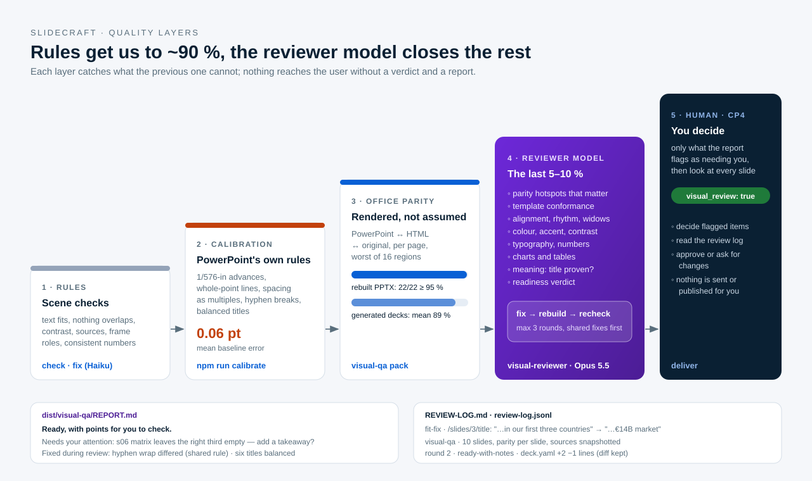

# The workflow

> **Audience:** users of the Claude Code plugin, agent integrators and contributors · **Prerequisites:** [concepts](concepts.md) · **Last reviewed:** 2026-10-11

A deck goes from a one-sentence goal to an editable PowerPoint the user can trust in seven
authoring stages, four human checkpoints and four verification levels, finished by a reviewer
model. The orchestrator (`/slidecraft:new`, or any agent following [`AGENTS.md`](../../AGENTS.md))
owns the conversation; sub-agents do focused work and write files; the CLI checks every hand-off.

## Stages, models and outputs

| # | Stage | Who | Model | Produces | Checkpoint |
|---|---|---|---|---|---|
| 1 | **Brief** — goal, ask, audience, usage → outputs | orchestrator + you | main session | `brief.yaml`, output plan | ✅ CP1 |
| 2 | **Pick** — three storyline × theme options as contact sheets | CLI + orchestrator | main session | `picker.html`, `option-A/B/C.png` | ✅ CP2 |
| 3 | **Storyline** — governing thought, SCR, MECE key line, evidence | `deck-strategist` | **Opus 5.5** | `storyline.md` | — |
| 4 | **Ghost deck** — action-title chain, exhibit per slide, data needed | `deck-strategist` | **Opus 5.5** | `deck.yaml` (ghost) | ✅ CP3 |
| 5 | **Build** — slides per section against layout contracts; cover visual (`art:` motif or picture); deck `language:` drives labels, numbers, typography, proofing; sources go into the notes | `slide-writer` × sections | **Sonnet 5.5** | `sections/*.yaml`, `dist/*` | — |
| 6 | **Review** — checks, fit-fix loop, partner review | `copy-fitter` → `partner-reviewer` | **Haiku 5.5** → **Opus 5.5** | fixed YAML, review notes, `REVIEW-LOG.md` | — |
| 6b | **Visual QA** — PowerPoint/HTML/difference images, template, colour, meaning, readiness | `visual-reviewer` | **Opus 5.5** | `dist/visual-qa/REPORT.md`, `record.json` | ✅ CP4 |
| 7 | **Deliver** | orchestrator | main session | PPTX · PDF · HTML · previews · manifest · report | — |

Agents name a model tier (`opus`, `sonnet`, `haiku`) in their frontmatter, which resolves to the
newest model of that tier. Reasoning-heavy judgement (story, partner review, visual review) runs
on the strongest model; writing slides against a fixed contract parallelises well on a fast one;
shortening a sentence to a character budget is mechanical
([ADR 0006](../adr/0006-model-tiering-and-checkpoints.md)). Ready-made hand-off templates for
every stage, in YAML, JSON and Markdown, and a complete example run in every output format are
in [`examples/orchestration/`](../../examples/orchestration/).

## How a slide is made

1. **Content** (YAML) names a layout and fills its contract; numbers come from `facts:` or
   data files and cite `sources:`.
2. **Composition** places the theme's frame (marker, rail, title rule, page number, sources,
   takeaway) once and the layout's exhibit in the body.
3. **Measurement** lays out every text with PowerPoint's own rules
   ([Office rendering rules](office-rendering-rules.md)): 1/576-inch advances, whole-point
   glyph sizes and baselines, line spacing exported as multiples, breaks after hyphens,
   balanced titles. Nothing is truncated; overflow becomes an `SC-FIT-*` diagnostic.
4. **Scene IR** is the single source for every engine: editable PPTX (native shapes, text,
   tables and charts — never a slide picture), HTML/SVG (each glyph placed where the layout
   measured it), vector PDF, PNG previews.

## Verification levels

| Level | What | Command | Fails on |
|---|---|---|---|
| L1 · Scene | fit, overlap, contrast, density, sources, required frame roles, consistency of metrics | `slidecraft check` / `fix` | any error |
| L2 · PPTX XML | text and notes present, named shapes, geometry and font-size drift, links | built into `build` | drift, missing roles |
| L3 · Real Office render | PowerPoint/LibreOffice → PDF/PNG of the actual PPTX | `--png-engine pptx-convert`, `visual-qa` | conversion errors |
| L4 · Fidelity | worst-region score per page ≥ 95 % between PowerPoint and HTML (and the original, when rebuilding) | `visual-qa`, `npm run calibrate` | reported per slide |
| Final · Visual QA | a reviewer model judges parity hotspots, template, craft, colour, typography, charts, meaning, readiness | `visual-qa` + `visual-reviewer` | blockers/majors → `not-ready` |

Every change made while checking — fit-fix rewrites, review rounds, source diffs — is written
to `review-log.jsonl` / `REVIEW-LOG.md` next to `deck.yaml`. The user receives
`dist/visual-qa/REPORT.md` with the verdict, **what needs their attention** and what was fixed.
`visual_review` stays `false` until a person has looked at every slide.

## Calibration (maintainers, on demand)

The rules in step 3 are not guessed: `npm run calibrate` renders ~2 200 probe lines in
PowerPoint, fits candidate models, rewrites `src/engine/office-rules.gen.ts` and checks a
10-deck corpus against the 95 % target. It runs when rendering changes or Office updates, not
on every commit ([guide](../how-to/calibrate-rendering.md)).

## Why checkpoints where they are

- **CP1** — a wrong goal or audience wastes everything after it.
- **CP2** — the story shape and the look are personal and organisational choices.
- **CP3** — the title chain *is* the argument; changing it here costs minutes.
- **CP4** — after rules, calibration and the reviewer model, a human still looks at every slide
  and decides the items in **Needs your attention**.

## Without Claude Code

Codex and other agents follow the same stages from [`AGENTS.md`](../../AGENTS.md); the CLI can
also be run by hand ([tutorial](../tutorials/cli-without-agent.md)).
