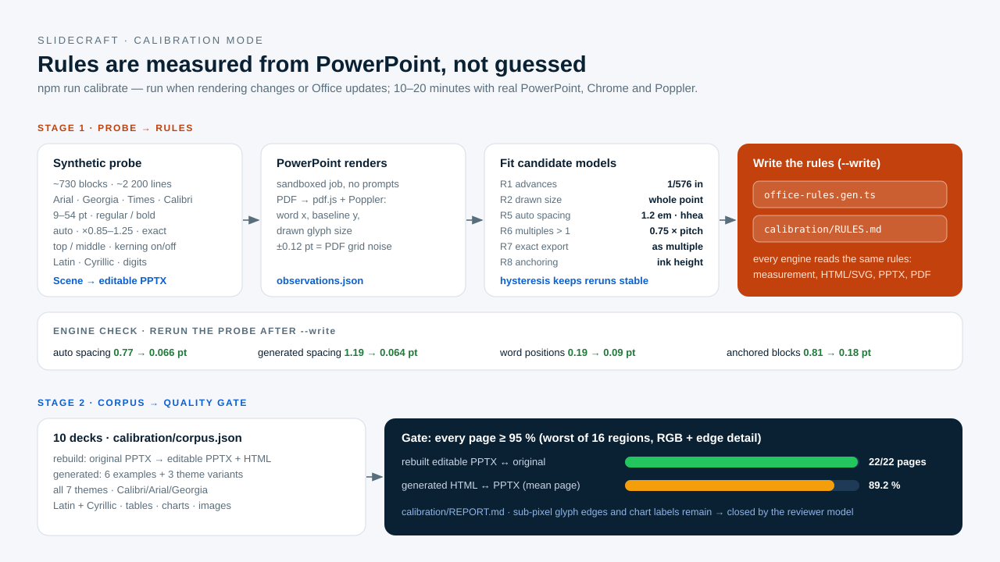

# Calibrate rendering against PowerPoint

> **Audience:** maintainers · **Prerequisites:** [Office rendering rules](../explanation/office-rendering-rules.md) · **Last reviewed:** 2026-10-11

Calibration measures how the local PowerPoint draws text and whole decks, derives the shared
rendering rules from that evidence, writes them into the repository and checks a 10-deck
corpus against the quality target. It is slow (10–20 minutes) and needs real Office, so it is
**not** part of every build or CI run.



## When to run it

- Rendering, measurement or export code changed in a way that could move text or lines.
- PowerPoint (or LibreOffice) was updated, or a new font family/theme was added.
- The corpus or a user reports HTML and PPTX drifting apart.
- Before claiming a fidelity number in a release.

Not after ordinary content, layout or documentation changes.

## Requirements

macOS with Microsoft PowerPoint (or LibreOffice via `SLIDECRAFT_CONVERTER=libreoffice`),
Google Chrome and Poppler (`brew install poppler`). Conversion jobs run inside PowerPoint's
sandbox, so no "Grant Access" prompts appear; calibration also sets
`SLIDECRAFT_OFFICE_RECOVER=1` so a stuck PowerPoint is restarted once.

## Stage 1 — probe: generate the rules

```sh
npm run calibrate -- --stage probe           # measure and report
npm run calibrate -- --stage probe --write   # also rewrite the rules
```

The probe builds synthetic slides through the normal Scene → PPTX path: four families
(Arial, Georgia, Times New Roman, Calibri when installed), 14 sizes from 9 to 54 pt,
regular and bold, kerning on and off, automatic spacing, multiples 0.85–1.25, exact spacing
×1.0–1.3, top- and middle-anchored blocks, Latin, Cyrillic and digits (~730 blocks, ~2 200
lines). PowerPoint renders them; word positions, baselines and drawn sizes are read from the
PDF; every candidate model is scored; the best is chosen.

Outputs:

| File | What |
|---|---|
| `src/engine/office-rules.gen.ts` | The rules every engine reads (with `--write`). Committed. |
| `calibration/RULES.md` | Evidence: candidate tables, per-family fits, engine check. Committed with `--write`. |
| `tests/.output/calibration/probe/` | Probe PPTX, Office PDF, `observations.json` for analysis. Ignored. |

Stability: values are rounded to measurement resolution and a rule changes only if the refit
is clearly better (0.005–0.01 pt hysteresis), so reruns do not flap. Always rerun the probe
once more after `--write`: the **engine check** table must improve or stay equal.

## Stage 2 — corpus: the quality gate

```sh
npm run calibrate -- --stage corpus                 # all decks, rewrites calibration/REPORT.md
npm run calibrate -- --stage corpus --deck pitch-deck
```

[`calibration/corpus.json`](../../calibration/corpus.json) lists 10 decks covering all seven
themes, Calibri/Arial/Georgia, Latin and Cyrillic, tables, native charts and images:

- `rebuild` — an original PPTX → editable PPTX + HTML (the Digital Ruble corpus). Gate pair:
  original PowerPoint render ↔ rebuilt editable PPTX in PowerPoint.
- `generated` — a deck YAML → editable PPTX + HTML (six examples and three theme variants).
  Gate pair: HTML ↔ the editable PPTX in PowerPoint.

**Quality metric.** Per page: the worst of 16 regions (4×4 at 1600 px), each the lower of RGB
similarity and edge-detail similarity. The target is **≥ 95 % on every page**. The metric is
deliberately strict — a 1 px text offset costs several points on text-dense pages — and is not
a perceptual percentage; no alignment, blurring or averaging is applied to make it pass.
Results go to `calibration/REPORT.md` (committed) and `tests/.output/calibration/corpus/`
(images, PDFs, `corpus.json`).

## Results on 2026-10-11 (PowerPoint for Mac 16.113.4)

| Stage | Before calibration | After |
|---|---|---|
| Probe: baselines, automatic spacing | 0.77 pt mean | **0.066 pt** (max 0.12) |
| Probe: baselines, generated spacing | 1.19 pt (exact, centred) | **0.064 pt** (exported as multiples) |
| Probe: word positions | 0.19 pt | **0.09 pt** |
| Corpus: rebuilt editable PPTX ↔ original | 8/22 pages ≥ 95 % | **22/22** (98.5–99.8 %) |
| Corpus: generated HTML ↔ PPTX, mean page score | 78.6 % | **89.2 %** (medians 78–93 %) |

The generated decks are visually indistinguishable at normal viewing size, but they do not
yet reach the strict 95 % per page: remaining differences are sub-pixel glyph edges, native
chart label placement and dark backgrounds. The final 5–10 % is closed by the
[visual QA stage](visual-qa.md), where a reviewer model judges what the metric cannot.

## Adding a deck to the corpus

Add an entry to `calibration/corpus.json`. Use content the owner has approved for the
repository — client material never enters the repo without explicit consent, and generated
reports stay in ignored `tests/.output/`.
