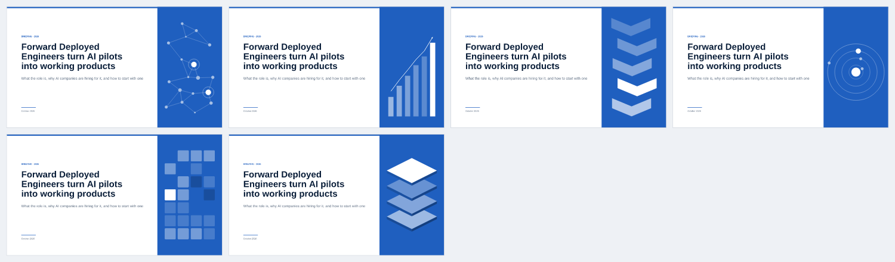
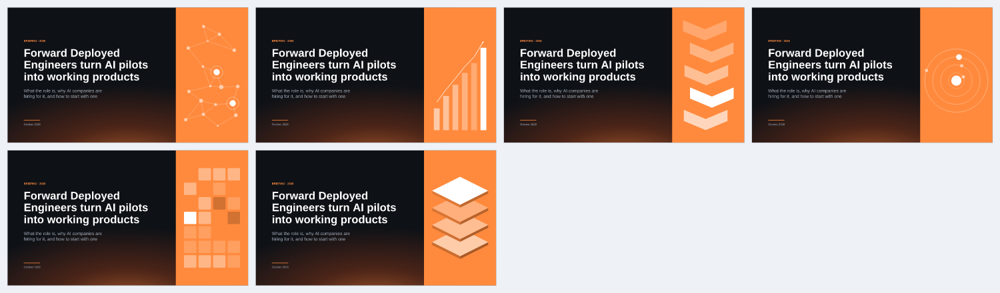

# Design the cover

> **Audience:** deck authors and agents · **Prerequisites:** a deck with a `title` cover · **Last reviewed:** 2026-10-12

The cover is the slide everyone sees first — in the file browser, on the shared screen, as the
thumbnail in a mail. SlideCraft gives it a visual that says what the deck is about: a
full-height panel on the right with either a **topic motif** or a **picture**. The title, kicker
and subtitle stay on the left, in the theme's type.

<p align="center"></p>
<p align="center"></p>

## Topic motif — `art:`

```yaml
- id: cover
  layout: title
  variant: cover
  title: Forward Deployed Engineers turn AI pilots into working products
  kicker: Briefing · 2026
  art: auto        # or network | growth | flow | orbit | grid | layers
```

| Motif | Fits decks about |
|---|---|
| `network` | AI, data, platforms, technology, engineering |
| `growth` | revenue, markets, investment, pricing, scale |
| `flow` | processes, plans, roadmaps, pilots, launches |
| `orbit` | customers, partners, people, teams, ecosystems |
| `layers` | architecture, infrastructure, security, risk |
| `grid` | products, portfolios, operations, programme updates |

`auto` reads the title, kicker and subtitle (English and Russian keywords) and picks the motif
with the most matches. The same title always draws the same details.

The motif is drawn from **native shapes in the theme accent** — not a picture. In PowerPoint
every node, bar and chevron is a shape you can move, recolour or delete; the Design tab's colour
changes do not touch it, but a brand theme's accent does (it is built from the theme).

## Picture — `image:` or `imagePrompt:`

```yaml
  image: assets/cover.jpg                      # your photo, cropped to the panel
  alt: Engineers at a customer site            # optional; without it the picture is decorative
```

```yaml
  imagePrompt: An engineer and an operations manager at a laptop in a warehouse office
```

`slidecraft images deck.yaml` generates pictures for every `imagePrompt` ([generate
images](generate-images.md)) and writes `image:` back. Until the file exists the cover shows the
motif (with an info diagnostic), so the deck always looks finished. A picture wins over `art:`.

## Choose from options (the rule)

The cover is chosen, not defaulted. SlideCraft renders the candidates; the assistant compares
them and recommends; you pick.

```sh
slidecraft covers deck.yaml            # motifs that fit the title best (and the current photo)
slidecraft covers deck.yaml --stock    # plus a stock photo for the cover's imageQuery
slidecraft covers deck.yaml --choose B # write option B into deck.yaml
```

The command writes `.slidecraft/covers/option-A|B|C.png`, a picker page `covers.html` and
`options.json` with the facts for each option: which words of the title a motif stands for, a
photo's author, licence and sharpness on the panel (ppi). The assistant compares the options
against the deck's message and look — does the cover say what the deck is about, does it fit
the colours, is the title still read first, is the photo sharp, licensed and free of private
people and logos — and recommends one with a reason for each.

## Rules

- One visual per cover; it never sits behind the title.
- Pick a picture that shows the subject — a product, a place, the people involved. A generic
  stock image is noise; the motif is the better default.
- The visual-QA reviewer checks the cover ([checklist](../../library/references/visual-qa.md)):
  a plain cover is a `should` finding.
- Covers without `art`, `image` or `imagePrompt` look as before — the panel is opt-in; the
  workflow turns it on for every new deck through the cover choice.
