<!-- Generated by `slidecraft gen` — do not edit by hand. -->
# Layouts

> **Audience:** deck authors, agents and contributors · **Generated from:** src/layouts/*.ts · **Version:** 0.7.5

Every layout is an exhibit type with a typed content contract. Common slide fields (`id`, `title`, `lead`, `tracker`, `sources`, `source`, `notes`, `status`, `ghost`) are documented in [deck-spec](deck-spec.md). Limits are early warnings; the measurer decides what actually fits (`SC-FIT-*`).

| Layout | Group | Variants | Use for |
|---|---|---|---|
| [`title`](#title) | frame | `cover`, `closing` | Use for the cover that frames the deck, or a closing slide with the ask and contacts. |
| [`agenda`](#agenda) | frame | `agenda`, `section-divider` | Use for the agenda at the start of a deck, or a section divider that shows where the audience is in the story. |
| [`exec-summary`](#exec-summary) | message | `scr`, `key-messages` | Use for the answer-first summary: the whole argument on one page, readable without the rest of the deck. |
| [`key-points`](#key-points) | message | `columns`, `cards`, `list` | Use for two to four parallel points that together prove the title, each with a short heading, support and an optional proof number. |
| [`composition`](#composition) | message | `regions` | Assemble several existing native exhibits in explicit body regions, keeping one shared frame and theme. |
| [`big-statement`](#big-statement) | message | `statement`, `quote`, `hero-number` | Use for the one thing the audience must remember: a single bold statement, a customer quote or one hero number, with room to breathe. |
| [`text-image`](#text-image) | message | `image-right`, `image-left` | Use for a story beat that needs a photo or illustration next to a few short paragraphs, such as a customer case or a site visit. |
| [`text`](#text) | message | `bullets`, `paragraphs`, `two-column` | Use for plain text when no exhibit fits — bullets, short paragraphs or two columns. Also where imported slides land. |
| [`before-after`](#before-after) | message | `panels` | Use for a change told as two states — how things are today and how they will be — with one number on each side. |
| [`freeform`](#freeform) | message | `body` | Use for a browser-first creative exhibit no layout covers: HTML and CSS inside the standard frame, checked for overflow and text size like every other slide. |
| [`freeform-canvas`](#freeform-canvas) | message | `body` | Use for custom HTML with shared title, source and page chrome by default. Explicit frame:none is reserved for a verified full-page composition that owns all chrome. |
| [`native-canvas`](#native-canvas) | message | `body` | Use for bespoke compositions that must remain editable in PowerPoint: every rectangle, line and text block is a native PPTX object. |
| [`kpi-tiles`](#kpi-tiles) | numbers | `tiles`, `strip` | Use for 2–4 headline numbers that prove the title at a glance, each with its label, change and context. |
| [`evidence-panorama`](#evidence-panorama) | numbers | `metric-and-cards` | Connect one sourced headline metric to four parallel models, implications or use cases; equal cards express categories, not relative magnitude. |
| [`chart-takeaway`](#chart-takeaway) | numbers | `bar`, `column`, `stacked`, `line`, `combo` | Use for one chart that proves the title, with the interpretation in a side panel. |
| [`waterfall`](#waterfall) | numbers | `full`, `with-takeaway` | Use for a bridge that explains how a starting total becomes an ending total through positive and negative drivers. |
| [`bubble-chart`](#bubble-chart) | numbers | `bubble`, `scatter`, `portfolio` | Use for items positioned on two measured dimensions — with bubble size for a third, or quadrant dividers for a portfolio (growth-share) view. |
| [`marimekko`](#marimekko) | numbers | `shares` | Use for market structure in one picture: segment size as column width and each player’s share as the stack within it. |
| [`tornado`](#tornado) | numbers | `bars` | Use for showing which assumptions move a result most: each driver’s downside and upside around the base case, widest on top. |
| [`football-field`](#football-field) | numbers | `ranges` | Use for comparing value ranges from several methods on one axis — valuation, price corridors or estimates — against a reference such as the offer. |
| [`funnel`](#funnel) | numbers | `funnel`, `pyramid` | Use for a conversion funnel (where volume is lost) or a pyramid (levels that build on each other). |
| [`data-table`](#data-table) | numbers | `plain`, `with-takeaway` | Use for a compact table of exact values where the reader needs to look up or compare several attributes at once. |
| [`options-comparison`](#options-comparison) | decide | `text`, `rating` | Use for comparing 2–5 options on the same criteria and showing which one wins and why. |
| [`matrix-2x2`](#matrix-2x2) | decide | `plot`, `quadrants` | Use for prioritising items on two dimensions, or naming four strategic positions. |
| [`swot`](#swot) | decide | `grid`, `with-implications` | Use for an internal (strengths, weaknesses) and external (opportunities, threats) view of a position — with the implications that follow. |
| [`five-forces`](#five-forces) | decide | `diagram` | Use for judging how attractive an industry is: the five competitive forces, each rated and evidenced, with the verdict. |
| [`pestel`](#pestel) | decide | `grid` | Use for the macro trends — political, economic, social, technological, environmental, legal — that shape a market, each with its impact. |
| [`business-model-canvas`](#business-model-canvas) | decide | `canvas` | Use for the whole business model on one page: segments, value proposition, channels, relationships, revenue, resources, activities, partners and costs. |
| [`value-chain`](#value-chain) | decide | `porter` | Use for showing where a business creates or loses value: Porter's primary activities in order, support activities across them, and the margin. |
| [`seven-s`](#seven-s) | decide | `diagram` | Use for checking whether an organisation is set up for a change: the seven elements, each rated aligned, partial or gap, with the evidence. |
| [`issue-tree`](#issue-tree) | decide | `issue`, `driver` | Use for breaking a question into MECE sub-questions (issue tree) or a metric into its drivers (driver tree). |
| [`maturity-model`](#maturity-model) | decide | `grid`, `staircase` | Use for showing where an organisation stands on a maturity scale and where it should get to — one capability as a staircase, or several on one grid. |
| [`coverage-map`](#coverage-map) | decide | `grid` | Use for showing the state of many functions at once on stable geometry — what is covered, partly covered, planned or missing. |
| [`architecture`](#architecture) | decide | `zones` | Use for showing where in a system a problem sits and what to do about it: components in zones, requests and responses, and a numbered register linked to markers on the diagram. |
| [`evidence-chain`](#evidence-chain) | decide | `chain` | Use for showing what an answer rests on: each check, its source and its result in order, ending in the conclusion and what would overturn it. |
| [`risk-matrix`](#risk-matrix) | decide | `heatmap` | Use for showing the main risks by likelihood and impact, with owners and mitigations. |
| [`process-steps`](#process-steps) | sequence | `chevrons`, `numbered` | Use for a sequence of 3–6 steps where order matters — an approach, a method or a customer journey. |
| [`timeline`](#timeline) | sequence | `milestones`, `gantt` | Use for dated milestones or a phased roadmap on one shared time axis. |
| [`gate-matrix`](#gate-matrix) | sequence | `gates` | Use for a stage-gate plan: what each stage delivers and what evidence opens the next one, and who decides. |
| [`process-compare`](#process-compare) | sequence | `lanes` | Use for showing what changes in a process: today’s steps against the proposed ones, with changed steps highlighted. |
| [`cadence`](#cadence) | sequence | `grid` | Use for showing who takes part when: roles or forums against a shared calendar, with recurring meetings, decisions, outputs and work periods. |
| [`callout`](#callout) | sequence | `image-left` | Use for showing someone how to do something on a screen or object: numbered callouts on the picture, the action and expected result for each, and how to check it worked. |
| [`team-cards`](#team-cards) | people | `cards`, `compact` | Use for introducing the people behind a proposal: who leads, who delivers, who the client sponsors are. |
| [`org-chart`](#org-chart) | people | `tree` | Use for a reporting structure two levels deep: who leads, which units report to them and who sits in each. |
| [`raci`](#raci) | people | `raci` | Use for showing who is Responsible, Accountable, Consulted and Informed for each decision or activity. |
| [`next-steps`](#next-steps) | close | `actions`, `decision` | Use for the closing slide that turns the recommendation into owned, dated actions, with or without the decision requested. |

## title

**Title** — Use for the cover that frames the deck, or a closing slide with the ask and contacts.

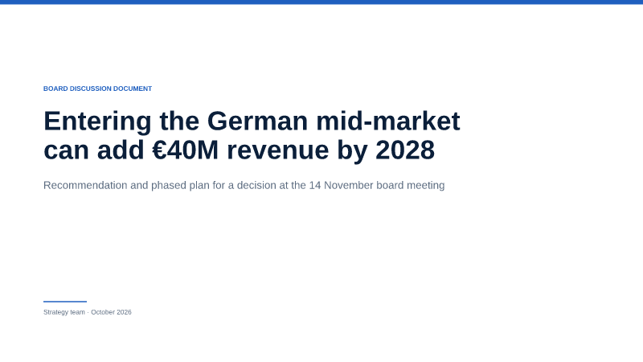 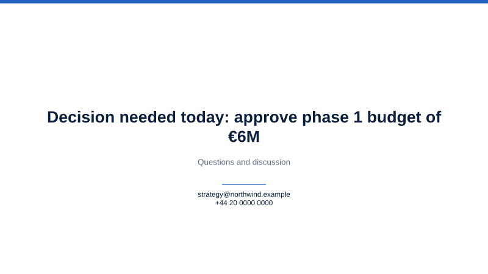

- **Use when:** First slide of every deck; Closing slide with thanks, contacts or a final ask
- **Avoid when:** Section breaks inside the deck — use agenda (section-divider)
- **Frame:** full-bleed (the layout draws the whole slide)

| Field | Type | Required | Limits | Description |
|---|---|---|---|---|
| `kicker` | string |  | ≤ 48 chars | Small label above the title, e.g. "Board meeting · Q3 review" |
| `subtitle` | string |  | ≤ 170 chars | One sentence framing the decision or story |
| `presenter` | string |  | ≤ 70 chars |  |
| `date` | string |  | ≤ 32 chars |  |
| `contact` | string[] |  | 0–3 items, each ≤ 70 chars | Closing variant: contact lines |
| `art` | `auto` \| `network` \| `growth` \| `flow` \| `orbit` \| `grid` \| `layers` |  |  | Cover: topic motif on a right-hand panel, drawn as editable shapes in the theme accent. auto picks it from the title (network: AI, data, tech · growth: money, markets · flow: process, plans · orbit: customers, people · layers: architecture, risk · grid: products, operations) |
| `image` | string |  |  | Cover: picture for the right-hand panel (path relative to the deck); wins over art |
| `imagePrompt` | string |  | ≤ 400 chars | Cover: what the panel picture should show; `slidecraft images` generates it. Until then the art motif is drawn |
| `imageQuery` | string |  | ≤ 120 chars | Stock photo search, e.g. "engineer with laptop in a warehouse"; `slidecraft images --stock` fills `image` |
| `imageCredit` | object |  |  | Photo credit; shown with the slide sources, in the notes and in the manifest |
| `imageCredit.author` | string | yes | ≤ 120 chars |  |
| `imageCredit.provider` | string | yes | ≤ 60 chars | Where it came from, e.g. "Openverse · Flickr", "Pexels" |
| `imageCredit.license` | string | yes | ≤ 60 chars | e.g. "CC BY 2.0", "Pexels License" |
| `imageCredit.licenseUrl` | string |  | ≤ 300 chars |  |
| `imageCredit.source` | string | yes | ≤ 400 chars | Page of the photo at the provider |
| `imageCredit.title` | string |  | ≤ 200 chars |  |
| `imageFocus` | `left` \| `center` \| `right` \| `top` \| `bottom` \| object |  |  | Which part of the picture stays in view when it is cropped to the slot: left, center, right, top, bottom, or { x, y } from 0 to 1 (default center) |
| `alt` | string |  | ≤ 140 chars | Alt text of the cover picture; without it the picture is decorative |

<details><summary>Example</summary>

```yaml
- id: example
  layout: title
  title: Entering the German mid-market can add €40M revenue by 2028
  kicker: Board discussion document
  subtitle: Recommendation and phased plan for a decision at the 14 November board meeting
  presenter: Strategy team
  date: October 2026
```

</details>

## agenda

**Agenda and section divider** — Use for the agenda at the start of a deck, or a section divider that shows where the audience is in the story.

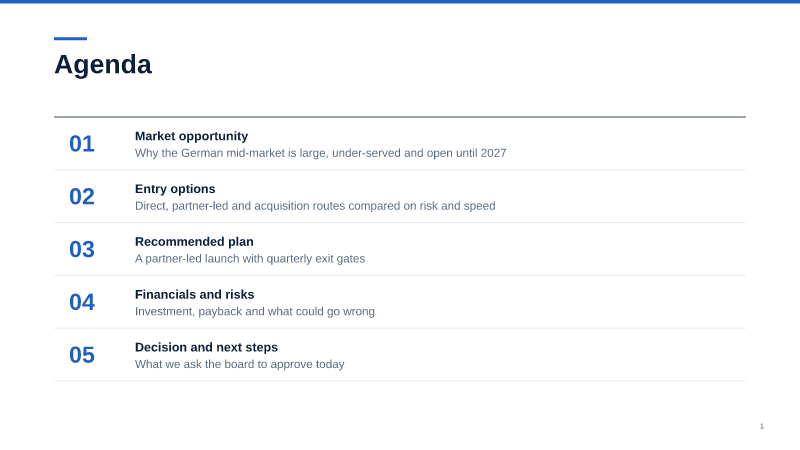 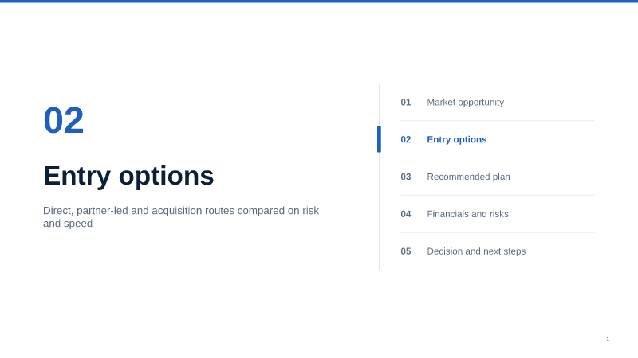

- **Use when:** Opening agenda for a deck longer than ten slides; Section break that resets attention and shows progress through the sections; Repeated agenda with the active section highlighted
- **Avoid when:** A cover or closing slide — use title; A single big sentence that carries the message — use big-statement; A sequence with durations or owners — use process-steps or timeline
- **Frame:** full-bleed (the layout draws the whole slide)

| Field | Type | Required | Limits | Description |
|---|---|---|---|---|
| `sections` | object[] | yes | 2–7 items | The sections of the deck, in order |
| `sections[].title` | string | yes | ≤ 60 chars | Section name, a noun phrase: "Market opportunity" |
| `sections[].summary` | string |  | ≤ 110 chars | One line on what the audience will learn or decide in this section |
| `current` | integer |  | 0…6 | 0-based index of the active section. Required for section-divider; on the agenda it highlights a section when the agenda is repeated as a progress marker |

<details><summary>Example</summary>

```yaml
- id: example
  layout: agenda
  variant: agenda
  title: Agenda
  sections:
    - title: Market opportunity
      summary: Why the German mid-market is large, under-served and open until 2027
    - title: Entry options
      summary: Direct, partner-led and acquisition routes compared on risk and speed
    - title: Recommended plan
      summary: A partner-led launch with quarterly exit gates
    - title: Financials and risks
      summary: Investment, payback and what could go wrong
    - title: Decision and next steps
      summary: What we ask the board to approve today
```

</details>

## exec-summary

**Executive summary** — Use for the answer-first summary: the whole argument on one page, readable without the rest of the deck.

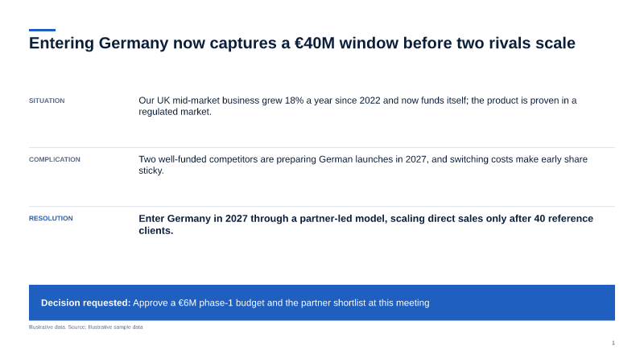 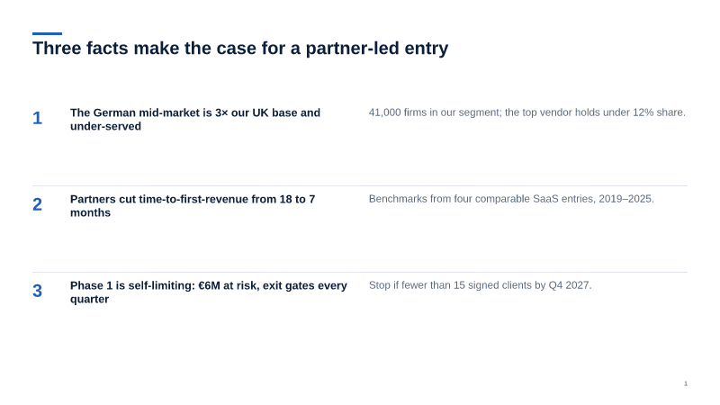

- **Use when:** Slide 2 of most decks; Pre-read summaries for boards and steering committees; Closing synthesis of a research readout
- **Avoid when:** A single data point — use kpi-tiles or big-statement; More than five messages — split the deck into sections
- **Frame:** standard (action title, tracker, lead and source line are drawn for you)

| Field | Type | Required | Limits | Description |
|---|---|---|---|---|
| `situation` | string |  | ≤ 260 chars | SCR variant: what the audience already accepts |
| `complication` | string |  | ≤ 260 chars | SCR variant: what changed / why act now |
| `resolution` | string |  | ≤ 300 chars | SCR variant: the answer — your recommendation |
| `messages` | object[] |  | 2–5 items | key-messages variant: the 2–5 supporting points of the pyramid |
| `messages[].headline` | string | yes | ≤ 110 chars | One claim, a full sentence |
| `messages[].detail` | string |  | ≤ 220 chars | Evidence or implication in one sentence |
| `ask` | string |  | ≤ 150 chars | The decision or action requested, shown in an accent band |

<details><summary>Example</summary>

```yaml
- id: example
  layout: exec-summary
  variant: scr
  title: Entering Germany now captures a €40M window before two rivals scale
  sources:
    - board-pack
  situation: Our UK mid-market business grew 18% a year since 2022 and now funds itself; the product is proven in a regulated market.
  complication: Two well-funded competitors are preparing German launches in 2027, and switching costs make early share sticky.
  resolution: Enter Germany in 2027 through a partner-led model, scaling direct sales only after 40 reference clients.
  ask: Approve a €6M phase-1 budget and the partner shortlist at this meeting
```

</details>

## key-points

**Key points** — Use for two to four parallel points that together prove the title, each with a short heading, support and an optional proof number.

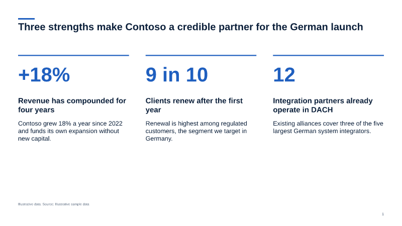 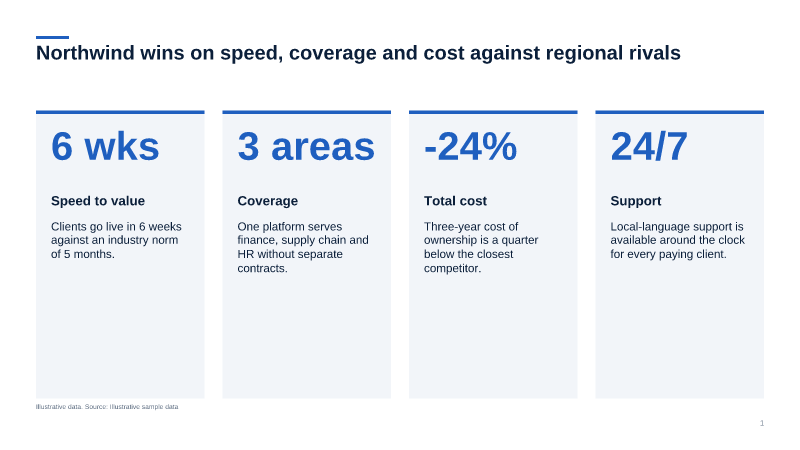 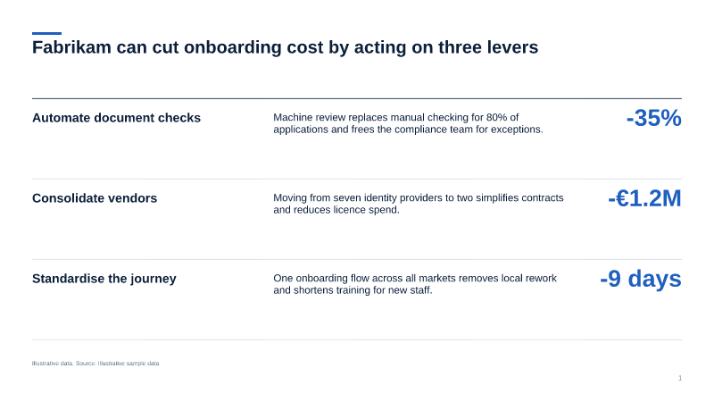

- **Use when:** Three reasons, pillars or findings that support the action title; Parallel points of equal weight where each can carry one proof number
- **Avoid when:** The whole argument as situation, complication and resolution — use exec-summary; Several KPIs with no explanatory text — use kpi-tiles; Steps in order — use process-steps
- **Frame:** standard (action title, tracker, lead and source line are drawn for you)

| Field | Type | Required | Limits | Description |
|---|---|---|---|---|
| `points` | object[] | yes | 2–4 items | 2–4 parallel points that together prove the title; list variant reads best with 3–4 |
| `points[].heading` | string | yes | ≤ 60 chars | The point as a short claim, not a topic label |
| `points[].body` | string |  | ≤ 220 chars | Evidence or implication in one or two sentences |
| `points[].metric` | string |  | ≤ 10 chars | Proof number shown prominently, e.g. "+18%", "€40M", "3×" |
| `points[].icon` | `adjustments` \| `alert-triangle` \| `api` \| `arrow-right` \| `arrow-up-right` \| `arrows-exchange` \| `award` \| `bolt` \| `box` \| `brain` \| `briefcase` \| `building` \| `building-bank` \| `building-factory` \| `building-store` \| `bulb` \| `calendar` \| `cash` \| `certificate` \| `chart-arrows-vertical` \| `chart-bar` \| `chart-dots` \| `chart-line` \| `chart-pie` \| `check` \| `checklist` \| `circle-check` \| `clipboard-check` \| `clock` \| `cloud` \| `code` \| `coin` \| `compass` \| `components` \| `cpu` \| `currency-dollar` \| `currency-euro` \| `database` \| `device-laptop` \| `device-mobile` \| `eye` \| `file-analytics` \| `file-text` \| `flag` \| `flask` \| `gauge` \| `git-branch` \| `heart` \| `heart-handshake` \| `hierarchy` \| `home` \| `hourglass` \| `infinity` \| `info-circle` \| `layout-dashboard` \| `leaf` \| `lifebuoy` \| `link` \| `list-check` \| `lock` \| `mail` \| `map` \| `map-pin` \| `message` \| `messages` \| `microscope` \| `network` \| `package` \| `phone` \| `plane` \| `player-play` \| `plug` \| `presentation` \| `puzzle` \| `receipt` \| `refresh` \| `report-analytics` \| `robot` \| `rocket` \| `route` \| `run` \| `scale` \| `school` \| `search` \| `server` \| `settings` \| `shield` \| `shield-check` \| `shopping-cart` \| `sitemap` \| `sparkles` \| `speakerphone` \| `stack-2` \| `star` \| `stopwatch` \| `target` \| `terminal-2` \| `tool` \| `tools` \| `trending-down` \| `trending-up` \| `trophy` \| `truck` \| `user` \| `user-check` \| `user-search` \| `users` \| `users-group` \| `versions` \| `walk` \| `wand` \| `world` \| `x` \| `zoom-check` |  |  | Icon above the point (Tabler set); give every point one or none |

<details><summary>Example</summary>

```yaml
- id: example
  layout: key-points
  variant: columns
  title: Three strengths make Contoso a credible partner for the German launch
  sources:
    - contoso-annual
  points:
    - metric: +18%
      heading: Revenue has compounded for four years
      body: Contoso grew 18% a year since 2022 and funds its own expansion without new capital.
    - metric: 9 in 10
      heading: Clients renew after the first year
      body: Renewal is highest among regulated customers, the segment we target in Germany.
    - metric: "12"
      heading: Integration partners already operate in DACH
      body: Existing alliances cover three of the five largest German system integrators.
```

</details>

## composition

**Component composition** — Assemble several existing native exhibits in explicit body regions, keeping one shared frame and theme.

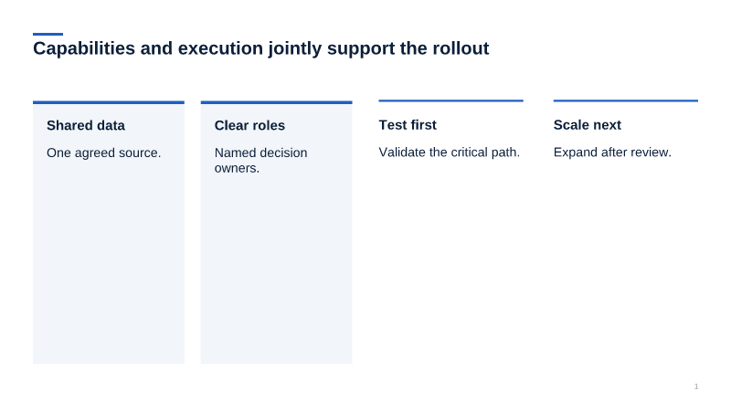

- **Use when:** One message needs two complementary exhibits from the existing library
- **Avoid when:** Independent messages that belong on separate slides; Dense layouts squeezed into unreadable regions
- **Frame:** standard (action title, tracker, lead and source line are drawn for you)

| Field | Type | Required | Limits | Description |
|---|---|---|---|---|
| `components` | object[] | yes | 1–12 items |  |
| `components[].id` | string | yes |  |  |
| `components[].layout` | string | yes |  |  |
| `components[].variant` | string |  |  |  |
| `components[].box` | object | yes |  | Fractions of the available body, not page coordinates |
| `components[].box.x` | number | yes | 0…1 |  |
| `components[].box.y` | number | yes | 0…1 |  |
| `components[].box.w` | number | yes | −∞…1 |  |
| `components[].box.h` | number | yes | −∞…1 |  |
| `components[].content` | object | yes |  |  |

<details><summary>Example</summary>

```yaml
- id: example
  layout: composition
  title: Capabilities and execution jointly support the rollout
  components:
    - id: capabilities
      layout: key-points
      variant: cards
      box:
        x: 0
        y: 0
        w: 0.48
        h: 1
      content:
        points:
          - heading: Shared data
            body: One agreed source.
          - heading: Clear roles
            body: Named decision owners.
    - id: execution
      layout: key-points
      variant: columns
      box:
        x: 0.52
        y: 0
        w: 0.48
        h: 1
      content:
        points:
          - heading: Test first
            body: Validate the critical path.
          - heading: Scale next
            body: Expand after review.
```

</details>

## big-statement

**Big statement** — Use for the one thing the audience must remember: a single bold statement, a customer quote or one hero number, with room to breathe.

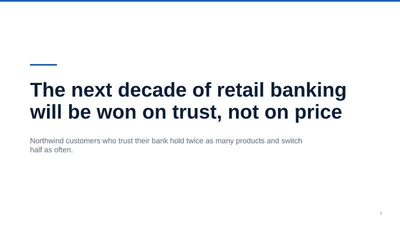 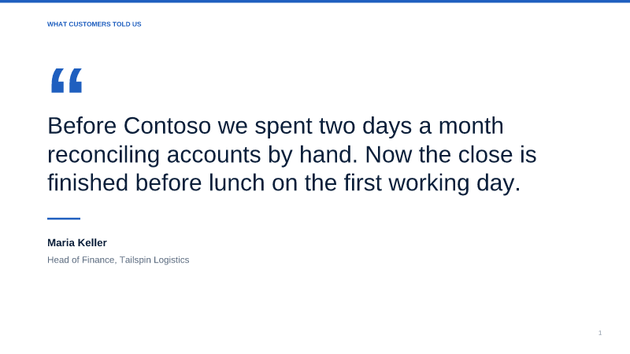 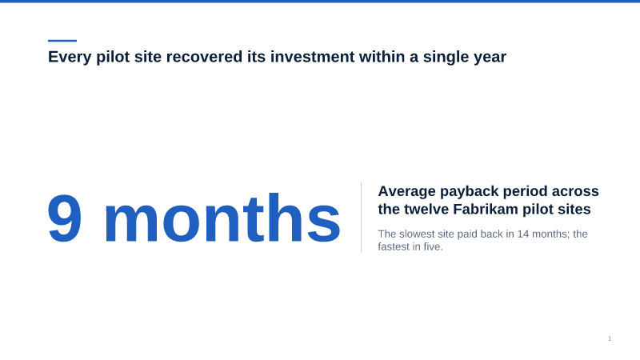

- **Use when:** A turning point in the story that deserves a full slide; A customer or expert quote that proves the argument; One number so large it needs no chart
- **Avoid when:** Several numbers side by side — use kpi-tiles; A claim that needs supporting evidence on the same page — use key-points or chart-takeaway
- **Frame:** full-bleed (the layout draws the whole slide)

| Field | Type | Required | Limits | Description |
|---|---|---|---|---|
| `support` | string |  | ≤ 200 chars | statement variant: one sentence that backs the statement, shown below it |
| `quote` | string |  | ≤ 240 chars | quote variant (required): the words, without quotation marks |
| `attribution` | string |  | ≤ 60 chars | quote variant: who said it |
| `role` | string |  | ≤ 60 chars | quote variant: their role and organisation |
| `number` | string |  | ≤ 10 chars | hero-number variant (required): the one number, e.g. "62%", "€40M", "3×" |
| `label` | string |  | ≤ 90 chars | hero-number variant (required): what the number measures, with unit and period |
| `context` | string |  | ≤ 180 chars | hero-number variant: why it matters or how it compares |

<details><summary>Example</summary>

```yaml
- id: example
  layout: big-statement
  variant: statement
  title: The next decade of retail banking will be won on trust, not on price
  support: Northwind customers who trust their bank hold twice as many products and switch half as often.
```

</details>

## text-image

**Text and image** — Use for a story beat that needs a photo or illustration next to a few short paragraphs, such as a customer case or a site visit.

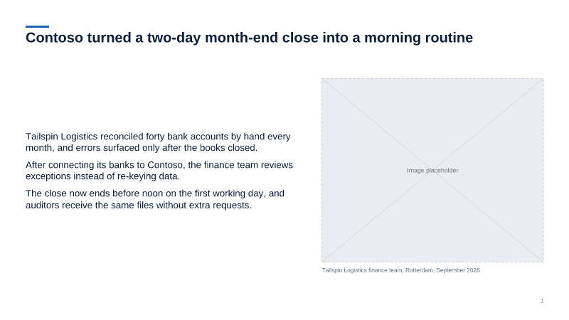 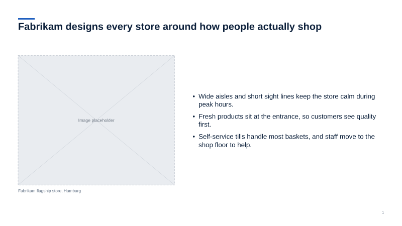

- **Use when:** Storytelling decks where one image carries the emotion and the text carries the point; A product, place or person that the audience should see while they read
- **Avoid when:** The image is a chart or table — use chart-takeaway or data-table; More than four short paragraphs — use key-points or split the slide
- **Frame:** standard (action title, tracker, lead and source line are drawn for you)

| Field | Type | Required | Limits | Description |
|---|---|---|---|---|
| `body` | string[] | yes | 1–4 items, each ≤ 260 chars | 1–4 short paragraphs (or bullets) that tell the story next to the image |
| `bullets` | boolean | yes |  | Set true to show the body strings as bullets instead of paragraphs |
| `image` | string |  |  | Image path relative to the deck file; leave empty to show a placeholder |
| `imagePrompt` | string |  | ≤ 400 chars | What the picture should show; `slidecraft images` generates it when `image` is empty |
| `imageQuery` | string |  | ≤ 120 chars | Stock photo search, e.g. "engineer with laptop in a warehouse"; `slidecraft images --stock` fills `image` |
| `imageCredit` | object |  |  | Photo credit; shown with the slide sources, in the notes and in the manifest |
| `imageCredit.author` | string | yes | ≤ 120 chars |  |
| `imageCredit.provider` | string | yes | ≤ 60 chars | Where it came from, e.g. "Openverse · Flickr", "Pexels" |
| `imageCredit.license` | string | yes | ≤ 60 chars | e.g. "CC BY 2.0", "Pexels License" |
| `imageCredit.licenseUrl` | string |  | ≤ 300 chars |  |
| `imageCredit.source` | string | yes | ≤ 400 chars | Page of the photo at the provider |
| `imageCredit.title` | string |  | ≤ 200 chars |  |
| `imageFocus` | `left` \| `center` \| `right` \| `top` \| `bottom` \| object |  |  | Which part of the picture stays in view when it is cropped to the slot: left, center, right, top, bottom, or { x, y } from 0 to 1 (default center) |
| `caption` | string |  | ≤ 120 chars | Small line under the image: what it shows and where it was taken |
| `alt` | string | yes | ≤ 140 chars | Alt text for the image: what it shows, for screen readers |

<details><summary>Example</summary>

```yaml
- id: example
  layout: text-image
  variant: image-right
  title: Contoso turned a two-day month-end close into a morning routine
  body:
    - Tailspin Logistics reconciled forty bank accounts by hand every month, and errors surfaced only after the books closed.
    - After connecting its banks to Contoso, the finance team reviews exceptions instead of re-keying data.
    - The close now ends before noon on the first working day, and auditors receive the same files without extra requests.
  alt: Finance team reviewing a dashboard at Tailspin Logistics
  caption: Tailspin Logistics finance team, Rotterdam, September 2026
```

</details>

## text

**Text** — Use for plain text when no exhibit fits — bullets, short paragraphs or two columns. Also where imported slides land.

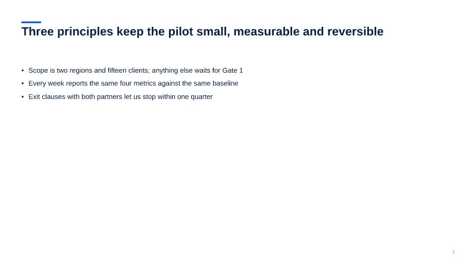 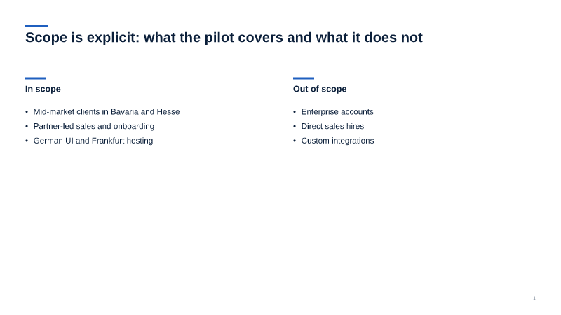 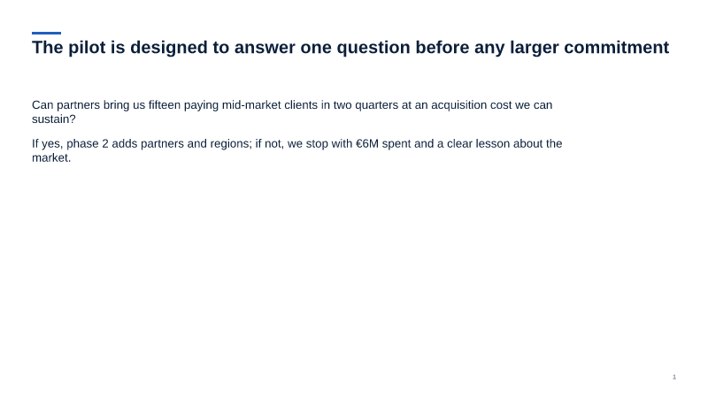

- **Use when:** Definitions, principles or context that really are text; Imported slides before they are redesigned; Two short lists side by side (e.g. in / out of scope)
- **Avoid when:** Parallel points with headings — use key-points; Anything with numbers — use a chart, kpi-tiles or a table
- **Frame:** standard (action title, tracker, lead and source line are drawn for you)

| Field | Type | Required | Limits | Description |
|---|---|---|---|---|
| `items` | string[] |  | 1–8 items, each ≤ 240 chars | bullets / paragraphs variants |
| `left` | object |  |  | two-column variant |
| `left.heading` | string |  | ≤ 50 chars |  |
| `left.items` | string[] | yes | 1–6 items, each ≤ 220 chars |  |
| `right` | object |  |  | two-column variant |
| `right.heading` | string |  | ≤ 50 chars |  |
| `right.items` | string[] | yes | 1–6 items, each ≤ 220 chars |  |

<details><summary>Example</summary>

```yaml
- id: example
  layout: text
  variant: bullets
  title: Three principles keep the pilot small, measurable and reversible
  items:
    - Scope is two regions and fifteen clients; anything else waits for Gate 1
    - Every week reports the same four metrics against the same baseline
    - Exit clauses with both partners let us stop within one quarter
```

</details>

## before-after

**Before and after** — Use for a change told as two states — how things are today and how they will be — with one number on each side.

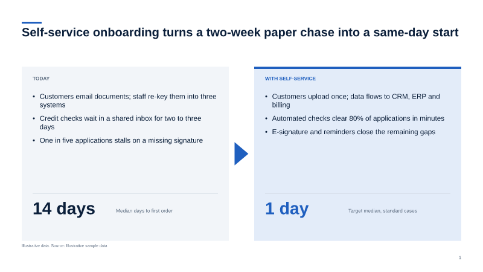

- **Use when:** The value of a change in plain words; Customer or employee experience before and after; Closing a case study: what changed
- **Avoid when:** The change is a sequence of steps — use process-compare; More than two states — use timeline or options-comparison
- **Frame:** standard (action title, tracker, lead and source line are drawn for you)

| Field | Type | Required | Limits | Description |
|---|---|---|---|---|
| `before` | object | yes |  | Today / the problem |
| `before.label` | string |  | ≤ 24 chars |  |
| `before.items` | string[] | yes | 2–5 items, each ≤ 110 chars |  |
| `before.metric` | object |  |  | One number that sums up the side, e.g. 9 days / order-to-cash |
| `before.metric.value` | string | yes | ≤ 10 chars |  |
| `before.metric.label` | string | yes | ≤ 40 chars |  |
| `after` | object | yes |  | Tomorrow / the outcome |
| `after.label` | string |  | ≤ 24 chars |  |
| `after.items` | string[] | yes | 2–5 items, each ≤ 110 chars |  |
| `after.metric` | object |  |  | One number that sums up the side, e.g. 9 days / order-to-cash |
| `after.metric.value` | string | yes | ≤ 10 chars |  |
| `after.metric.label` | string | yes | ≤ 40 chars |  |

<details><summary>Example</summary>

```yaml
- id: example
  layout: before-after
  title: Self-service onboarding turns a two-week paper chase into a same-day start
  sources:
    - ops-review
  before:
    label: Today
    items:
      - Customers email documents; staff re-key them into three systems
      - Credit checks wait in a shared inbox for two to three days
      - One in five applications stalls on a missing signature
    metric:
      value: 14 days
      label: Median days to first order
  after:
    label: With self-service
    items:
      - Customers upload once; data flows to CRM, ERP and billing
      - Automated checks clear 80% of applications in minutes
      - E-signature and reminders close the remaining gaps
    metric:
      value: 1 day
      label: Target median, standard cases
```

</details>

## freeform

**Freeform HTML** — Use for a browser-first creative exhibit no layout covers: HTML and CSS inside the standard frame, checked for overflow and text size like every other slide.

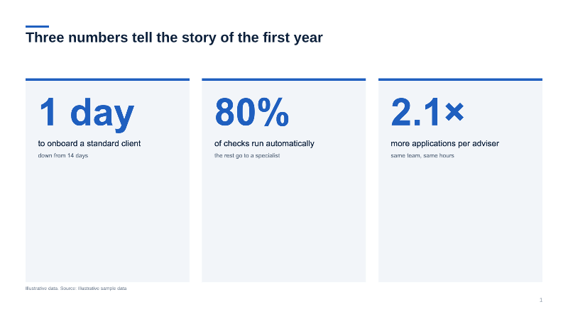

- **Use when:** Keynotes and story decks that need a bespoke visual; A one-off diagram or composition that would take too long to build from layouts; HTML-first decks presented from a browser
- **Avoid when:** Any exhibit a layout already covers — layouts stay editable in PowerPoint; Complex CSS without a verified editable equivalent: supply ppt primitives rather than silently rasterising content
- **Frame:** standard (action title, tracker, lead and source line are drawn for you)

| Field | Type | Required | Limits | Description |
|---|---|---|---|---|
| `html` | string | yes | ≤ 12000 chars | HTML fragment for the slide body. Theme tokens: var(--ink), var(--accent), var(--font-heading)… |
| `css` | string |  | ≤ 6000 chars | CSS for the fragment; scoped to this slide |
| `ppt` | any[] |  | 1–250 items | Editable PowerPoint equivalent, with stable ids and coordinates in inches relative to the HTML canvas. This is used for PPTX while html remains the visual reference. |
| `alt` | string | yes | ≤ 300 chars | What the slide shows, in words — for screen readers and the DOCX memo |

<details><summary>Example</summary>

```yaml
- id: example
  layout: freeform
  title: Three numbers tell the story of the first year
  sources:
    - ops-review
  alt: "Three large numbers in a row: 14 days to 1 day onboarding, 80 percent automated checks, 2.1 times more applications"
  css: .row{display:flex;gap:28px;height:100%;align-items:stretch}.cell{flex:1;background:var(--surface);border-top:6px solid var(--accent);padding:28px}.n{font-family:var(--font-heading);font-weight:700;font-size:64pt;line-height:1;color:var(--accent)}.l{margin-top:16px;font-size:var(--size-body);color:var(--ink)}.s{margin-top:8px;font-size:var(--size-small);color:var(--muted)}
  html: <div class="row"><div class="cell"><div class="n">1 day</div><div class="l">to onboard a standard client</div><div class="s">down from 14 days</div></div><div class="cell"><div class="n">80%</div><div class="l">of checks run automatically</div><div class="s">the rest go to a specialist</div></div><div class="cell"><div class="n">2.1×</div><div class="l">more applications per adviser</div><div class="s">same team, same hours</div></div></div>
```

</details>

## freeform-canvas

**Freeform canvas** — Use for custom HTML with shared title, source and page chrome by default. Explicit frame:none is reserved for a verified full-page composition that owns all chrome.

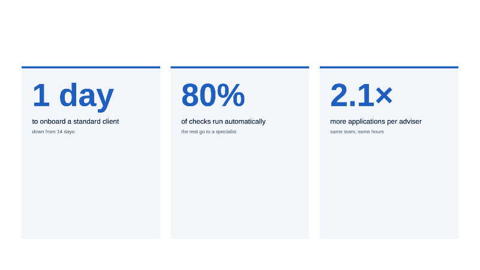

- **Use when:** Keynotes and story decks that need a bespoke visual; A one-off diagram or composition that would take too long to build from layouts; HTML-first decks presented from a browser
- **Avoid when:** Any exhibit a layout already covers — layouts stay editable in PowerPoint; Complex CSS without a verified editable equivalent: supply ppt primitives rather than silently rasterising content
- **Frame:** full-bleed (the layout draws the whole slide)

| Field | Type | Required | Limits | Description |
|---|---|---|---|---|
| `html` | string | yes | ≤ 12000 chars | HTML fragment for the slide body. Theme tokens: var(--ink), var(--accent), var(--font-heading)… |
| `css` | string |  | ≤ 6000 chars | CSS for the fragment; scoped to this slide |
| `ppt` | any[] |  | 1–250 items | Editable PowerPoint equivalent, with stable ids and coordinates in inches relative to the HTML canvas. This is used for PPTX while html remains the visual reference. |
| `alt` | string | yes | ≤ 300 chars | What the slide shows, in words — for screen readers and the DOCX memo |

<details><summary>Example</summary>

```yaml
- id: example
  layout: freeform-canvas
  title: Three numbers tell the story of the first year
  sources:
    - ops-review
  alt: "Three large numbers in a row: 14 days to 1 day onboarding, 80 percent automated checks, 2.1 times more applications"
  css: .row{display:flex;gap:28px;height:100%;align-items:stretch}.cell{flex:1;background:var(--surface);border-top:6px solid var(--accent);padding:28px}.n{font-family:var(--font-heading);font-weight:700;font-size:64pt;line-height:1;color:var(--accent)}.l{margin-top:16px;font-size:var(--size-body);color:var(--ink)}.s{margin-top:8px;font-size:var(--size-small);color:var(--muted)}
  html: <div class="row"><div class="cell"><div class="n">1 day</div><div class="l">to onboard a standard client</div><div class="s">down from 14 days</div></div><div class="cell"><div class="n">80%</div><div class="l">of checks run automatically</div><div class="s">the rest go to a specialist</div></div><div class="cell"><div class="n">2.1×</div><div class="l">more applications per adviser</div><div class="s">same team, same hours</div></div></div>
```

</details>

## native-canvas

**Native canvas** — Use for bespoke compositions that must remain editable in PowerPoint: every rectangle, line and text block is a native PPTX object.

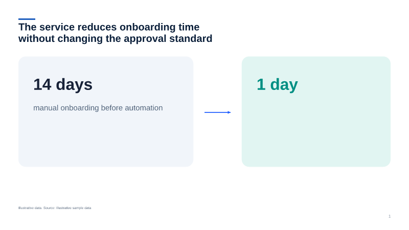

- **Use when:** A standard layout does not fit the message; The recipient will edit the PowerPoint; A bespoke visual needs a native PPTX representation
- **Avoid when:** A standard exhibit already communicates the point; A browser-only visual needs arbitrary CSS
- **Frame:** standard (action title, tracker, lead and source line are drawn for you)

| Field | Type | Required | Limits | Description |
|---|---|---|---|---|
| `elements` | any[] | yes | 1–120 items |  |

<details><summary>Example</summary>

```yaml
- id: example
  layout: native-canvas
  title: The service reduces onboarding time without changing the approval standard
  sources:
    - ops-review
  elements:
    - kind: rect
      x: 0
      y: 0
      w: 47
      h: 75
      fill: "#F1F5FA"
      radius: 5
    - kind: text
      x: 4
      y: 12
      w: 39
      h: 16
      text: 14 days
      font: heading
      size: 38
      bold: true
      color: "#182238"
    - kind: text
      x: 4
      y: 32
      w: 39
      h: 20
      text: manual onboarding before automation
      size: 18
      color: "#53657C"
    - kind: line
      x1: 50
      y1: 38
      x2: 57
      y2: 38
      color: "#1F5EFF"
      width: 2
      arrowEnd: true
    - kind: rect
      x: 60
      y: 0
      w: 40
      h: 75
      fill: "#E1F5F2"
      radius: 5
    - kind: text
      x: 64
      y: 12
      w: 32
      h: 16
      text: 1 day
      font: heading
      size: 38
      bold: true
      color: "#008F83"
```

</details>

## kpi-tiles

**KPI tiles** — Use for 2–4 headline numbers that prove the title at a glance, each with its label, change and context.

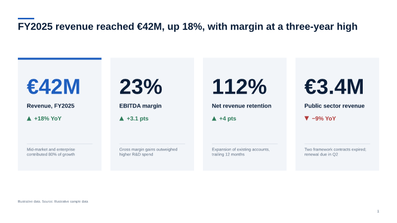 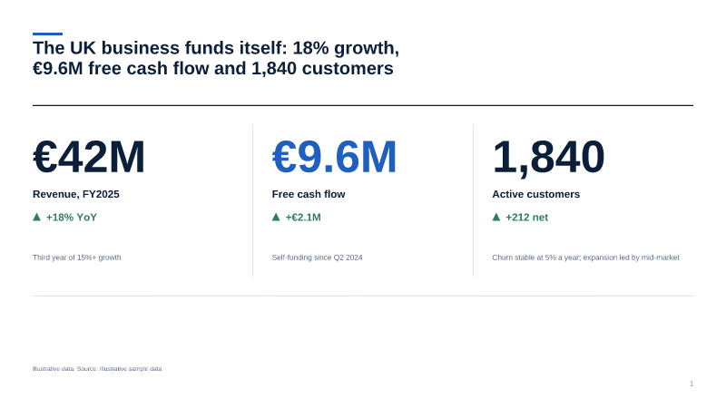

- **Use when:** A status or results slide where the numbers are the message; Opening a section with its three or four defining metrics; Before/after or target-vs-actual headline figures
- **Avoid when:** More than four numbers or any time series — use chart-takeaway or data-table; A single number that is the whole slide — use big-statement; Numbers that need a bridge between them — use waterfall
- **Frame:** standard (action title, tracker, lead and source line are drawn for you)

| Field | Type | Required | Limits | Description |
|---|---|---|---|---|
| `tiles` | object[] | yes | 2–4 items | The 2–4 headline numbers, most important first |
| `tiles[].value` | string | yes | ≤ 8 chars | The number itself, units attached: "€42M", "18%" |
| `tiles[].label` | string | yes | ≤ 50 chars | What the number measures, with period: "Revenue, FY2025" |
| `tiles[].delta` | string |  | ≤ 16 chars | Change versus a reference, sign included: "+12% YoY" |
| `tiles[].trend` | `up` \| `down` \| `flat` |  |  | Direction of the delta; colors it and picks the glyph (default: flat) |
| `tiles[].note` | string |  | ≤ 100 chars | One line of context: definition or driver |
| `highlight` | integer |  | 0…3 | Index of the one tile the title is about; it gets the accent color |

<details><summary>Example</summary>

```yaml
- id: example
  layout: kpi-tiles
  variant: tiles
  title: FY2025 revenue reached €42M, up 18%, with margin at a three-year high
  sources:
    - finance-fy25
  tiles:
    - value: €42M
      label: Revenue, FY2025
      delta: +18% YoY
      trend: up
      note: Mid-market and enterprise contributed 80% of growth
    - value: 23%
      label: EBITDA margin
      delta: +3.1 pts
      trend: up
      note: Gross margin gains outweighed higher R&D spend
    - value: 112%
      label: Net revenue retention
      delta: +4 pts
      trend: up
      note: Expansion of existing accounts, trailing 12 months
    - value: €3.4M
      label: Public sector revenue
      delta: −9% YoY
      trend: down
      note: Two framework contracts expired; renewal due in Q2
  highlight: 0
```

</details>

## evidence-panorama

**Evidence panorama** — Connect one sourced headline metric to four parallel models, implications or use cases; equal cards express categories, not relative magnitude.

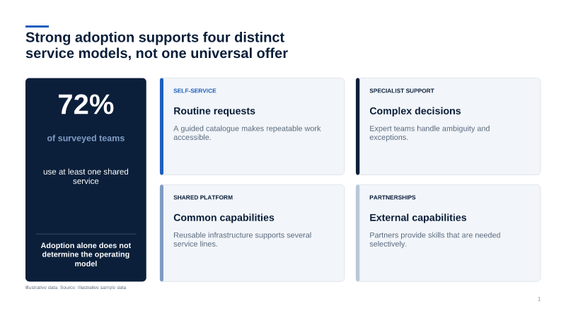

- **Use when:** One observation motivates four different strategic responses; Compare four models with a common context and a shared bottom-line conclusion
- **Avoid when:** The title claims a ranking or market share: use a chart; Alternatives must be scored against identical criteria: use options-comparison
- **Frame:** standard (action title, tracker, lead and source line are drawn for you)

| Field | Type | Required | Limits | Description |
|---|---|---|---|---|
| `metric` | object | yes |  |  |
| `metric.value` | string | yes | ≤ 12 chars |  |
| `metric.label` | string | yes | ≤ 70 chars |  |
| `metric.context` | string | yes | ≤ 120 chars |  |
| `metric.implication` | string | yes | ≤ 120 chars |  |
| `cards` | object[] | yes | 4–4 items |  |
| `cards[].label` | string | yes | ≤ 70 chars |  |
| `cards[].title` | string | yes | ≤ 90 chars |  |
| `cards[].body` | string | yes | ≤ 240 chars |  |

<details><summary>Example</summary>

```yaml
- id: example
  layout: evidence-panorama
  title: Strong adoption supports four distinct service models, not one universal offer
  sources:
    - illustrative-survey
  metric:
    value: 72%
    label: of surveyed teams
    context: use at least one shared service
    implication: Adoption alone does not determine the operating model
  cards:
    - label: SELF-SERVICE
      title: Routine requests
      body: A guided catalogue makes repeatable work accessible.
    - label: SPECIALIST SUPPORT
      title: Complex decisions
      body: Expert teams handle ambiguity and exceptions.
    - label: SHARED PLATFORM
      title: Common capabilities
      body: Reusable infrastructure supports several service lines.
    - label: PARTNERSHIPS
      title: External capabilities
      body: Partners provide skills that are needed selectively.
```

</details>

## chart-takeaway

**Chart with takeaway** — Use for one chart that proves the title, with the interpretation in a side panel.

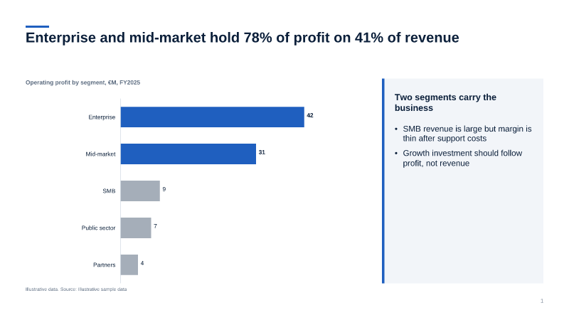 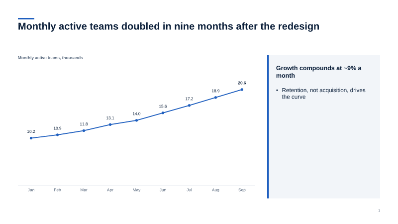 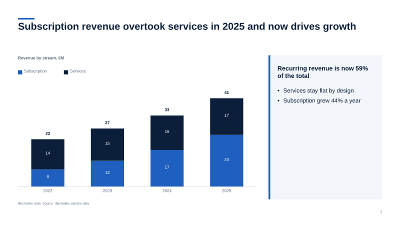 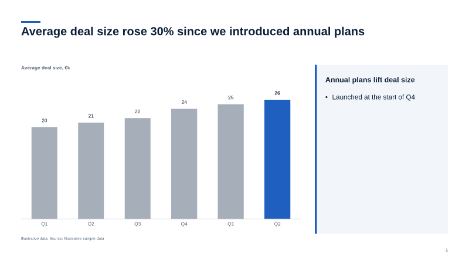 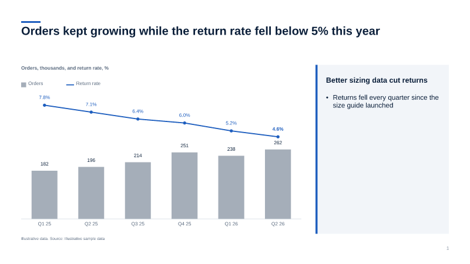

- **Use when:** Comparing items (bar), a trend over time (column or line), or composition (stacked); A volume and a rate over the same periods — bars plus a line on its own scale (combo); Any slide whose title carries a number from the data
- **Avoid when:** A bridge from one total to another — use waterfall; Fewer than three data points — use kpi-tiles
- **Frame:** standard (action title, tracker, lead and source line are drawn for you)

| Field | Type | Required | Limits | Description |
|---|---|---|---|---|
| `chart` | object | yes |  |  |
| `chart.label` | string |  | ≤ 90 chars | What is measured, with unit and period: "Revenue by segment, €M, FY2025" |
| `chart.categories` | string[] | yes | 2–12 items, each ≤ 28 chars |  |
| `chart.series` | object[] | yes | 1–4 items |  |
| `chart.series[].name` | string | yes | ≤ 30 chars |  |
| `chart.series[].values` | number[] | yes |  |  |
| `chart.unit` | string |  | ≤ 4 chars | Unit glyph on labels: "%", "€", "$", "M" |
| `chart.decimals` | integer |  | 0…2 |  |
| `chart.lineUnit` | string |  | ≤ 4 chars | Combo: unit of the line series (the second), e.g. "%" next to bars in €M |
| `chart.lineDecimals` | integer |  | 0…2 |  |
| `chart.highlight` | string \| integer[] |  |  | Categories (names or indices) to color as the insight; the rest recede |
| `takeaway` | object | yes |  |  |
| `takeaway.headline` | string | yes | ≤ 90 chars | The so-what in one sentence |
| `takeaway.points` | string[] | yes | 0–3 items, each ≤ 150 chars |  |

<details><summary>Example</summary>

```yaml
- id: example
  layout: chart-takeaway
  variant: bar
  title: Enterprise and mid-market hold 78% of profit on 41% of revenue
  sources:
    - finance-fy25
  chart:
    label: Operating profit by segment, €M, FY2025
    categories:
      - Enterprise
      - Mid-market
      - SMB
      - Public sector
      - Partners
    series:
      - name: Profit
        values:
          - 42
          - 31
          - 9
          - 7
          - 4
    highlight:
      - Enterprise
      - Mid-market
  takeaway:
    headline: Two segments carry the business
    points:
      - SMB revenue is large but margin is thin after support costs
      - Growth investment should follow profit, not revenue
```

</details>

## waterfall

**Waterfall** — Use for a bridge that explains how a starting total becomes an ending total through positive and negative drivers.

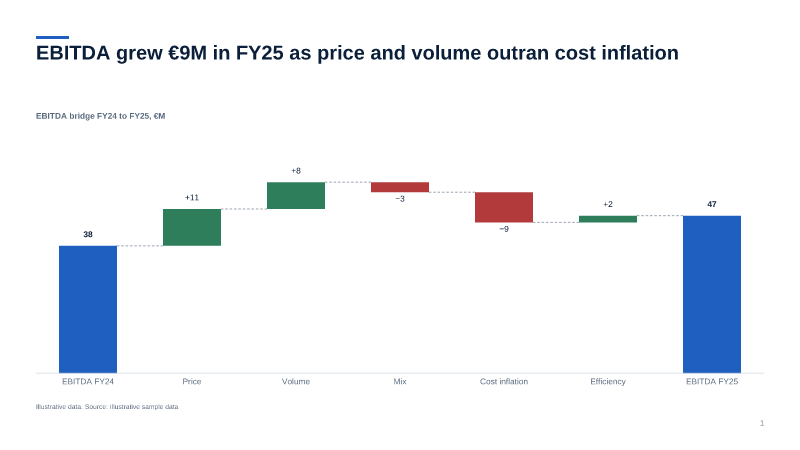 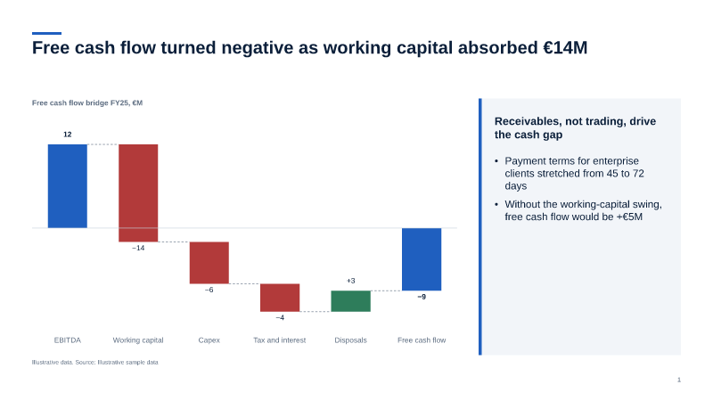

- **Use when:** Profit, revenue or cash bridges between two periods or scenarios; Showing which drivers add and which erode a total; A title that says "X grew/fell by N because of A, B and C"
- **Avoid when:** Comparing independent categories — use chart-takeaway (bar); More than 12 steps — group small drivers into "Other"; Only start and end values matter — use kpi-tiles
- **Frame:** standard (action title, tracker, lead and source line are drawn for you)

| Field | Type | Required | Limits | Description |
|---|---|---|---|---|
| `chart` | object | yes |  |  |
| `chart.label` | string |  | ≤ 90 chars | What is bridged, with unit and period: "EBITDA bridge FY24 to FY25, €M" |
| `chart.steps` | object[] | yes | 3–12 items | Start total, drivers, then end total; the drivers must sum to the end total |
| `chart.steps[].label` | string | yes | ≤ 24 chars | Short category name: "Price", "FY24", "Cost inflation" |
| `chart.steps[].value` | number | yes |  | Delta for a driver (negative = decrease); the absolute level when total is true |
| `chart.steps[].total` | boolean |  |  | True for start, subtotal and end bars: they stand on the baseline |
| `chart.unit` | string |  | ≤ 4 chars | Unit glyph on labels: "%", "€", "$", "M" |
| `chart.decimals` | integer |  | 0…2 |  |
| `takeaway` | object |  |  | Required for the with-takeaway variant: the interpretation in a side panel |
| `takeaway.headline` | string | yes | ≤ 90 chars | The so-what in one sentence |
| `takeaway.points` | string[] | yes | 0–3 items, each ≤ 150 chars |  |

<details><summary>Example</summary>

```yaml
- id: example
  layout: waterfall
  variant: full
  title: EBITDA grew €9M in FY25 as price and volume outran cost inflation
  sources:
    - finance-fy25
  chart:
    label: EBITDA bridge FY24 to FY25, €M
    steps:
      - label: EBITDA FY24
        value: 38
        total: true
      - label: Price
        value: 11
      - label: Volume
        value: 8
      - label: Mix
        value: -3
      - label: Cost inflation
        value: -9
      - label: Efficiency
        value: 2
      - label: EBITDA FY25
        value: 47
        total: true
    decimals: 0
```

</details>

## bubble-chart

**Bubble and scatter chart** — Use for items positioned on two measured dimensions — with bubble size for a third, or quadrant dividers for a portfolio (growth-share) view.

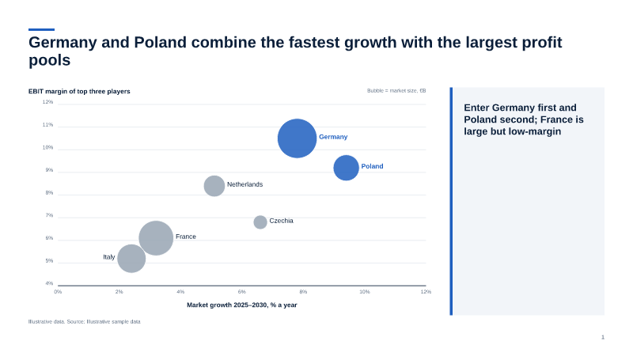 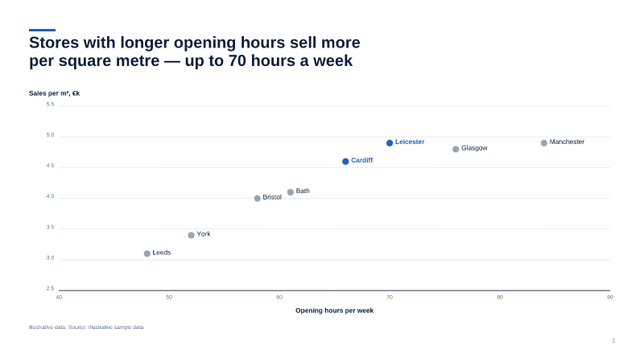 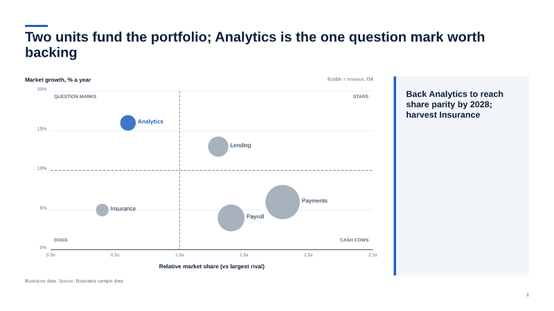

- **Use when:** Portfolio of business units or products: growth vs share, size = revenue; Correlation between two metrics across markets, stores or customers; Competitor positioning on real numbers
- **Avoid when:** Positions are judgements, not numbers — use matrix-2x2; One dimension only — use chart-takeaway (bar)
- **Frame:** standard (action title, tracker, lead and source line are drawn for you)

| Field | Type | Required | Limits | Description |
|---|---|---|---|---|
| `xAxis` | object | yes |  |  |
| `xAxis.label` | string | yes | ≤ 48 chars |  |
| `xAxis.unit` | string |  | ≤ 6 chars | e.g. "%", "€", "x" |
| `xAxis.min` | number |  |  |  |
| `xAxis.max` | number |  |  |  |
| `yAxis` | object | yes |  |  |
| `yAxis.label` | string | yes | ≤ 48 chars |  |
| `yAxis.unit` | string |  | ≤ 6 chars | e.g. "%", "€", "x" |
| `yAxis.min` | number |  |  |  |
| `yAxis.max` | number |  |  |  |
| `sizeLabel` | string |  | ≤ 40 chars | bubble and portfolio: what the bubble area shows, e.g. "Revenue, €M" |
| `items` | object[] | yes | 2–15 items |  |
| `items[].label` | string | yes | ≤ 24 chars |  |
| `items[].x` | number | yes |  |  |
| `items[].y` | number | yes |  |  |
| `items[].size` | number |  |  | Bubble area; required for bubble and portfolio |
| `items[].highlight` | boolean |  |  |  |
| `split` | object |  |  | portfolio variant: quadrant dividers, e.g. a growth-share matrix |
| `split.x` | number | yes |  | Vertical divider, in x units (e.g. relative share 1.0) |
| `split.y` | number | yes |  | Horizontal divider, in y units (e.g. market growth 10%) |
| `split.names` | string[] |  | 4–4 items, each ≤ 20 chars | Quadrant names: top-left, top-right, bottom-left, bottom-right |
| `takeaway` | string |  | ≤ 140 chars | Interpretation, side panel |

<details><summary>Example</summary>

```yaml
- id: example
  layout: bubble-chart
  variant: bubble
  title: Germany and Poland combine the fastest growth with the largest profit pools
  sources:
    - market-est
  xAxis:
    label: Market growth 2025–2030, % a year
    unit: "%"
  yAxis:
    label: EBIT margin of top three players
    unit: "%"
  sizeLabel: Bubble = market size, €B
  items:
    - label: Germany
      x: 7.8
      y: 10.5
      size: 14
      highlight: true
    - label: Poland
      x: 9.4
      y: 9.2
      size: 6.1
      highlight: true
    - label: Netherlands
      x: 5.1
      y: 8.4
      size: 4.2
    - label: France
      x: 3.2
      y: 6.1
      size: 11
    - label: Italy
      x: 2.4
      y: 5.2
      size: 7.5
    - label: Czechia
      x: 6.6
      y: 6.8
      size: 1.8
  takeaway: Enter Germany first and Poland second; France is large but low-margin
```

</details>

## marimekko

**Marimekko** — Use for market structure in one picture: segment size as column width and each player’s share as the stack within it.

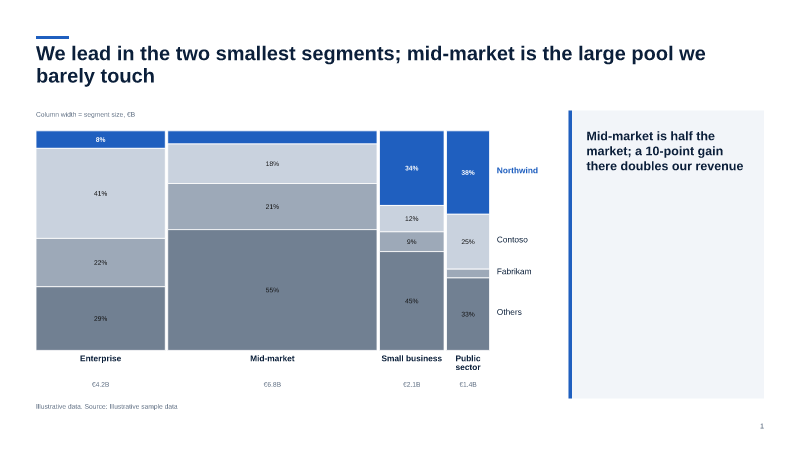

- **Use when:** Where we are strong and where the big segments are; Share by segment for us vs competitors; Profit pools by region and player
- **Avoid when:** Segments are about the same size — use a stacked column (chart-takeaway); More than seven segments or six players — group the long tail
- **Frame:** standard (action title, tracker, lead and source line are drawn for you)

| Field | Type | Required | Limits | Description |
|---|---|---|---|---|
| `unit` | string |  | ≤ 6 chars | Unit of the column totals, e.g. "€B" |
| `totalLabel` | string |  | ≤ 40 chars | What column width shows, e.g. "Market size, €B" |
| `series` | string[] | yes | 2–6 items, each ≤ 20 chars | Players or sub-segments stacked in every column; put "Others" last |
| `columns` | object[] | yes | 2–7 items |  |
| `columns[].label` | string | yes | ≤ 18 chars |  |
| `columns[].total` | number | yes |  | Column width: segment size |
| `columns[].shares` | number[] | yes |  | One value per series (shares or amounts — normalised to 100%) |
| `highlight` | integer |  | 0…9007199254740991 | Series index to show in the accent |
| `decimals` | integer |  | 0…2 |  |
| `takeaway` | string |  | ≤ 140 chars | Interpretation, side panel |

<details><summary>Example</summary>

```yaml
- id: example
  layout: marimekko
  title: We lead in the two smallest segments; mid-market is the large pool we barely touch
  sources:
    - market-est
  unit: €B
  totalLabel: Column width = segment size, €B
  series:
    - Northwind
    - Contoso
    - Fabrikam
    - Others
  highlight: 0
  columns:
    - label: Enterprise
      total: 4.2
      shares:
        - 8
        - 41
        - 22
        - 29
    - label: Mid-market
      total: 6.8
      shares:
        - 6
        - 18
        - 21
        - 55
    - label: Small business
      total: 2.1
      shares:
        - 34
        - 12
        - 9
        - 45
    - label: Public sector
      total: 1.4
      shares:
        - 38
        - 25
        - 4
        - 33
  decimals: 1
  takeaway: Mid-market is half the market; a 10-point gain there doubles our revenue
```

</details>

## tornado

**Tornado (sensitivity)** — Use for showing which assumptions move a result most: each driver’s downside and upside around the base case, widest on top.

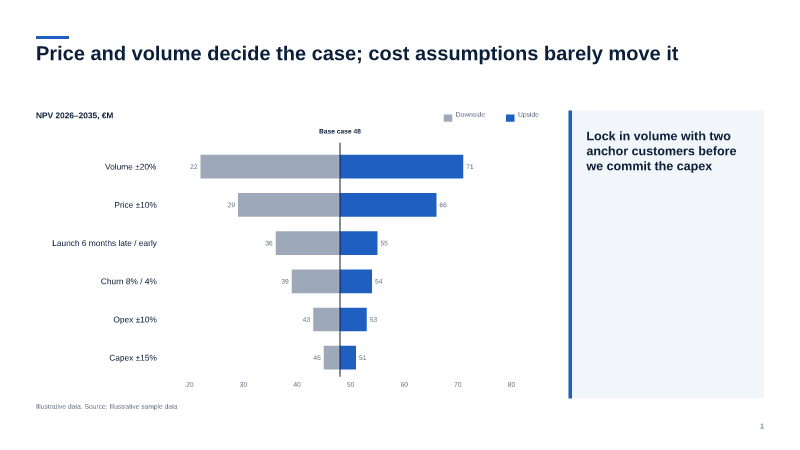

- **Use when:** Business case risk: which assumptions to test or hedge first; Explaining the range around a forecast or valuation
- **Avoid when:** Scenarios rather than one driver at a time — use options-comparison or data-table; Bridging from one value to another — use waterfall
- **Frame:** standard (action title, tracker, lead and source line are drawn for you)

| Field | Type | Required | Limits | Description |
|---|---|---|---|---|
| `metric` | string | yes | ≤ 48 chars | What moves, e.g. "NPV, €M" |
| `base` | number | yes |  | Base-case value of the metric |
| `baseLabel` | string |  | ≤ 24 chars | Defaults to "Base case" |
| `unit` | string |  | ≤ 6 chars |  |
| `decimals` | integer |  | 0…2 |  |
| `lowLabel` | string |  | ≤ 20 chars | Legend for the downside, e.g. "Pessimistic" |
| `highLabel` | string |  | ≤ 20 chars | Legend for the upside, e.g. "Optimistic" |
| `drivers` | object[] | yes | 2–9 items | Sorted automatically, widest swing on top |
| `drivers[].label` | string | yes | ≤ 36 chars | Driver and its range, e.g. "Price ±10%" |
| `drivers[].low` | number | yes |  | Metric when the driver is at its downside |
| `drivers[].high` | number | yes |  | Metric when the driver is at its upside |
| `takeaway` | string |  | ≤ 140 chars | Interpretation, side panel |

<details><summary>Example</summary>

```yaml
- id: example
  layout: tornado
  title: Price and volume decide the case; cost assumptions barely move it
  sources:
    - fin-plan
  metric: NPV 2026–2035, €M
  base: 48
  unit: ""
  lowLabel: Downside
  highLabel: Upside
  drivers:
    - label: Volume ±20%
      low: 22
      high: 71
    - label: Price ±10%
      low: 29
      high: 66
    - label: Launch 6 months late / early
      low: 36
      high: 55
    - label: Churn 8% / 4%
      low: 39
      high: 54
    - label: Opex ±10%
      low: 43
      high: 53
    - label: Capex ±15%
      low: 45
      high: 51
  takeaway: Lock in volume with two anchor customers before we commit the capex
```

</details>

## football-field

**Football field (ranges)** — Use for comparing value ranges from several methods on one axis — valuation, price corridors or estimates — against a reference such as the offer.

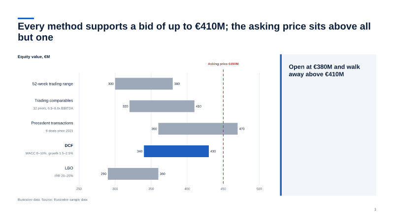

- **Use when:** Valuation summary for M&A or fundraising; Price or cost estimates from several sources; Market sizing triangulated top-down and bottom-up
- **Avoid when:** Point values, not ranges — use chart-takeaway (bar); Ranges around one driver at a time — use tornado
- **Frame:** standard (action title, tracker, lead and source line are drawn for you)

| Field | Type | Required | Limits | Description |
|---|---|---|---|---|
| `metric` | string | yes | ≤ 48 chars | What the ranges show, e.g. "Equity value, €M" |
| `unit` | string |  | ≤ 6 chars |  |
| `decimals` | integer |  | 0…2 |  |
| `ranges` | object[] | yes | 2–8 items |  |
| `ranges[].label` | string | yes | ≤ 30 chars | Method, e.g. "DCF (WACC 8–10%)" |
| `ranges[].note` | string |  | ≤ 40 chars | Basis, e.g. "12 peers, 2027 EBITDA" |
| `ranges[].low` | number | yes |  |  |
| `ranges[].high` | number | yes |  |  |
| `ranges[].highlight` | boolean |  |  |  |
| `marker` | object |  |  | A reference line, e.g. the offer price or our bid |
| `marker.value` | number | yes |  |  |
| `marker.label` | string | yes | ≤ 28 chars |  |
| `takeaway` | string |  | ≤ 140 chars | Interpretation, side panel |

<details><summary>Example</summary>

```yaml
- id: example
  layout: football-field
  title: Every method supports a bid of up to €410M; the asking price sits above all but one
  sources:
    - fin-plan
  metric: Equity value, €M
  ranges:
    - label: 52-week trading range
      low: 300
      high: 380
    - label: Trading comparables
      note: 12 peers, 6.5–8.0x EBITDA
      low: 320
      high: 410
    - label: Precedent transactions
      note: 9 deals since 2021
      low: 360
      high: 470
    - label: DCF
      note: WACC 8–10%, growth 1.5–2.5%
      low: 340
      high: 430
      highlight: true
    - label: LBO
      note: IRR 20–25%
      low: 290
      high: 360
  marker:
    value: 450
    label: Asking price €450M
  takeaway: Open at €380M and walk away above €410M
```

</details>

## funnel

**Funnel / pyramid** — Use for a conversion funnel (where volume is lost) or a pyramid (levels that build on each other).

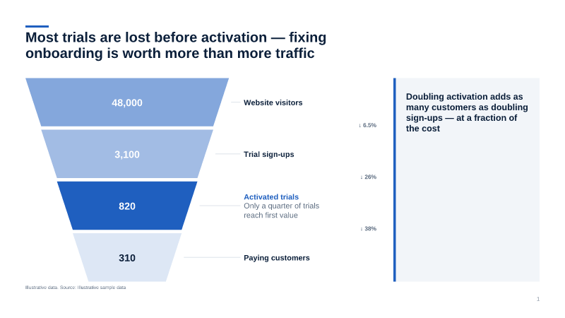 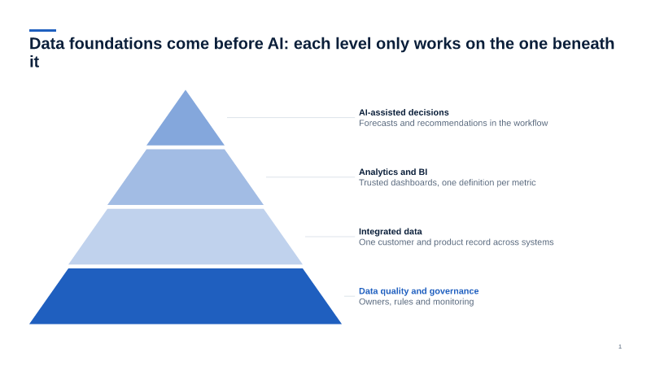

- **Use when:** Sales or marketing funnels and drop-off; Customer journey conversion; Hierarchies of needs, capabilities or priorities (pyramid)
- **Avoid when:** Stages are not a narrowing sequence — use chart-takeaway (bar); Exact values matter most — use data-table
- **Frame:** standard (action title, tracker, lead and source line are drawn for you)

| Field | Type | Required | Limits | Description |
|---|---|---|---|---|
| `stages` | object[] | yes | 3–6 items | funnel: widest first. pyramid: top (smallest) first |
| `stages[].label` | string | yes | ≤ 30 chars |  |
| `stages[].value` | string |  | ≤ 12 chars | funnel: the volume at this stage, e.g. "12,400" |
| `stages[].note` | string |  | ≤ 80 chars |  |
| `conversions` | string[] |  | each ≤ 8 chars | funnel: conversion between consecutive stages, e.g. "34%" |
| `highlight` | integer |  | 0…9007199254740991 | Stage to emphasise (e.g. the biggest drop) |
| `takeaway` | string |  | ≤ 140 chars |  |

<details><summary>Example</summary>

```yaml
- id: example
  layout: funnel
  variant: funnel
  title: Most trials are lost before activation — fixing onboarding is worth more than more traffic
  sources:
    - finance-fy25
  stages:
    - label: Website visitors
      value: 48,000
    - label: Trial sign-ups
      value: 3,100
    - label: Activated trials
      value: "820"
      note: Only a quarter of trials reach first value
    - label: Paying customers
      value: "310"
  conversions:
    - 6.5%
    - 26%
    - 38%
  highlight: 2
  takeaway: Doubling activation adds as many customers as doubling sign-ups — at a fraction of the cost
```

</details>

## data-table

**Data table** — Use for a compact table of exact values where the reader needs to look up or compare several attributes at once.

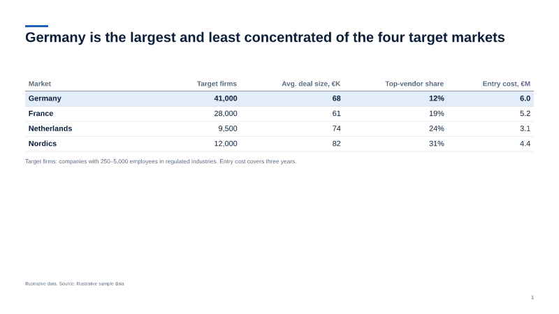 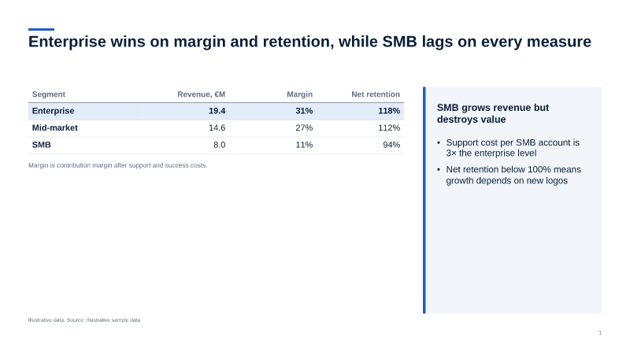

- **Use when:** Exact figures matter more than shape (financials, benchmarks, price lists); Several attributes per item, with one row or column carrying the message; Backup or appendix pages that document the numbers behind a chart
- **Avoid when:** A trend or ranking that the eye should see — use chart-takeaway; Scoring options against criteria for a decision — use options-comparison; More than ten rows or six columns — summarise and move the rest to backup
- **Frame:** standard (action title, tracker, lead and source line are drawn for you)

| Field | Type | Required | Limits | Description |
|---|---|---|---|---|
| `header` | string[] | yes | 2–6 items, each ≤ 28 chars | Column headings with units: "Revenue, €M" |
| `rows` | string[][] | yes | 2–10 items | Data rows; every row has exactly one cell per header column |
| `highlightRow` | integer |  | 0…9007199254740991 | Index of the one data row the title is about |
| `highlightCol` | integer |  | 0…9007199254740991 | Index of the one column to emphasise, e.g. the recommended option |
| `align` | `left` \| `center` \| `right`[] |  | 0–6 items | Per-column alignment; right-align numeric columns |
| `colWeights` | number[] |  | 0–6 items | Relative column widths (default: first column 1.3, others 1) |
| `note` | string |  | ≤ 160 chars | Footnote under the table: definitions, exclusions, units |
| `takeaway` | object |  |  | Required for the with-takeaway variant: the interpretation in a side panel |
| `takeaway.headline` | string | yes | ≤ 90 chars | The so-what in one sentence |
| `takeaway.points` | string[] | yes | 0–3 items, each ≤ 150 chars |  |

<details><summary>Example</summary>

```yaml
- id: example
  layout: data-table
  variant: plain
  title: Germany is the largest and least concentrated of the four target markets
  sources:
    - market-study
  header:
    - Market
    - Target firms
    - Avg. deal size, €K
    - Top-vendor share
    - Entry cost, €M
  rows:
    - - Germany
      - 41,000
      - "68"
      - 12%
      - "6.0"
    - - France
      - 28,000
      - "61"
      - 19%
      - "5.2"
    - - Netherlands
      - 9,500
      - "74"
      - 24%
      - "3.1"
    - - Nordics
      - 12,000
      - "82"
      - 31%
      - "4.4"
  highlightRow: 0
  align:
    - left
    - right
    - right
    - right
    - right
  colWeights:
    - 1.5
    - 1
    - 1.2
    - 1.2
    - 1
  note: "Target firms: companies with 250–5,000 employees in regulated industries. Entry cost covers three years."
```

</details>

## options-comparison

**Options comparison** — Use for comparing 2–5 options on the same criteria and showing which one wins and why.

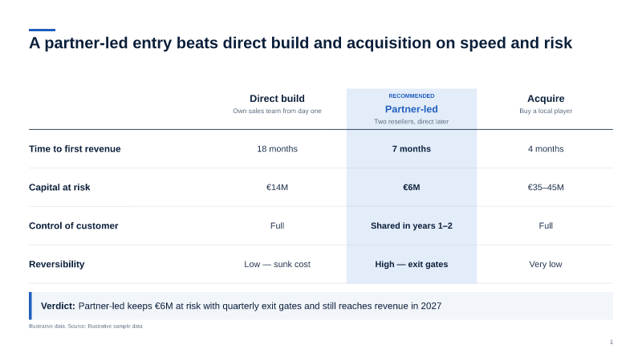 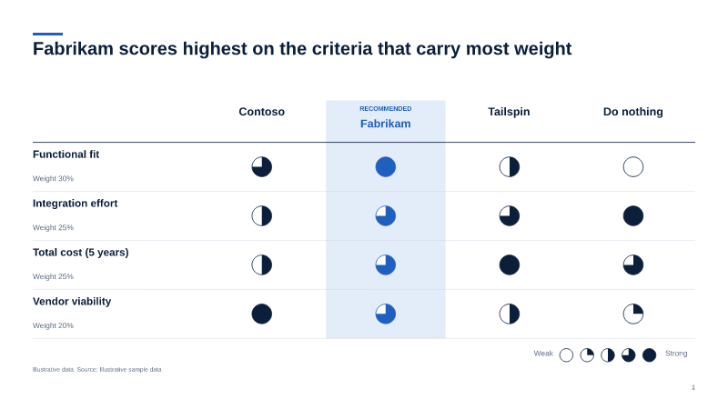

- **Use when:** Choosing between strategic options, vendors or scenarios; Showing that "do nothing" was considered; Any recommendation that needs a transparent comparison
- **Avoid when:** Two dimensions of prioritisation — use matrix-2x2; Numeric comparisons of one metric — use chart-takeaway (bar)
- **Frame:** standard (action title, tracker, lead and source line are drawn for you)

| Field | Type | Required | Limits | Description |
|---|---|---|---|---|
| `options` | object[] | yes | 2–5 items |  |
| `options[].name` | string | yes | ≤ 28 chars |  |
| `options[].summary` | string |  | ≤ 60 chars | One line on what the option is |
| `criteria` | object[] | yes | 2–6 items |  |
| `criteria[].name` | string | yes | ≤ 40 chars | Same criteria for every option |
| `criteria[].weight` | string |  | ≤ 12 chars | e.g. "High", "30%" |
| `cells` | string \| integer[][] | yes |  | One row per criterion, one value per option: text (text variant) or 0–4 (rating) |
| `recommended` | integer |  | 0…9007199254740991 | Index of the recommended option |
| `verdict` | string |  | ≤ 140 chars | One-line conclusion shown under the grid |

<details><summary>Example</summary>

```yaml
- id: example
  layout: options-comparison
  variant: text
  title: A partner-led entry beats direct build and acquisition on speed and risk
  sources:
    - strategy-analysis
  options:
    - name: Direct build
      summary: Own sales team from day one
    - name: Partner-led
      summary: Two resellers, direct later
    - name: Acquire
      summary: Buy a local player
  criteria:
    - name: Time to first revenue
    - name: Capital at risk
    - name: Control of customer
    - name: Reversibility
  cells:
    - - 18 months
      - 7 months
      - 4 months
    - - €14M
      - €6M
      - €35–45M
    - - Full
      - Shared in years 1–2
      - Full
    - - Low — sunk cost
      - High — exit gates
      - Very low
  recommended: 1
  verdict: Partner-led keeps €6M at risk with quarterly exit gates and still reaches revenue in 2027
```

</details>

## matrix-2x2

**2×2 matrix** — Use for prioritising items on two dimensions, or naming four strategic positions.

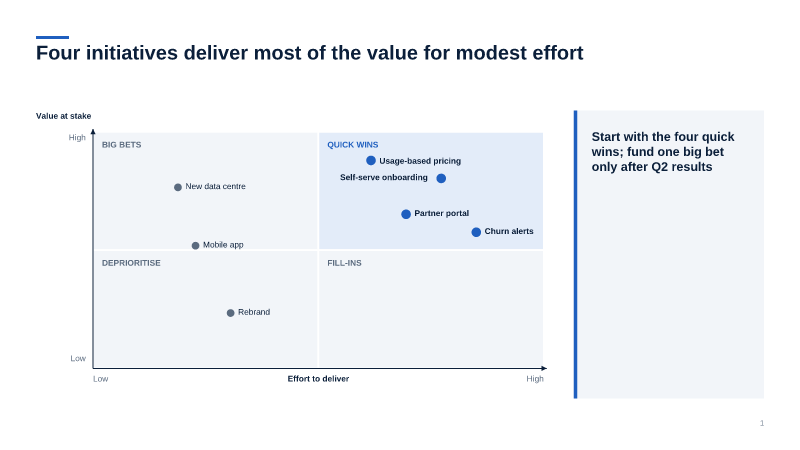 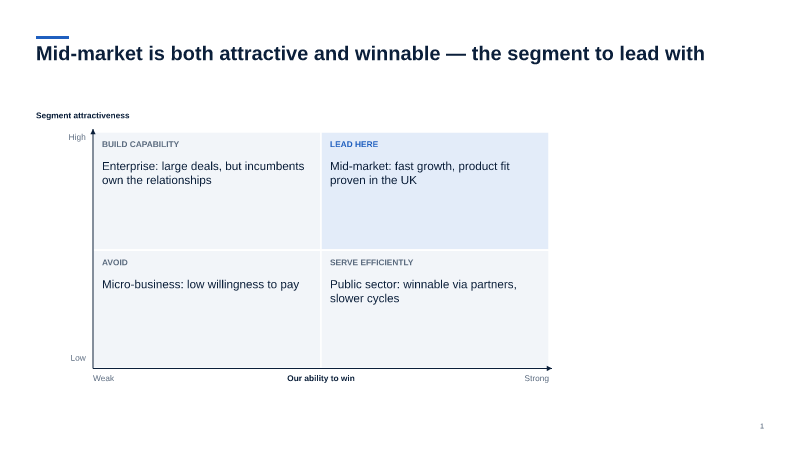

- **Use when:** Impact vs effort prioritisation; Segment attractiveness vs ability to win; Competitive positioning
- **Avoid when:** One dimension only — use a sorted bar (chart-takeaway); More than ~12 items — use a table
- **Frame:** standard (action title, tracker, lead and source line are drawn for you)

| Field | Type | Required | Limits | Description |
|---|---|---|---|---|
| `xAxis` | object | yes |  |  |
| `xAxis.label` | string | yes | ≤ 40 chars |  |
| `xAxis.low` | string | yes | ≤ 16 chars |  |
| `xAxis.high` | string | yes | ≤ 16 chars |  |
| `yAxis` | object | yes |  |  |
| `yAxis.label` | string | yes | ≤ 40 chars |  |
| `yAxis.low` | string | yes | ≤ 16 chars |  |
| `yAxis.high` | string | yes | ≤ 16 chars |  |
| `quadrants` | object[] | yes | 4–4 items | Order: top-left, top-right, bottom-left, bottom-right. Top-right is treated as the target |
| `quadrants[].name` | string | yes | ≤ 36 chars |  |
| `quadrants[].note` | string |  | ≤ 110 chars |  |
| `items` | object[] |  | 0–12 items | plot variant: items positioned 0–1 on each axis |
| `items[].label` | string | yes | ≤ 24 chars |  |
| `items[].x` | number | yes | 0…1 |  |
| `items[].y` | number | yes | 0…1 |  |
| `items[].highlight` | boolean |  |  |  |
| `takeaway` | string |  | ≤ 140 chars | Interpretation shown in a side panel |

<details><summary>Example</summary>

```yaml
- id: example
  layout: matrix-2x2
  variant: plot
  title: Four initiatives deliver most of the value for modest effort
  xAxis:
    label: Effort to deliver
    low: Low
    high: High
  yAxis:
    label: Value at stake
    low: Low
    high: High
  quadrants:
    - name: Big bets
    - name: Quick wins
    - name: Deprioritise
    - name: Fill-ins
  items:
    - label: Self-serve onboarding
      x: 0.78
      y: 0.82
      highlight: true
    - label: Partner portal
      x: 0.7
      y: 0.66
      highlight: true
    - label: Usage-based pricing
      x: 0.62
      y: 0.9
      highlight: true
    - label: Churn alerts
      x: 0.86
      y: 0.58
      highlight: true
    - label: New data centre
      x: 0.18
      y: 0.78
    - label: Rebrand
      x: 0.3
      y: 0.22
    - label: Mobile app
      x: 0.22
      y: 0.52
  takeaway: Start with the four quick wins; fund one big bet only after Q2 results
```

</details>

## swot

**SWOT** — Use for an internal (strengths, weaknesses) and external (opportunities, threats) view of a position — with the implications that follow.

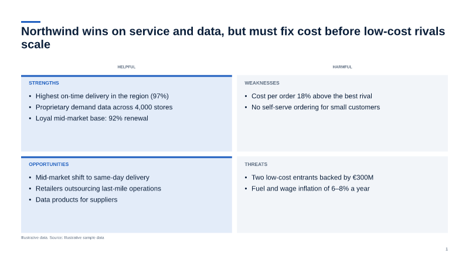 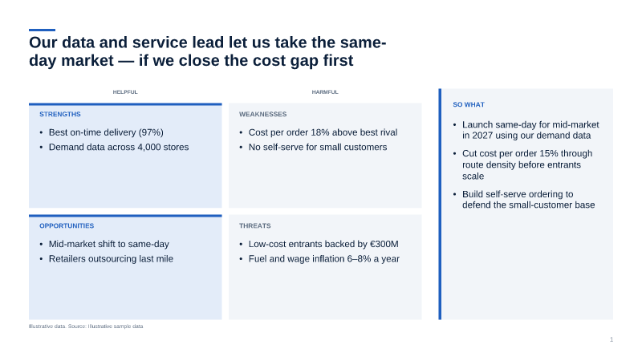

- **Use when:** Assessing a business, product or market entry before choosing a strategy; A one-page diagnostic that the recommendation then builds on
- **Avoid when:** A list without a so-what — add implications or use key-points; Comparing options — use options-comparison
- **Frame:** standard (action title, tracker, lead and source line are drawn for you)

| Field | Type | Required | Limits | Description |
|---|---|---|---|---|
| `strengths` | string[] | yes | 1–4 items, each ≤ 90 chars | Internal, helpful — one specific, evidenced point each |
| `weaknesses` | string[] | yes | 1–4 items, each ≤ 90 chars | Internal, harmful — one specific, evidenced point each |
| `opportunities` | string[] | yes | 1–4 items, each ≤ 90 chars | External, helpful — one specific, evidenced point each |
| `threats` | string[] | yes | 1–4 items, each ≤ 90 chars | External, harmful — one specific, evidenced point each |
| `takeaway` | string |  | ≤ 140 chars | with-implications variant: what the four boxes mean for the decision |
| `implications` | string[] |  | 2–4 items, each ≤ 110 chars | with-implications variant: the moves that follow (use S to seize O, fix W before T…) |

<details><summary>Example</summary>

```yaml
- id: example
  layout: swot
  variant: grid
  title: Northwind wins on service and data, but must fix cost before low-cost rivals scale
  sources:
    - ops-review
  strengths:
    - Highest on-time delivery in the region (97%)
    - Proprietary demand data across 4,000 stores
    - "Loyal mid-market base: 92% renewal"
  weaknesses:
    - Cost per order 18% above the best rival
    - No self-serve ordering for small customers
  opportunities:
    - Mid-market shift to same-day delivery
    - Retailers outsourcing last-mile operations
    - Data products for suppliers
  threats:
    - Two low-cost entrants backed by €300M
    - Fuel and wage inflation of 6–8% a year
```

</details>

## five-forces

**Five forces** — Use for judging how attractive an industry is: the five competitive forces, each rated and evidenced, with the verdict.

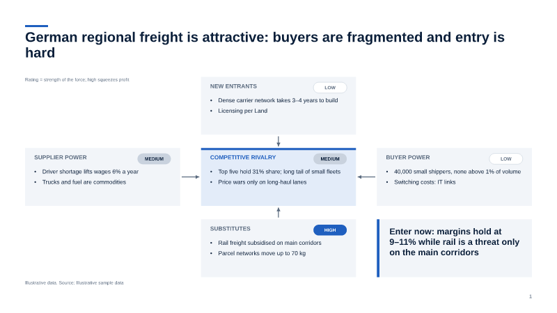

- **Use when:** Market entry or investment: is the profit pool worth fighting for?; Explaining why margins are falling or protected
- **Avoid when:** Comparing named competitors — use options-comparison or bubble-chart; Macro trends rather than industry structure — use pestel
- **Frame:** standard (action title, tracker, lead and source line are drawn for you)

| Field | Type | Required | Limits | Description |
|---|---|---|---|---|
| `entrants` | object | yes |  | Threat of new entrants |
| `entrants.rating` | `low` \| `medium` \| `high` | yes |  | Strength of the force: high means it squeezes profit |
| `entrants.points` | string[] | yes | 1–3 items, each ≤ 70 chars | The evidence behind the rating |
| `suppliers` | object | yes |  | Bargaining power of suppliers |
| `suppliers.rating` | `low` \| `medium` \| `high` | yes |  | Strength of the force: high means it squeezes profit |
| `suppliers.points` | string[] | yes | 1–3 items, each ≤ 70 chars | The evidence behind the rating |
| `rivalry` | object | yes |  | Rivalry among existing competitors (the centre) |
| `rivalry.rating` | `low` \| `medium` \| `high` | yes |  | Strength of the force: high means it squeezes profit |
| `rivalry.points` | string[] | yes | 1–3 items, each ≤ 70 chars | The evidence behind the rating |
| `buyers` | object | yes |  | Bargaining power of buyers |
| `buyers.rating` | `low` \| `medium` \| `high` | yes |  | Strength of the force: high means it squeezes profit |
| `buyers.points` | string[] | yes | 1–3 items, each ≤ 70 chars | The evidence behind the rating |
| `substitutes` | object | yes |  | Threat of substitutes |
| `substitutes.rating` | `low` \| `medium` \| `high` | yes |  | Strength of the force: high means it squeezes profit |
| `substitutes.points` | string[] | yes | 1–3 items, each ≤ 70 chars | The evidence behind the rating |
| `takeaway` | string |  | ≤ 140 chars | Verdict on industry attractiveness, shown in the bottom-right corner |

<details><summary>Example</summary>

```yaml
- id: example
  layout: five-forces
  title: "German regional freight is attractive: buyers are fragmented and entry is hard"
  sources:
    - market-est
  entrants:
    rating: low
    points:
      - Dense carrier network takes 3–4 years to build
      - Licensing per Land
  suppliers:
    rating: medium
    points:
      - Driver shortage lifts wages 6% a year
      - Trucks and fuel are commodities
  rivalry:
    rating: medium
    points:
      - Top five hold 31% share; long tail of small fleets
      - Price wars only on long-haul lanes
  buyers:
    rating: low
    points:
      - 40,000 small shippers, none above 1% of volume
      - "Switching costs: IT links"
  substitutes:
    rating: high
    points:
      - Rail freight subsidised on main corridors
      - Parcel networks move up to 70 kg
  takeaway: "Enter now: margins hold at 9–11% while rail is a threat only on the main corridors"
```

</details>

## pestel

**PESTEL** — Use for the macro trends — political, economic, social, technological, environmental, legal — that shape a market, each with its impact.

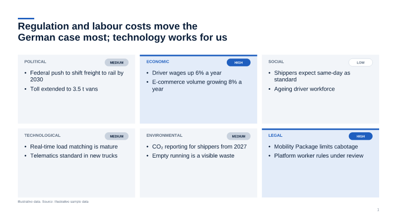

- **Use when:** Context for a market entry or long-term strategy; Scanning regulation and technology shifts before a plan
- **Avoid when:** Industry structure and competitors — use five-forces; Trends without an effect on the decision — cut them or use key-points
- **Frame:** standard (action title, tracker, lead and source line are drawn for you)

| Field | Type | Required | Limits | Description |
|---|---|---|---|---|
| `factors` | object[] | yes | 3–6 items | In PESTEL order; leave out factors that do not matter |
| `factors[].factor` | `political` \| `economic` \| `social` \| `technological` \| `environmental` \| `legal` | yes |  |  |
| `factors[].impact` | `low` \| `medium` \| `high` |  |  | How much this factor moves the business case |
| `factors[].points` | string[] | yes | 1–3 items, each ≤ 90 chars | Trend and its effect on us |
| `takeaway` | string |  | ≤ 140 chars | What the macro picture means, side panel |

<details><summary>Example</summary>

```yaml
- id: example
  layout: pestel
  title: Regulation and labour costs move the German case most; technology works for us
  sources:
    - market-est
  factors:
    - factor: political
      impact: medium
      points:
        - Federal push to shift freight to rail by 2030
        - Toll extended to 3.5 t vans
    - factor: economic
      impact: high
      points:
        - Driver wages up 6% a year
        - E-commerce volume growing 8% a year
    - factor: social
      impact: low
      points:
        - Shippers expect same-day as standard
        - Ageing driver workforce
    - factor: technological
      impact: medium
      points:
        - Real-time load matching is mature
        - Telematics standard in new trucks
    - factor: environmental
      impact: medium
      points:
        - CO₂ reporting for shippers from 2027
        - Empty running is a visible waste
    - factor: legal
      impact: high
      points:
        - Mobility Package limits cabotage
        - Platform worker rules under review
```

</details>

## business-model-canvas

**Business model canvas** — Use for the whole business model on one page: segments, value proposition, channels, relationships, revenue, resources, activities, partners and costs.


- **Use when:** A new business, product line or venture explained end to end; Comparing today’s model with a target model (one canvas per slide)
- **Avoid when:** Only the economics matter — use waterfall or data-table; Only the customer value matters — use key-points
- **Frame:** standard (action title, tracker, lead and source line are drawn for you)

| Field | Type | Required | Limits | Description |
|---|---|---|---|---|
| `partners` | string[] | yes | 1–5 items, each ≤ 60 chars | Key partners: who we rely on |
| `activities` | string[] | yes | 1–3 items, each ≤ 50 chars | Key activities: what we must do well |
| `resources` | string[] | yes | 1–3 items, each ≤ 50 chars | Key resources: what we must own |
| `value` | string[] | yes | 1–5 items, each ≤ 60 chars | Value propositions: why customers choose us (highlighted) |
| `relationships` | string[] | yes | 1–3 items, each ≤ 50 chars | Customer relationships: how we win and keep customers |
| `channels` | string[] | yes | 1–3 items, each ≤ 50 chars | Channels: how we reach and deliver |
| `segments` | string[] | yes | 1–5 items, each ≤ 60 chars | Customer segments: for whom |
| `costs` | string[] | yes | 1–3 items, each ≤ 70 chars | Cost structure: biggest costs |
| `revenue` | string[] | yes | 1–3 items, each ≤ 70 chars | Revenue streams: how we earn |

<details><summary>Example</summary>

```yaml
- id: example
  layout: business-model-canvas
  title: Fabrikam earns a take rate on capacity that carriers already drive
  sources:
    - fab-metrics
  partners:
    - Regional carriers
    - Telematics providers
    - Payment provider
  activities:
    - Real-time matching
    - Carrier onboarding
  resources:
    - Live capacity data
    - Pricing engine
  value:
    - Same-day part loads at up to 40% below full-load price
    - Booking in under a minute
    - Carriers earn on empty space
  relationships:
    - Self-serve with account managers for top 100
  channels:
    - Web app and API
    - Carrier mobile app
  segments:
    - Small shippers under 50 loads a month
    - Regional carriers with 5–200 trucks
  costs:
    - Engineering and data (45%)
    - Sales and onboarding (30%)
  revenue:
    - 21% take rate per load
    - Premium tracking subscription
```

</details>

## value-chain

**Value chain** — Use for showing where a business creates or loses value: Porter's primary activities in order, support activities across them, and the margin.


- **Use when:** Locating cost or value along the activities of a company or an industry; Showing where a new capability (AI, partner, automation) plugs into the business
- **Avoid when:** A process with owners and timing — use process-steps or timeline; Industry profitability — use five-forces
- **Frame:** standard (action title, tracker, lead and source line are drawn for you)

| Field | Type | Required | Limits | Description |
|---|---|---|---|---|
| `support` | object[] | yes | 0–4 items | Support activities across the chain (infrastructure, people, technology…) |
| `support[].name` | string | yes | ≤ 28 chars |  |
| `support[].point` | string |  | ≤ 110 chars | One line: what this function adds |
| `primary` | object[] | yes | 3–6 items | Primary activities in the order value flows to the customer |
| `primary[].name` | string | yes | ≤ 28 chars | Activity, e.g. "Inbound logistics", "Customer success" |
| `primary[].points` | string[] | yes | 0–3 items, each ≤ 80 chars | Where value is created or lost in this activity |
| `highlight` | integer[] |  |  | Indices of primary activities where the insight sits |
| `margin` | string |  | ≤ 14 chars | Label of the margin arrow; defaults to "Margin" in the deck language |
| `takeaway` | string |  | ≤ 140 chars | The so-what, in a band under the chain |

<details><summary>Example</summary>

```yaml
- id: example
  layout: value-chain
  title: Most of the margin is lost in fulfilment and service, not in production
  sources:
    - ops-review
  support:
    - name: Technology
      point: Planning on spreadsheets; no shared order data
    - name: People
      point: Two-thirds of service staff are temporary
    - name: Procurement
      point: Freight bought spot, lane by lane
  primary:
    - name: Inbound
      points:
        - Supplier lead times 9 days
    - name: Production
      points:
        - OEE 84%, at benchmark
    - name: Fulfilment
      points:
        - 12% of orders ship late
        - Express surcharges €3.1M
    - name: Sales
      points:
        - Win rate stable at 31%
    - name: Service
      points:
        - Returns cost 4.2% of revenue
  highlight:
    - 2
    - 4
  takeaway: "Fix fulfilment and returns first: €5M of margin sits in two activities"
```

</details>

## seven-s

**McKinsey 7S** — Use for checking whether an organisation is set up for a change: the seven elements, each rated aligned, partial or gap, with the evidence.


- **Use when:** Before a transformation, merger or new operating model: what must change besides strategy?; Explaining why a strategy is not landing
- **Avoid when:** Market or competitive factors — use swot, pestel or five-forces; A sequence of change steps — use process-steps or timeline
- **Frame:** standard (action title, tracker, lead and source line are drawn for you)

| Field | Type | Required | Limits | Description |
|---|---|---|---|---|
| `strategy` | object | yes |  |  |
| `strategy.status` | `aligned` \| `partial` \| `gap` | yes |  | aligned, partial or gap — how well it supports the change |
| `strategy.points` | string[] | yes | 1–2 items, each ≤ 70 chars | Evidence for the status |
| `structure` | object | yes |  |  |
| `structure.status` | `aligned` \| `partial` \| `gap` | yes |  | aligned, partial or gap — how well it supports the change |
| `structure.points` | string[] | yes | 1–2 items, each ≤ 70 chars | Evidence for the status |
| `systems` | object | yes |  |  |
| `systems.status` | `aligned` \| `partial` \| `gap` | yes |  | aligned, partial or gap — how well it supports the change |
| `systems.points` | string[] | yes | 1–2 items, each ≤ 70 chars | Evidence for the status |
| `sharedValues` | object | yes |  | The centre: what the organisation believes and rewards |
| `sharedValues.status` | `aligned` \| `partial` \| `gap` | yes |  | aligned, partial or gap — how well it supports the change |
| `sharedValues.points` | string[] | yes | 1–2 items, each ≤ 70 chars | Evidence for the status |
| `style` | object | yes |  |  |
| `style.status` | `aligned` \| `partial` \| `gap` | yes |  | aligned, partial or gap — how well it supports the change |
| `style.points` | string[] | yes | 1–2 items, each ≤ 70 chars | Evidence for the status |
| `staff` | object | yes |  |  |
| `staff.status` | `aligned` \| `partial` \| `gap` | yes |  | aligned, partial or gap — how well it supports the change |
| `staff.points` | string[] | yes | 1–2 items, each ≤ 70 chars | Evidence for the status |
| `skills` | object | yes |  |  |
| `skills.status` | `aligned` \| `partial` \| `gap` | yes |  | aligned, partial or gap — how well it supports the change |
| `skills.points` | string[] | yes | 1–2 items, each ≤ 70 chars | Evidence for the status |
| `takeaway` | string |  | ≤ 120 chars | Where to act first, shown under the diagram |

<details><summary>Example</summary>

```yaml
- id: example
  layout: seven-s
  title: Strategy and systems are ready for AI; skills and incentives are not
  sources:
    - org-review
  strategy:
    status: aligned
    points:
      - AI in the top three priorities for 2027
  structure:
    status: partial
    points:
      - AI team sits in IT, far from the business
  systems:
    status: aligned
    points:
      - Data platform and model access in place
  sharedValues:
    status: partial
    points:
      - Pilots celebrated; production use is not
  style:
    status: partial
    points:
      - Leaders sponsor, but rarely use the tools
  staff:
    status: gap
    points:
      - No engineers placed with the business teams
  skills:
    status: gap
    points:
      - Few people can scope and evaluate an AI use case
  takeaway: "Act on staff and skills first: embed engineers with the business owners"
```

</details>

## issue-tree

**Issue / driver tree** — Use for breaking a question into MECE sub-questions (issue tree) or a metric into its drivers (driver tree).

 

- **Use when:** Structuring a problem before the analysis (hypothesis tree); Showing which hypotheses the analysis confirmed or rejected; Explaining how a top-line metric decomposes into drivers
- **Avoid when:** A sequence of steps — use process-steps; More than ~10 leaves — split into two slides
- **Frame:** standard (action title, tracker, lead and source line are drawn for you)

| Field | Type | Required | Limits | Description |
|---|---|---|---|---|
| `root` | object | yes |  |  |
| `root.label` | string | yes | ≤ 90 chars | The question (issue) or the top metric (driver) |
| `root.value` | string |  | ≤ 12 chars |  |
| `branches` | object[] | yes | 2–4 items | MECE sub-questions or drivers; at most 10 leaves in total |
| `branches[].label` | string | yes | ≤ 60 chars |  |
| `branches[].value` | string |  | ≤ 12 chars |  |
| `branches[].status` | `confirmed` \| `rejected` \| `open` |  |  | Hypothesis status after analysis |
| `branches[].leaves` | object[] | yes | 1–4 items |  |
| `branches[].leaves[].label` | string | yes | ≤ 70 chars |  |
| `branches[].leaves[].value` | string |  | ≤ 12 chars | driver variant: the number this node contributes |
| `branches[].leaves[].status` | `confirmed` \| `rejected` \| `open` |  |  | Hypothesis status after analysis |
| `takeaway` | string |  | ≤ 140 chars |  |

<details><summary>Example</summary>

```yaml
- id: example
  layout: issue-tree
  variant: issue
  title: Margin fell because of mix and price, not cost — two of six hypotheses hold
  sources:
    - finance-fy25
  root:
    label: Why did operating margin fall 4 points in FY2025?
  branches:
    - label: Revenue mix shifted
      status: confirmed
      leaves:
        - label: More low-margin SMB deals
          status: confirmed
        - label: Fewer services attached
          status: open
    - label: Prices eroded
      status: confirmed
      leaves:
        - label: Discounting above policy
          status: confirmed
        - label: Competitor price cuts
          status: rejected
    - label: Costs rose
      status: rejected
      leaves:
        - label: Cloud costs per user
          status: rejected
        - label: Support headcount
          status: rejected
  takeaway: Fix discount governance and deal mix first; cost programmes would not move margin
```

</details>

## maturity-model

**Maturity model** — Use for showing where an organisation stands on a maturity scale and where it should get to — one capability as a staircase, or several on one grid.

 

- **Use when:** Capability assessments (data, AI, security, operations); Setting a target level and the gap per dimension; Explaining what the next level would look like
- **Avoid when:** Levels that do not build on each other — use key-points; Scores that are really numbers — use a bar chart
- **Frame:** standard (action title, tracker, lead and source line are drawn for you)

| Field | Type | Required | Limits | Description |
|---|---|---|---|---|
| `levels` | object[] | yes | 3–5 items | Maturity levels, lowest first |
| `levels[].name` | string | yes | ≤ 24 chars |  |
| `levels[].description` | string |  | ≤ 90 chars | What this level looks like (staircase) |
| `dimensions` | object[] |  | 1–6 items | grid variant: capabilities assessed on the levels |
| `dimensions[].name` | string | yes | ≤ 30 chars |  |
| `dimensions[].current` | integer | yes | 1…9007199254740991 | Level today, 1-based |
| `dimensions[].target` | integer | yes | 1…9007199254740991 | Level we aim for, 1-based |
| `current` | integer |  | 1…9007199254740991 | staircase variant: level today |
| `target` | integer |  | 1…9007199254740991 | staircase variant: target level |
| `targetLabel` | string |  | ≤ 30 chars | e.g. "Target by end of 2027" |

<details><summary>Example</summary>

```yaml
- id: example
  layout: maturity-model
  variant: grid
  title: Data foundations are a level behind the use cases we want to run next year
  sources:
    - assessment
  levels:
    - name: Ad hoc
    - name: Repeatable
    - name: Defined
    - name: Managed
    - name: Optimised
  dimensions:
    - name: Data quality
      current: 2
      target: 4
    - name: Governance and ownership
      current: 2
      target: 3
    - name: Platform and tooling
      current: 3
      target: 4
    - name: Skills and roles
      current: 1
      target: 3
    - name: Use-case delivery
      current: 3
      target: 4
  targetLabel: Target by end of 2027
```

</details>

## coverage-map

**Coverage map** — Use for showing the state of many functions at once on stable geometry — what is covered, partly covered, planned or missing.


- **Use when:** Capability or automation coverage across a value chain; Status of the same functions over successive snapshots; Where the gaps are before choosing priorities
- **Avoid when:** Fewer than six items — use key-points or a table; Statuses with dates and owners — use data-table or gate-matrix
- **Frame:** standard (action title, tracker, lead and source line are drawn for you)

| Field | Type | Required | Limits | Description |
|---|---|---|---|---|
| `groups` | object[] | yes | 2–6 items | Rows of functions or capabilities; keep the same rows between snapshots |
| `groups[].name` | string | yes | ≤ 24 chars |  |
| `groups[].items` | object[] | yes | 1–6 items |  |
| `groups[].items[].label` | string | yes | ≤ 28 chars |  |
| `groups[].items[].status` | `none` \| `planned` \| `partial` \| `full` | yes |  |  |
| `snapshot` | string |  | ≤ 30 chars | When the map was taken, e.g. "As of Q3 2026" |
| `statusLabels` | object |  |  | Words for the four states, e.g. "Live" instead of "Full" |
| `statusLabels.none` | string |  | ≤ 24 chars |  |
| `statusLabels.planned` | string |  | ≤ 24 chars |  |
| `statusLabels.partial` | string |  | ≤ 24 chars |  |
| `statusLabels.full` | string |  | ≤ 24 chars |  |

<details><summary>Example</summary>

```yaml
- id: example
  layout: coverage-map
  title: Automation covers most of order-to-cash; record-to-report is the gap to close next
  snapshot: As of Q3 2026
  statusLabels:
    full: Live
    partial: Partly live
    planned: Planned
    none: Manual
  groups:
    - name: Order-to-cash
      items:
        - label: Credit check
          status: full
        - label: Order entry
          status: full
        - label: Invoicing
          status: partial
        - label: Collections
          status: planned
    - name: Procure-to-pay
      items:
        - label: Requisitions
          status: full
        - label: Invoice matching
          status: partial
        - label: Payments
          status: full
    - name: Record-to-report
      items:
        - label: Journals
          status: none
        - label: Reconciliations
          status: planned
        - label: Consolidation
          status: none
        - label: Reporting
          status: partial
```

</details>

## architecture

**Architecture with register** — Use for showing where in a system a problem sits and what to do about it: components in zones, requests and responses, and a numbered register linked to markers on the diagram.


- **Use when:** Technology or data-flow findings tied to specific components; Controls, risks or changes that each belong to a part of the system; Explaining a target architecture with the decisions it needs
- **Avoid when:** A sequence of steps without components — use process-steps; Reporting lines — use org-chart
- **Frame:** standard (action title, tracker, lead and source line are drawn for you)

| Field | Type | Required | Limits | Description |
|---|---|---|---|---|
| `zones` | object[] | yes | 2–4 items | Columns left to right, e.g. channels → services → data |
| `zones[].name` | string | yes | ≤ 24 chars |  |
| `zones[].components` | object[] | yes | 1–4 items |  |
| `zones[].components[].id` | string | yes | ≤ 20 chars | Short key used by links |
| `zones[].components[].label` | string | yes | ≤ 28 chars |  |
| `zones[].components[].marker` | integer |  | 1…9 | Register number shown on the box |
| `zones[].components[].highlight` | boolean |  |  | The component the slide is about |
| `links` | object[] | yes | 0–8 items |  |
| `links[].from` | string | yes |  |  |
| `links[].to` | string | yes |  |  |
| `links[].marker` | integer |  | 1…9 |  |
| `links[].dashed` | boolean |  |  | Response or data returned, as opposed to a request |
| `register` | object[] | yes | 1–6 items | Numbered findings, risks or controls, linked to the markers on the diagram |
| `register[].marker` | integer | yes | 1…9 |  |
| `register[].title` | string | yes | ≤ 40 chars |  |
| `register[].text` | string | yes | ≤ 110 chars |  |

<details><summary>Example</summary>

```yaml
- id: example
  layout: architecture
  title: Two gaps in the order flow cause most failed orders; both have a known fix
  sources:
    - ops-review
  zones:
    - name: Channels
      components:
        - id: web
          label: Web shop
        - id: app
          label: Mobile app
    - name: Services
      components:
        - id: orders
          label: Order service
          highlight: true
          marker: 1
        - id: pay
          label: Payment gateway
    - name: Records
      components:
        - id: erp
          label: ERP
          marker: 2
        - id: crm
          label: CRM
  links:
    - from: web
      to: orders
    - from: app
      to: orders
    - from: orders
      to: pay
    - from: orders
      to: erp
    - from: erp
      to: crm
      dashed: true
  register:
    - marker: 1
      title: No retry on payment timeouts
      text: 2.1% of orders fail when the gateway is slow; add an idempotent retry with a 30-second window
    - marker: 2
      title: Nightly ERP sync
      text: Stock is up to 24 hours old; move to event-based updates for the 300 fastest-moving items
```

</details>

## evidence-chain

**Evidence chain** — Use for showing what an answer rests on: each check, its source and its result in order, ending in the conclusion and what would overturn it.


- **Use when:** Audit, compliance or due-diligence findings; Answering "how do we know?" for a recommendation; Acceptance decisions that depend on several tests
- **Avoid when:** Steps of a process — use process-steps; A single number — use kpi-tiles or big-statement
- **Frame:** standard (action title, tracker, lead and source line are drawn for you)

| Field | Type | Required | Limits | Description |
|---|---|---|---|---|
| `steps` | object[] | yes | 2–5 items |  |
| `steps[].check` | string | yes | ≤ 40 chars | What was checked |
| `steps[].source` | string | yes | ≤ 50 chars | Where the evidence comes from |
| `steps[].result` | `pass` \| `partial` \| `fail` \| `unknown` | yes |  |  |
| `steps[].finding` | string | yes | ≤ 100 chars | What the evidence shows |
| `conclusion` | string | yes | ≤ 130 chars | The answer the chain supports |
| `exception` | string |  | ≤ 130 chars | What would change the answer |
| `resultLabels` | object |  |  |  |
| `resultLabels.pass` | string |  | ≤ 14 chars |  |
| `resultLabels.partial` | string |  | ≤ 14 chars |  |
| `resultLabels.fail` | string |  | ≤ 14 chars |  |
| `resultLabels.unknown` | string |  | ≤ 14 chars |  |

<details><summary>Example</summary>

```yaml
- id: example
  layout: evidence-chain
  title: Four independent checks support releasing the new pricing to all regions
  sources:
    - pricing-pilot
  steps:
    - check: Conversion in pilot regions
      source: A/B test, 6 weeks, 41k visits
      result: pass
      finding: Conversion held at 3.1% vs 3.0% control; revenue per visit up 7%
    - check: Churn of existing customers
      source: Billing data, Q3
      result: pass
      finding: No change in monthly churn after the notice period
    - check: Sales team readiness
      source: Training records
      result: partial
      finding: 80% certified; the rest finish by 15 November
    - check: Legal review in the EU
      source: Counsel memo, Oct 2026
      result: unknown
      finding: Opinion expected next week for two markets
  conclusion: Release in all regions on 1 December, with the two EU markets following the legal opinion
  exception: A negative legal opinion would hold those two markets on current prices
```

</details>

## risk-matrix

**Risk heatmap** — Use for showing the main risks by likelihood and impact, with owners and mitigations.


- **Use when:** Risk sections of investment and programme decks; Steering-committee risk reviews; Pre-mortems
- **Avoid when:** Risks without any assessment — use data-table; More than eight risks — show the top ones and move the rest to backup
- **Frame:** standard (action title, tracker, lead and source line are drawn for you)

| Field | Type | Required | Limits | Description |
|---|---|---|---|---|
| `risks` | object[] | yes | 2–8 items |  |
| `risks[].id` | string | yes | ≤ 4 chars | Short id shown in the grid, e.g. "R1" |
| `risks[].title` | string | yes | ≤ 60 chars |  |
| `risks[].likelihood` | integer | yes | 1…3 | 1 low · 2 medium · 3 high |
| `risks[].impact` | integer | yes | 1…3 | 1 low · 2 medium · 3 high |
| `risks[].owner` | string |  | ≤ 22 chars |  |
| `risks[].mitigation` | string |  | ≤ 70 chars |  |

<details><summary>Example</summary>

```yaml
- id: example
  layout: risk-matrix
  title: Two high risks need owners this quarter; the rest are monitored
  sources:
    - market-model
  risks:
    - id: R1
      title: Partners under-deliver pipeline
      likelihood: 2
      impact: 3
      owner: Strategy
      mitigation: Quarterly targets with exit clauses
    - id: R2
      title: Localisation slips past Q2
      likelihood: 3
      impact: 3
      owner: Product
      mitigation: Dedicated squad, scope frozen
    - id: R3
      title: Rivals undercut on price
      likelihood: 3
      impact: 2
      owner: Sales
      mitigation: Price floor agreed with CFO
    - id: R4
      title: Data-residency audit delay
      likelihood: 1
      impact: 2
      owner: Legal
    - id: R5
      title: Key hire not found
      likelihood: 2
      impact: 1
      owner: HR
```

</details>

## process-steps

**Process steps** — Use for a sequence of 3–6 steps where order matters — an approach, a method or a customer journey.

 

- **Use when:** Explaining the approach or methodology; A phased plan without dates; How a product or process works
- **Avoid when:** Steps with dates and durations — use timeline (gantt); Unordered points — use key-points
- **Frame:** standard (action title, tracker, lead and source line are drawn for you)

| Field | Type | Required | Limits | Description |
|---|---|---|---|---|
| `steps` | object[] | yes | 3–6 items |  |
| `steps[].title` | string | yes | ≤ 36 chars | Verb-led step name, e.g. "Sign two partners" |
| `steps[].body` | string |  | ≤ 150 chars | What happens and the output of the step |
| `steps[].owner` | string |  | ≤ 30 chars |  |
| `steps[].icon` | `adjustments` \| `alert-triangle` \| `api` \| `arrow-right` \| `arrow-up-right` \| `arrows-exchange` \| `award` \| `bolt` \| `box` \| `brain` \| `briefcase` \| `building` \| `building-bank` \| `building-factory` \| `building-store` \| `bulb` \| `calendar` \| `cash` \| `certificate` \| `chart-arrows-vertical` \| `chart-bar` \| `chart-dots` \| `chart-line` \| `chart-pie` \| `check` \| `checklist` \| `circle-check` \| `clipboard-check` \| `clock` \| `cloud` \| `code` \| `coin` \| `compass` \| `components` \| `cpu` \| `currency-dollar` \| `currency-euro` \| `database` \| `device-laptop` \| `device-mobile` \| `eye` \| `file-analytics` \| `file-text` \| `flag` \| `flask` \| `gauge` \| `git-branch` \| `heart` \| `heart-handshake` \| `hierarchy` \| `home` \| `hourglass` \| `infinity` \| `info-circle` \| `layout-dashboard` \| `leaf` \| `lifebuoy` \| `link` \| `list-check` \| `lock` \| `mail` \| `map` \| `map-pin` \| `message` \| `messages` \| `microscope` \| `network` \| `package` \| `phone` \| `plane` \| `player-play` \| `plug` \| `presentation` \| `puzzle` \| `receipt` \| `refresh` \| `report-analytics` \| `robot` \| `rocket` \| `route` \| `run` \| `scale` \| `school` \| `search` \| `server` \| `settings` \| `shield` \| `shield-check` \| `shopping-cart` \| `sitemap` \| `sparkles` \| `speakerphone` \| `stack-2` \| `star` \| `stopwatch` \| `target` \| `terminal-2` \| `tool` \| `tools` \| `trending-down` \| `trending-up` \| `trophy` \| `truck` \| `user` \| `user-check` \| `user-search` \| `users` \| `users-group` \| `versions` \| `walk` \| `wand` \| `world` \| `x` \| `zoom-check` |  |  | Icon for the step (Tabler set); every step or none |
| `highlight` | integer |  | 0…9007199254740991 | Index of the step to emphasise (e.g. where we are now) |

<details><summary>Example</summary>

```yaml
- id: example
  layout: process-steps
  variant: chevrons
  title: A four-step partner-led entry limits risk at every stage
  steps:
    - title: Select partners
      body: Shortlist six resellers; sign two with exclusive mid-market rights
      owner: Strategy
    - title: Localise
      body: German UI, data residency in Frankfurt, local payment methods
      owner: Product
    - title: Launch pilots
      body: 15 reference clients through partners, success team on site
      owner: Sales
    - title: Scale direct
      body: Hire direct sales once 40 references are live
      owner: Country lead
  highlight: 0
```

</details>

## timeline

**Timeline** — Use for dated milestones or a phased roadmap on one shared time axis.

 

- **Use when:** Roadmaps and phased plans; History of how we got here; Project status against plan
- **Avoid when:** Steps without dates — use process-steps; More than 8 workstreams — split by phase
- **Frame:** standard (action title, tracker, lead and source line are drawn for you)

| Field | Type | Required | Limits | Description |
|---|---|---|---|---|
| `milestones` | object[] |  | 3–8 items | milestones variant |
| `milestones[].date` | string | yes | ≤ 16 chars |  |
| `milestones[].title` | string | yes | ≤ 40 chars |  |
| `milestones[].body` | string |  | ≤ 90 chars |  |
| `milestones[].highlight` | boolean |  |  |  |
| `periods` | string[] |  | 3–12 items, each ≤ 10 chars | gantt variant: column headers, e.g. "Q1 26" |
| `rows` | object[] |  | 2–8 items | gantt variant: workstreams on the shared period axis |
| `rows[].name` | string | yes | ≤ 30 chars | Workstream |
| `rows[].highlight` | boolean |  |  |  |
| `rows[].bars` | object[] | yes | 1–3 items |  |
| `rows[].bars[].start` | integer | yes | 0…9007199254740991 |  |
| `rows[].bars[].end` | integer | yes | 0…9007199254740991 | Inclusive period index |
| `rows[].bars[].label` | string |  | ≤ 30 chars |  |
| `today` | integer |  | 0…9007199254740991 | gantt: period index of "today" |

<details><summary>Example</summary>

```yaml
- id: example
  layout: timeline
  variant: milestones
  title: First German revenue lands in Q3 2027, nine months after the decision
  milestones:
    - date: Nov 2026
      title: Board decision
      body: Phase-1 budget of €6M approved
    - date: Jan 2027
      title: Partners signed
      body: Two resellers with mid-market rights
    - date: Apr 2027
      title: Localised product
      body: German UI and Frankfurt hosting live
    - date: Jul 2027
      title: First revenue
      body: 15 pilot clients go live
      highlight: true
    - date: Q1 2028
      title: Gate 2
      body: Scale direct sales if 40 references
```

</details>

## gate-matrix

**Stages and gates** — Use for a stage-gate plan: what each stage delivers and what evidence opens the next one, and who decides.


- **Use when:** Phased investments with go / no-go decisions; Pilots that scale only on evidence; Launch readiness
- **Avoid when:** Dates matter more than criteria — use timeline (gantt); More than four stages — group them
- **Frame:** standard (action title, tracker, lead and source line are drawn for you)

| Field | Type | Required | Limits | Description |
|---|---|---|---|---|
| `stages` | object[] | yes | 3–4 items |  |
| `stages[].name` | string | yes | ≤ 22 chars |  |
| `stages[].output` | string | yes | ≤ 90 chars | What the stage delivers |
| `gates` | object[] | yes |  | One gate on each boundary between stages (stages − 1) |
| `gates[].name` | string | yes | ≤ 18 chars |  |
| `gates[].criteria` | string[] | yes | 1–3 items, each ≤ 60 chars | Evidence needed to pass |
| `gates[].decider` | string | yes | ≤ 30 chars | Who decides at the gate |
| `current` | integer |  | 0…9007199254740991 | Index of the stage we are in now |

<details><summary>Example</summary>

```yaml
- id: example
  layout: gate-matrix
  title: Each phase is funded only when the previous gate shows evidence, capping risk at €6M
  sources:
    - market-model
  stages:
    - name: Pilot
      output: 15 partner-sourced clients live in two regions
    - name: Scale partners
      output: Four partners, 40 reference clients, unit economics proven
    - name: Go direct
      output: Direct sales team for enterprise accounts
  gates:
    - name: Gate 1
      criteria:
        - ≥ 15 signed clients
        - Churn below 3% a quarter
      decider: Board
    - name: Gate 2
      criteria:
        - ≥ 40 references
        - CAC payback under 18 months
      decider: Board + CFO
  current: 0
```

</details>

## process-compare

**Current vs proposed process** — Use for showing what changes in a process: today’s steps against the proposed ones, with changed steps highlighted.


- **Use when:** Operating-model or automation proposals; Before/after of a customer journey; Explaining where time or cost disappears
- **Avoid when:** A single process without a comparison — use process-steps; Organisational change without steps — use key-points
- **Frame:** standard (action title, tracker, lead and source line are drawn for you)

| Field | Type | Required | Limits | Description |
|---|---|---|---|---|
| `current` | object | yes |  | The process today |
| `current.label` | string | yes | ≤ 20 chars |  |
| `current.steps` | object[] | yes | 2–6 items |  |
| `current.steps[].label` | string | yes | ≤ 30 chars |  |
| `current.steps[].changed` | boolean |  |  |  |
| `current.steps[].note` | string |  | ≤ 48 chars |  |
| `current.metric` | string |  | ≤ 14 chars | Outcome of the lane, e.g. "9 days" |
| `proposed` | object | yes |  | The proposed process; mark steps that change with changed: true |
| `proposed.label` | string | yes | ≤ 20 chars |  |
| `proposed.steps` | object[] | yes | 2–6 items |  |
| `proposed.steps[].label` | string | yes | ≤ 30 chars |  |
| `proposed.steps[].changed` | boolean |  |  |  |
| `proposed.steps[].note` | string |  | ≤ 48 chars |  |
| `proposed.metric` | string |  | ≤ 14 chars | Outcome of the lane, e.g. "9 days" |
| `metricLabel` | string |  | ≤ 36 chars | What the lane metrics measure, e.g. "Order-to-cash time" |

<details><summary>Example</summary>

```yaml
- id: example
  layout: process-compare
  title: Automating credit checks and invoicing cuts order-to-cash from 9 days to 3
  sources:
    - finance-fy25
  metricLabel: Order-to-cash time
  current:
    label: Today
    metric: 9 days
    steps:
      - label: Order received
      - label: Manual credit check
        note: 2–3 days
      - label: Ship
      - label: Invoice by email
        note: 4 days
      - label: Payment
  proposed:
    label: Proposed
    metric: 3 days
    steps:
      - label: Order received
      - label: Automated credit check
        changed: true
        note: minutes
      - label: Ship
      - label: e-Invoice on dispatch
        changed: true
        note: same day
      - label: Payment
```

</details>

## cadence

**Role calendar** — Use for showing who takes part when: roles or forums against a shared calendar, with recurring meetings, decisions, outputs and work periods.


- **Use when:** Governance cadence: steerco, working groups, reviews; Planning cycles and reporting calendars; Who is needed in which week of a programme
- **Avoid when:** Workstreams with dependencies — use timeline (gantt); One-off milestones only — use timeline (milestones)
- **Frame:** standard (action title, tracker, lead and source line are drawn for you)

| Field | Type | Required | Limits | Description |
|---|---|---|---|---|
| `periods` | string[] | yes | 4–13 items, each ≤ 10 chars | Columns: weeks, months or sprints |
| `rows` | object[] | yes | 2–7 items |  |
| `rows[].name` | string | yes | ≤ 28 chars | Role, forum or team |
| `rows[].events` | object[] | yes | 0–13 items |  |
| `rows[].events[].at` | integer | yes | 0…9007199254740991 | Period index, 0-based |
| `rows[].events[].span` | integer |  | 1…9007199254740991 | Periods covered (work) |
| `rows[].events[].kind` | `meeting` \| `decision` \| `output` \| `work` | yes |  |  |
| `rows[].events[].label` | string |  | ≤ 18 chars |  |
| `today` | integer |  | 0…9007199254740991 | Highlight the current period |

<details><summary>Example</summary>

```yaml
- id: example
  layout: cadence
  title: A monthly rhythm keeps decisions with the steerco and work with the teams
  periods:
    - Jan
    - Feb
    - Mar
    - Apr
    - May
    - Jun
  today: 2
  rows:
    - name: Steering committee
      events:
        - at: 0
          kind: decision
          label: Budget
        - at: 2
          kind: decision
          label: Gate 1
        - at: 5
          kind: decision
          label: Gate 2
    - name: Programme office
      events:
        - at: 0
          kind: meeting
          label: Review
        - at: 1
          kind: meeting
          label: Review
        - at: 2
          kind: meeting
          label: Review
        - at: 3
          kind: meeting
          label: Review
        - at: 4
          kind: meeting
          label: Review
        - at: 5
          kind: meeting
          label: Review
    - name: Workstream leads
      events:
        - at: 0
          span: 3
          kind: work
          label: Pilot
        - at: 3
          span: 3
          kind: work
          label: Roll-out
    - name: Finance
      events:
        - at: 2
          kind: output
          label: Q1 report
        - at: 5
          kind: output
          label: H1 report
```

</details>

## callout

**Callouts and steps** — Use for showing someone how to do something on a screen or object: numbered callouts on the picture, the action and expected result for each, and how to check it worked.


- **Use when:** Training and onboarding: where to click, what to expect; Explaining a new tool, form or dashboard to its users; Field or lab procedures with a photo of the object
- **Avoid when:** Steps without a picture — use process-steps; A system view with findings — use architecture
- **Frame:** standard (action title, tracker, lead and source line are drawn for you)

| Field | Type | Required | Limits | Description |
|---|---|---|---|---|
| `image` | string |  |  | Screenshot or photo, relative to the deck file |
| `alt` | string | yes | ≤ 140 chars | What the image shows |
| `steps` | object[] | yes | 1–6 items |  |
| `steps[].action` | string | yes | ≤ 70 chars | What the reader does |
| `steps[].result` | string |  | ≤ 80 chars | What they should see |
| `steps[].x` | number |  | 0…1 | Callout position on the image, 0–1 from the left |
| `steps[].y` | number |  | 0…1 | Callout position on the image, 0–1 from the top |
| `check` | string |  | ≤ 110 chars | How to verify the result |

<details><summary>Example</summary>

```yaml
- id: example
  layout: callout
  title: Approving an invoice takes three clicks and shows a green status when done
  image: examples/narrative-story/assets/reconciliation.png
  alt: Screenshot of the invoice queue with the approve button and status column
  steps:
    - action: Open the invoice from the queue
      result: The detail pane opens on the right
      x: 0.22
      y: 0.3
    - action: Check amount and cost centre
      result: Both fields are filled; mismatches show in red
      x: 0.62
      y: 0.45
    - action: Click Approve
      result: "Status turns green: Approved"
      x: 0.8
      y: 0.78
  check: The invoice leaves your queue and appears under Approved today
```

</details>

## team-cards

**Team cards** — Use for introducing the people behind a proposal: who leads, who delivers, who the client sponsors are.

 

- **Use when:** Proposal or engagement team slide with two to six people; Steering committee, governance or advisory board line-up; Named owners of a program after the decision
- **Avoid when:** More than six people — group by team in a table (data-table); Assigning actions to people — use next-steps; A sequence of responsibilities over time — use timeline
- **Frame:** standard (action title, tracker, lead and source line are drawn for you)

| Field | Type | Required | Limits | Description |
|---|---|---|---|---|
| `people` | object[] | yes | 2–6 items | The people, in order of importance; more than four are shown in two rows |
| `people[].name` | string | yes | ≤ 40 chars | Full name |
| `people[].role` | string | yes | ≤ 50 chars | Role or title, plus the relevant function |
| `people[].bio` | string |  | ≤ 150 chars | One sentence of relevant experience; credentials, not a life story |
| `people[].image` | string |  |  | Path to a portrait photo, relative to the deck file; empty shows a placeholder |

<details><summary>Example</summary>

```yaml
- id: example
  layout: team-cards
  variant: cards
  title: A senior team that has run three German launches leads the entry
  people:
    - name: Anna Keller
      role: Managing Director, DACH
      bio: Built Fabrikam’s German business from zero to €60M in five years.
    - name: Marcus Lindgren
      role: Head of Partnerships
      bio: Signed 40 channel partners across the Nordics and the DACH region.
    - name: Priya Nair
      role: Chief Financial Officer
      bio: Led the Contoso carve-out and two cross-border integrations.
    - name: Tomas Weber
      role: Program Director
      bio: Ran Northwind’s UK platform migration on time and 8% under budget.
```

</details>

## org-chart

**Org chart** — Use for a reporting structure two levels deep: who leads, which units report to them and who sits in each.


- **Use when:** Programme or project governance; A proposed organisation — highlight the new or changing unit; Showing the team that will deliver
- **Avoid when:** Decision rights matter more than lines — use raci; Biographies matter — use team-cards
- **Frame:** standard (action title, tracker, lead and source line are drawn for you)

| Field | Type | Required | Limits | Description |
|---|---|---|---|---|
| `root` | object | yes |  | Top of the chart |
| `root.name` | string | yes | ≤ 36 chars | Person or unit name |
| `root.role` | string |  | ≤ 48 chars |  |
| `units` | object[] | yes | 2–5 items | Direct reports or units |
| `units[].name` | string | yes | ≤ 36 chars | Person or unit name |
| `units[].role` | string |  | ≤ 48 chars |  |
| `units[].members` | string[] |  | 0–4 items, each ≤ 40 chars | Up to four names or sub-teams listed under the unit |
| `units[].highlight` | boolean |  |  | Emphasise this unit (new, changing, the ask) |

<details><summary>Example</summary>

```yaml
- id: example
  layout: org-chart
  title: A small transformation office reports to the COO and owns the four workstreams
  root:
    name: Transformation office
    role: "Sponsor: Chief Operating Officer"
  units:
    - name: Customer onboarding
      role: "Lead: Head of Sales Ops"
      members:
        - Process design
        - CRM changes
    - name: Finance automation
      role: "Lead: Financial Controller"
      members:
        - Credit checks
        - e-Invoicing
        - Close
    - name: Data platform
      role: "Lead: new hire, Q1"
      members:
        - Data model
        - Quality rules
        - Reporting
      highlight: true
    - name: Change and training
      role: "Lead: HR Business Partner"
      members:
        - Communications
        - Training
```

</details>

## raci

**RACI / decision rights** — Use for showing who is Responsible, Accountable, Consulted and Informed for each decision or activity.


- **Use when:** Governance of a programme or new operating model; Clarifying decision rights before a launch; Hand-offs between teams
- **Avoid when:** Just listing team members — use team-cards; More than 7 roles — group roles first
- **Frame:** standard (action title, tracker, lead and source line are drawn for you)

| Field | Type | Required | Limits | Description |
|---|---|---|---|---|
| `roles` | string[] | yes | 3–7 items, each ≤ 18 chars | Columns: roles or teams, short names |
| `activities` | string[] | yes | 3–9 items, each ≤ 56 chars | Rows: decisions or activities |
| `cells` | `R` \| `A` \| `C` \| `I` \| `A/R` \| ``[][] | yes |  | One row per activity, one code per role: R, A, C, I, A/R or empty |
| `note` | string |  | ≤ 140 chars |  |

<details><summary>Example</summary>

```yaml
- id: example
  layout: raci
  title: One accountable owner per decision ends the pricing stalemate
  roles:
    - CEO
    - CFO
    - Sales
    - Product
    - Legal
  activities:
    - Set list prices
    - Approve discounts above 15%
    - Change packaging
    - Sign partner contracts
    - Publish price changes
  cells:
    - - I
      - A
      - C
      - R
      - ""
    - - ""
      - A
      - R
      - I
      - ""
    - - I
      - C
      - C
      - A/R
      - ""
    - - A
      - C
      - R
      - ""
      - C
    - - ""
      - I
      - R
      - A
      - C
  note: Today three of five decisions have two or more accountable owners
```

</details>

## next-steps

**Next steps** — Use for the closing slide that turns the recommendation into owned, dated actions, with or without the decision requested.

 

- **Use when:** Last content slide before the appendix; Steering committee wrap-up that assigns owners and dates; A decision slide that pairs the ask with the first steps after approval
- **Avoid when:** A plan with phases and durations — use timeline or process-steps; Introducing the people involved — use team-cards; Restating the whole argument — use exec-summary
- **Frame:** standard (action title, tracker, lead and source line are drawn for you)

| Field | Type | Required | Limits | Description |
|---|---|---|---|---|
| `decision` | string |  | ≤ 160 chars | The ask, one sentence that starts with a verb: "Approve a €6M phase-1 budget and the partner shortlist". Required for the decision variant |
| `steps` | object[] | yes | 1–7 items | The next steps in the order they happen |
| `steps[].action` | string | yes | ≤ 110 chars | A concrete action that starts with a verb and has a visible result |
| `steps[].owner` | string | yes | ≤ 30 chars | One accountable person or role, never a team |
| `steps[].due` | string | yes | ≤ 20 chars | A date or milestone: "21 Nov", "Week 48", "Q1 2027" |

<details><summary>Example</summary>

```yaml
- id: example
  layout: next-steps
  variant: actions
  title: Six actions in the next 30 days put the German launch on track
  steps:
    - action: Confirm the phase-1 budget with the board and release the first tranche
      owner: P. Nair
      due: 14 Nov
    - action: Sign letters of intent with the three shortlisted partners
      owner: M. Lindgren
      due: 28 Nov
    - action: Register the German entity and open the operating accounts
      owner: P. Nair
      due: 5 Dec
    - action: Localize the product and complete the data-residency review
      owner: E. Rossi
      due: 19 Dec
    - action: Hire the country lead and two partner managers in Munich
      owner: A. Keller
      due: Q1 2027
    - action: Run the first quarterly gate review against the exit criteria
      owner: T. Weber
      due: Mar 2027
```

</details>
