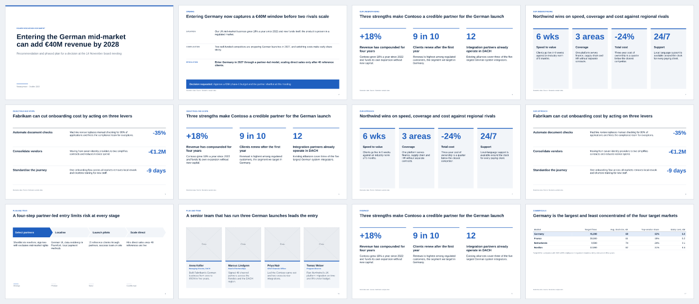
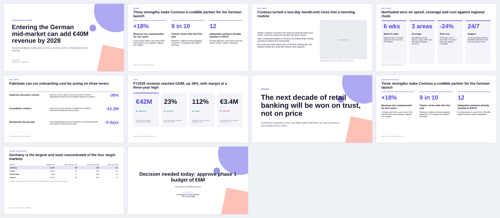

<!-- Generated by `slidecraft gen` — do not edit by hand. -->
# Storylines

> **Audience:** deck authors, agents and contributors · **Generated from:** library/storylines/*.yaml · **Version:** 0.1.0

A storyline is the shape of the argument for a kind of task. `slidecraft templates --brief brief.yaml` ranks them against your brief; `slidecraft scaffold` turns the chosen one into a ghost deck.

| Storyline | Arc | Best for | Themes |
|---|---|---|---|
| [`business-case`](#business-case) | Recommendation and ask → problem and opportunity → options → economics → risks and sensitivities → funding ask and gates | business case, investment, budget request, funding, capex, ROI | consulting-classic, executive |
| [`case-study`](#case-study) | Context → challenge → what we did → results → what we learned → what we would do differently → recommendations | case study, lessons learned, retrospective, post-mortem, project review, success story | editorial, midnight, consulting-classic |
| [`client-proposal`](#client-proposal) | Our understanding → objectives and scope → approach → plan → team → evidence → commercials → next steps | proposal, RFP response, tender, bid, pitch to client, statement of work | consulting-classic, executive, corporate-blue |
| [`executive-update`](#executive-update) | Headline status (RAG) → plan vs actual vs forecast → what changed → risks and issues → decisions needed | status report, steerco, steering committee, QBR, board update, progress update | executive, consulting-classic, corporate-blue |
| [`narrative-story`](#narrative-story) | Hook → stakes → journey → turning point → insight → call to action | storytelling, keynote, talk, share experience, conference, all-hands | midnight, editorial, modern-pitch |
| [`pitch-deck`](#pitch-deck) | Problem → solution → why now → market → product → business model → traction → competition → go-to-market → team → financials → ask | pitch deck, investor, fundraising, seed, series A, venture capital | modern-pitch, midnight, corporate-blue |
| [`product-overview`](#product-overview) | Job to be done → how it works → key features → proof → roadmap → pricing and packaging → call to action | product overview, product launch, launch, go-to-market, release, product demo | modern-pitch, corporate-blue, editorial |
| [`research-readout`](#research-readout) | Research question → method and sample → key findings → implications → recommendations → appendix | research readout, findings, survey results, user research, market research, customer research | editorial, consulting-classic, corporate-blue |
| [`strategy-recommendation`](#strategy-recommendation) | Situation → Complication → Resolution (answer) → 3 reasons → plan → risks → ask | strategy, recommendation, decision, market entry, investment decision, growth strategy | consulting-classic, executive, corporate-blue |

## business-case

**Business case** — Investment or budget request — the problem, options including do-nothing, the economics, risks and sensitivities, a recommendation, and a gated funding ask.

- **Arc:** Recommendation and ask → problem and opportunity → options → economics → risks and sensitivities → funding ask and gates
- **Length:** 8–16 slides · **Audiences:** investment committee, CFO, executive committee, board, budget holder, finance

**Principles**

- Put the recommendation and the amount requested on page two. The rest is the proof.
- Always include do-nothing as a costed option. It is the real baseline for every benefit.
- Show the economics as a bridge that adds up, with assumptions visible and sourced.
- Show sensitivities and the break-even point. A case that survives its downside is a credible one.
- Release money in tranches tied to gates with explicit evidence, not as a single cheque.

| Section | Slot | Purpose | Layouts | Required |
|---|---|---|---|---|
| Opening | `cover` | Name the investment and the decision being requested. | `title` | yes |
| Opening | `summary` | Give the problem, recommended option, economics and ask on one page. | `exec-summary` | yes |
| Problem and opportunity | `problem` ×1–2 | Show the problem or opportunity is real, quantified and urgent. | `chart-takeaway`, `kpi-tiles`, `big-statement` | yes |
| Problem and opportunity | `drivers` | Explain why the status quo will not fix this and why act now. | `timeline`, `key-points`, `big-statement` | optional |
| Options | `options` | Compare the realistic options, including do-nothing, on the same criteria. | `options-comparison`, `matrix-2x2` | yes |
| Economics | `costs` | Show total investment and run costs of the recommended option. | `data-table`, `chart-takeaway` | yes |
| Economics | `value` | Show how benefits build up and what they are worth. | `waterfall`, `chart-takeaway` | yes |
| Economics | `returns` | Show net return versus do-nothing — NPV, payback and cumulative cash. | `waterfall`, `chart-takeaway`, `kpi-tiles` | yes |
| Risks and sensitivities | `sensitivities` | Show how the case behaves when key assumptions turn out worse. | `chart-takeaway`, `data-table` | yes |
| Risks and sensitivities | `risks` | Name the main delivery and benefit risks and how each is controlled. | `data-table`, `matrix-2x2` | yes |
| Recommendation and funding | `recommendation` | State the recommended option and why, tied to the decision criteria. | `big-statement`, `key-points` | yes |
| Recommendation and funding | `roadmap` | Show the delivery plan and where benefits arrive. | `timeline`, `process-steps` | optional |
| Recommendation and funding | `funding` | Request a specific sum, released in tranches against named gates. | `next-steps`, `data-table` | yes |

## case-study

**Case study** — Lessons-learned story of a project or initiative — context, challenge, what we did, results, what we learned, what we would do differently, and recommendations.

- **Arc:** Context → challenge → what we did → results → what we learned → what we would do differently → recommendations
- **Length:** 8–16 slides · **Audiences:** peers and practitioners, leadership team, project teams, community of practice, prospective clients

**Principles**

- Tell it as a story with a clear question, such as "How did we cut release time by 70%?" and keep returning to it.
- Separate what happened (facts, dates, numbers) from what we conclude (lessons). Never blur them.
- Be honest about mistakes and constraints. Candour is what makes the lessons believable.
- Every lesson is transferable. State it so a team in another context could apply it.
- Close on what the audience should do differently, not on a recap of the project.

| Section | Slot | Purpose | Layouts | Required |
|---|---|---|---|---|
| Context and challenge | `cover` | Name the case and the question it answers. | `title` | yes |
| Context and challenge | `context` | Give the audience just enough background to follow the story. | `text-image`, `key-points`, `kpi-tiles` | yes |
| Context and challenge | `challenge` | Explain the problem we faced and why it was hard. | `big-statement`, `key-points`, `chart-takeaway` | yes |
| What we did | `approach` | Show what we did, in order, and the key decisions on the way. | `timeline`, `process-steps` | yes |
| What we did | `detail` ×0–3 | Go deeper on the one or two moves that made the difference. | `text-image`, `key-points`, `chart-takeaway` | optional |
| Results | `results` | Show what we achieved against the starting point and the goal. | `kpi-tiles`, `chart-takeaway`, `waterfall` | yes |
| Results | `voices` | Add the human view of the result from users, customers or the team. | `big-statement`, `text-image` | optional |
| Lessons | `lessons` ×1–2 | State what worked and what we learned, as transferable lessons. | `key-points`, `big-statement` | yes |
| Lessons | `do-differently` | Be candid about what we would change if we started again. | `options-comparison`, `key-points`, `data-table` | yes |
| Recommendations | `recommendations` | Tell the audience what to do with these lessons. | `next-steps`, `key-points` | yes |

## client-proposal

**Client proposal** — Proposal to a client — our understanding of the problem kept apart from our approach, then scope, plan, team, proof, commercials and next steps.

- **Arc:** Our understanding → objectives and scope → approach → plan → team → evidence → commercials → next steps
- **Length:** 10–20 slides · **Audiences:** client executive, procurement committee, project sponsor, selection panel, buying committee

**Principles**

- Understanding comes first and stands alone. The client must recognise their own situation before they hear our solution.
- Use the client's words and numbers from the brief or interviews, not our template language.
- Every part of the approach traces to an objective. Cut method that serves no stated goal.
- Proof beats claims. Two relevant cases with outcomes outweigh a page of credentials.
- Make the price easy to compare. Show what is in, what is out and the assumptions behind the fee.

| Section | Slot | Purpose | Layouts | Required |
|---|---|---|---|---|
| Opening | `cover` | Name the client, the engagement and the date. | `title` | yes |
| Opening | `summary` | Summarise the situation, what we propose, why us and the ask on one page. | `exec-summary` | yes |
| Our understanding | `context` | Show we understand the client's situation and ambition in their terms. | `text-image`, `key-points`, `kpi-tiles` | yes |
| Our understanding | `challenge` | Define the core problem or opportunity and why it matters now. | `key-points`, `chart-takeaway`, `big-statement` | yes |
| Objectives and scope | `objectives` | State what success looks like for the client, as measurable outcomes. | `key-points`, `kpi-tiles` | yes |
| Objectives and scope | `scope` | Fix what is in scope, out of scope and assumed, to prevent later disputes. | `options-comparison`, `data-table`, `key-points` | yes |
| Our approach | `approach` | Show how we will reach the objectives, phase by phase. | `process-steps`, `key-points` | yes |
| Our approach | `method` ×0–3 | Explain the specific methods, tools or assets that make our approach different. | `key-points`, `text-image`, `matrix-2x2` | optional |
| Plan and team | `plan` | Show the timeline, milestones and the client's role in them. | `timeline`, `process-steps` | yes |
| Plan and team | `team` | Introduce the people who will do the work and their relevant experience. | `team-cards` | yes |
| Evidence | `cases` ×1–3 | Prove we have solved a comparable problem, with results. | `text-image`, `kpi-tiles`, `key-points` | yes |
| Commercials | `fees` | Present the fee, what it covers and the terms. | `data-table`, `options-comparison` | yes |
| Next steps | `next-steps` | Make agreeing and starting easy, with owners and dates. | `next-steps` | yes |

## executive-update

**Executive update** — Status-first update for a board or steerco — RAG headline, plan vs actual vs forecast, what changed, risks and issues, and the decisions needed.

- **Arc:** Headline status (RAG) → plan vs actual vs forecast → what changed → risks and issues → decisions needed
- **Length:** 6–12 slides · **Audiences:** board, steering committee, executive committee, sponsors, leadership team

**Principles**

- Lead with the overall status and the one thing that needs attention. Never bury a red.
- Plan, actual and forecast share one axis and one unit, so the gap is visible at a glance.
- Report change since the last meeting. Do not re-explain the project every time.
- Every risk or issue has an owner, a mitigation and a date. A list of worries is not a status.
- Close with decisions requested, each with an owner and a deadline. If nothing needs deciding, shorten the deck.

| Section | Slot | Purpose | Layouts | Required |
|---|---|---|---|---|
| Headline | `cover` | Identify the programme, the period and the status owner. | `title` | yes |
| Headline | `status` | Give the overall RAG status, the headline message and the asks on one page. | `exec-summary`, `key-points`, `kpi-tiles` | yes |
| Performance | `kpis` | Show the few metrics that define success against target. | `kpi-tiles`, `data-table` | yes |
| Performance | `plan-vs-actual` ×1–3 | Show where we are against plan and where we expect to land, on one axis. | `chart-takeaway`, `timeline`, `waterfall` | yes |
| Performance | `milestones` | Show milestone delivery, what slipped and the effect on the end date. | `timeline`, `data-table` | optional |
| What changed | `changes` | Say what moved since the last meeting, and why. | `key-points`, `data-table` | yes |
| Risks and issues | `risks` | Show the top risks and live issues with exposure, owner and mitigation. | `data-table`, `matrix-2x2` | yes |
| Decisions and next steps | `decisions` | Ask for explicit decisions, with owner and date, and list the actions that follow. | `next-steps` | yes |
| Backup | `appendix` ×0–4 | Hold detail the committee may ask about without crowding the main flow. | `data-table`, `chart-takeaway`, `timeline` | optional |

## narrative-story

**Narrative story** — A story-led talk that makes one idea memorable — hook, stakes, journey, turning point, insight and a call to action.

- **Arc:** Hook → stakes → journey → turning point → insight → call to action
- **Length:** 8–20 slides · **Audiences:** conference audience, all-hands, community, customers, team

**Principles**

- One idea the audience should remember; every slide serves it.
- Show, don't list — one image, one number or one sentence per slide.
- Put the tension early; the insight lands only after a turning point.
- Use real moments, names (with permission) and numbers to make it concrete.
- End with one thing the audience can do tomorrow.

| Section | Slot | Purpose | Layouts | Required |
|---|---|---|---|---|
| Hook | `cover` | Promise the idea in a line that makes people curious. | `title` | yes |
| Hook | `hook` | Open with a moment, a surprising number or a question that creates tension. | `big-statement`, `text-image` | yes |
| Stakes | `stakes` | Make the audience care — what is at risk and for whom. | `big-statement`, `kpi-tiles`, `text-image` | yes |
| Journey | `journey` ×2–5 | Walk through what happened, in order, with the obstacles faced. | `timeline`, `text-image`, `process-steps` | yes |
| Journey | `turning-point` | Show the moment things changed and what caused it. | `big-statement`, `chart-takeaway`, `text-image` | yes |
| Insight | `insight` | State the transferable lesson as a crisp claim. | `big-statement`, `key-points` | yes |
| Insight | `proof` | Prove the lesson generalises beyond this story. | `chart-takeaway`, `kpi-tiles`, `big-statement` | optional |
| Call to action | `cta` | Leave the audience with one thing to do and how to reach you. | `title`, `next-steps` | yes |

## pitch-deck

**Pitch deck** — Investor pitch — the problem, the solution, why now, market, product, business model, traction, competition, go-to-market, team, financials and the ask.

- **Arc:** Problem → solution → why now → market → product → business model → traction → competition → go-to-market → team → financials → ask
- **Length:** 10–16 slides · **Audiences:** venture investors, angel investors, accelerator panel, strategic investors, corporate venture

**Principles**

- One message per slide, and one visual. The deck must be understood in three minutes of skimming.
- Traction goes as early as it is strong. Real numbers beat any claim about the market.
- Size the market bottom-up (customers times price) and show the maths. A top-down percentage invites doubt.
- Name real competitors and say honestly why you win. Never claim there is none.
- Close with a precise ask, covering how much, for what runway and which milestones it buys.

| Section | Slot | Purpose | Layouts | Required |
|---|---|---|---|---|
| Opening | `cover` | State what the company does in a line that sticks. | `title` | yes |
| Problem and solution | `problem` | Make the audience feel a painful, frequent and expensive problem. | `big-statement`, `key-points`, `kpi-tiles` | yes |
| Problem and solution | `solution` | Show how the product removes the pain, in one view. | `text-image`, `key-points` | yes |
| Problem and solution | `why-now` | Explain what changed that makes this possible and necessary today. | `timeline`, `key-points`, `chart-takeaway` | yes |
| Market and product | `market` | Show the market is large enough to build a big company, using a credible build-up. | `chart-takeaway`, `kpi-tiles` | yes |
| Market and product | `product` ×1–3 | Show the product working, and what is hard to copy. | `text-image`, `process-steps`, `key-points` | yes |
| Market and product | `business-model` | Show how the company makes money and why the unit economics work. | `key-points`, `data-table`, `kpi-tiles` | yes |
| Proof | `traction` ×1–2 | Prove demand with the strongest metrics, trending the right way. | `chart-takeaway`, `kpi-tiles`, `big-statement` | yes |
| Proof | `competition` | Position against real alternatives and show where we win. | `matrix-2x2`, `options-comparison` | yes |
| Proof | `go-to-market` | Show how we will win customers repeatably and affordably. | `process-steps`, `key-points`, `chart-takeaway` | yes |
| Team and financials | `team` | Show why this team is the one to win. | `team-cards` | yes |
| Team and financials | `financials` | Show the plan the money buys and the milestones it reaches. | `chart-takeaway`, `data-table`, `waterfall` | yes |
| The ask | `ask` | State how much we are raising, for what, and the milestones it buys. | `kpi-tiles`, `key-points`, `big-statement` | yes |

## product-overview

**Product overview** — Product or launch overview for customers or internal stakeholders — the job to be done, how it works, key features, proof, roadmap, packaging and a call to action.

- **Arc:** Job to be done → how it works → key features → proof → roadmap → pricing and packaging → call to action
- **Length:** 8–16 slides · **Audiences:** prospective customers, customers, sales team, internal stakeholders, partners, leadership team

**Principles**

- Start with the customer's job and pain, in their words. The product appears only after the need is clear.
- Describe benefits first and features second. Each feature title states what the user can now do.
- Show the real product (screens, a flow, a number) rather than adjectives.
- Proof is specific. A named customer with a measured result beats "trusted by leaders".
- End with one action for this audience, not a menu of options.

| Section | Slot | Purpose | Layouts | Required |
|---|---|---|---|---|
| Opening | `cover` | Name the product and its promise in one line. | `title` | yes |
| Opening | `job` | Frame the job the customer is trying to get done and why it is hard today. | `big-statement`, `key-points`, `text-image` | yes |
| How it works | `how-it-works` | Show the product's core flow in three to five steps. | `process-steps`, `text-image` | yes |
| How it works | `features` ×1–3 | Present the key capabilities and the benefit of each. | `key-points`, `text-image` | yes |
| How it works | `differentiators` | Show what makes this product different from alternatives. | `options-comparison`, `matrix-2x2`, `key-points` | optional |
| Proof | `results` | Prove the product delivers, with metrics from real usage. | `kpi-tiles`, `chart-takeaway` | yes |
| Proof | `testimonial` | Add a credible voice from a customer or user. | `big-statement`, `text-image` | optional |
| Roadmap and packaging | `roadmap` | Show where the product is going and when, to build confidence without overpromising. | `timeline`, `key-points` | yes |
| Roadmap and packaging | `packaging` | Make the offer and its price clear, and help the buyer choose. | `data-table`, `options-comparison` | yes |
| Call to action | `cta` | Tell the audience the single next step and how to take it. | `next-steps`, `title` | yes |

## research-readout

**Research readout** — Findings readout for a survey, user research or analysis — the question, method and sample, one finding per slide, implications, recommendations and an appendix.

- **Arc:** Research question → method and sample → key findings → implications → recommendations → appendix
- **Length:** 8–20 slides · **Audiences:** product team, leadership team, stakeholders, marketing team, client, research community

**Principles**

- Open with the question and the top-line answer, so the audience knows what the research settles.
- One finding per slide, and the title is the finding stated as a sentence with its number.
- Show the evidence that carries the claim, whether a chart, a quote or both. Do not show every cut of the data.
- State sample size, method and limits plainly. Say what the data cannot tell us.
- Separate findings (what we saw) from implications (what it means) and recommendations (what to do).

| Section | Slot | Purpose | Layouts | Required |
|---|---|---|---|---|
| Framing | `cover` | Name the study, the team and the date. | `title` | yes |
| Framing | `question` | State the question the research was meant to answer and why it matters. | `big-statement`, `key-points` | yes |
| Framing | `summary` | Give the answer, the key findings and the recommendations in one view. | `exec-summary`, `key-points` | yes |
| Method and sample | `method` | Show how the research was done and who took part, so the findings can be trusted. | `key-points`, `kpi-tiles`, `process-steps` | yes |
| Findings | `finding` ×3–8 | Report one finding with the evidence that supports it. | `chart-takeaway`, `key-points`, `big-statement`, `data-table` | yes |
| Findings | `segments` | Show where results differ meaningfully between groups. | `data-table`, `chart-takeaway`, `matrix-2x2` | optional |
| Findings | `voices` ×0–3 | Make the numbers human with verbatim evidence. | `big-statement`, `text-image` | optional |
| Implications and recommendations | `implications` | Explain what the findings mean for the business or product. | `key-points`, `matrix-2x2`, `options-comparison` | yes |
| Implications and recommendations | `recommendations` | Recommend specific actions ranked by impact and effort. | `data-table`, `matrix-2x2`, `key-points` | yes |
| Implications and recommendations | `next-steps` | Say what happens next and what further research is needed. | `next-steps` | yes |
| Appendix | `method-detail` | Document the method in enough detail to audit or replicate it. | `data-table`, `key-points` | optional |
| Appendix | `detail` ×0–6 | Hold the full tables and extra cuts that back up the main findings. | `data-table`, `chart-takeaway` | optional |

## strategy-recommendation

**Strategy recommendation** — Answer-first recommendation for a decision maker — the governing thought up front, three reasons, the plan and the ask.

- **Arc:** Situation → Complication → Resolution (answer) → 3 reasons → plan → risks → ask
- **Length:** 8–18 slides · **Audiences:** board, executive committee, CEO, investment committee, steering committee

**Principles**

- State the recommendation on slide 2. Everything after proves it.
- Read the action titles alone — they must argue the full case.
- Each reason is MECE with the others and has its own evidence slide(s).
- Every number carries a source; illustrative data is labelled as such.
- End with an explicit decision request, owner and date.

| Section | Slot | Purpose | Layouts | Required |
|---|---|---|---|---|
| Opening | `cover` | Frame the decision the audience is here to make. | `title` | yes |
| Opening | `summary` | Give the whole argument on one page — situation, complication, resolution and the ask. | `exec-summary` | yes |
| Why change | `context` | Establish the situation the audience already accepts, quantified. | `kpi-tiles`, `chart-takeaway` | yes |
| Why change | `complication` | Show what changed and why waiting is costly. | `chart-takeaway`, `timeline`, `big-statement` | yes |
| The recommendation | `options` | Show the options considered and why the recommended one wins on the criteria that matter. | `options-comparison`, `matrix-2x2` | yes |
| The recommendation | `reasons` ×2–4 | Prove each of the three reasons behind the recommendation, one slide each. | `chart-takeaway`, `waterfall`, `key-points`, `data-table` | yes |
| The recommendation | `value` | Quantify the value at stake and how it builds up. | `waterfall`, `kpi-tiles` | optional |
| How we get there | `plan` | Show the phased plan with gates between phases. | `timeline`, `process-steps` | yes |
| How we get there | `risks` | Name the main risks and how each is mitigated. | `data-table`, `matrix-2x2` | optional |
| Decision | `ask` | Make the decision explicit — what, who, by when — and the immediate next steps. | `next-steps` | yes |
