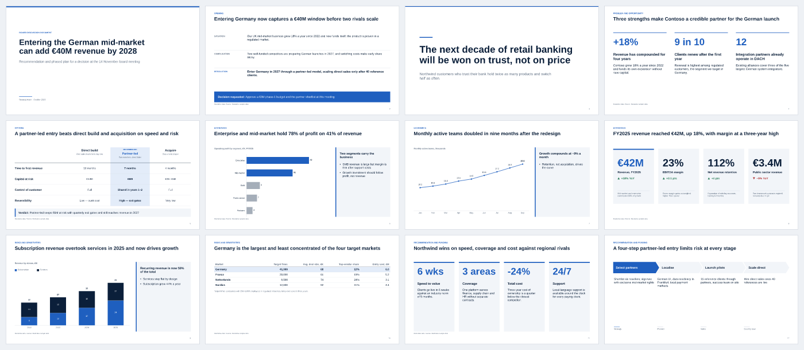
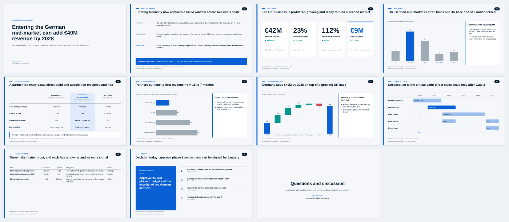
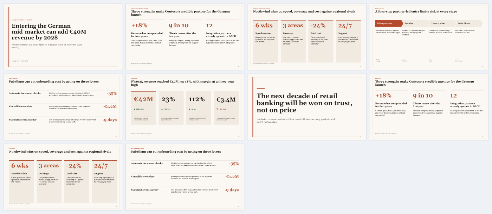
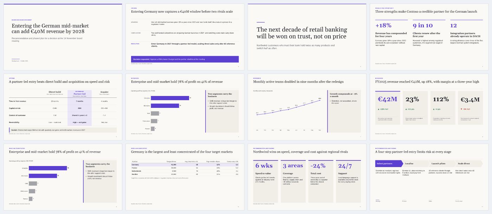
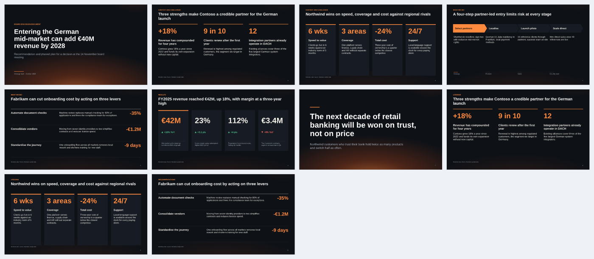
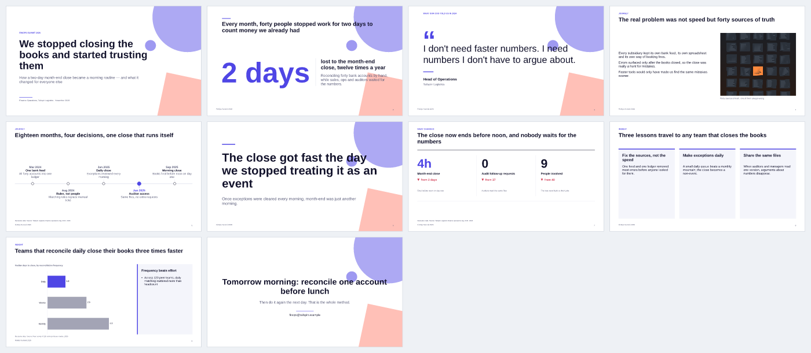

<!-- Generated by `slidecraft gen` — do not edit by hand. -->
# Themes

> **Audience:** deck authors, agents and contributors · **Generated from:** library/themes/*.json · **Version:** 0.7.2

Themes are pure tokens — colors, chart palette, fonts, type scale, decor and chrome. Any storyline works with any theme. Fonts are limited to Arial, Georgia and Times New Roman because SlideCraft measures them exactly with metric-compatible open fonts ([ADR 0005](../adr/0005-metric-compatible-fonts.md)).

| Theme | Look | Best for | Fonts | Engine |
|---|---|---|---|---|
| [`consulting-classic`](#consulting-classic) | White page, deep navy ink and a single blue accent — the restrained, answer-first look of top-tier strategy decks. | strategy-recommendation, executive-update, business-case, client-proposal, research-readout | Arial / Arial | pptx |
| [`corporate-blue`](#corporate-blue) | Light surfaces, royal blue accent and flowing gradient waves — a confident, friendly look for business reviews and sales reports. | executive-update, product-overview, research-readout, client-proposal | Arial / Arial | pptx |
| [`editorial-fintech`](#editorial-fintech) | Quiet analytical pages with ink panels, crisp blue rails, numbered section headers and an independent source and conclusion layer. | research-readout, strategy-recommendation, executive-update | Arial / Arial | pptx |
| [`editorial`](#editorial) | Warm paper stock, deep ink and a terracotta accent with serif headings and a fine page frame — a magazine feel for research and storytelling. | research-readout, narrative-story, case-study | Georgia / Arial | pptx |
| [`executive`](#executive) | Warm white page, graphite ink and one violet accent with serif headings — a calm, generous look for leadership updates and decision memos. | executive-update, business-case, client-proposal | Georgia / Arial | pptx |
| [`midnight`](#midnight) | Near-black navy canvas, off-white type and a warm orange glow — cinematic and focused, made for keynotes, pitches and stories. | narrative-story, pitch-deck, case-study | Arial / Arial | html |
| [`modern-pitch`](#modern-pitch) | Crisp white, electric indigo and big bold titles with playful geometric shapes — the energetic look for startup and product decks. | pitch-deck, product-overview | Arial / Arial | pptx |

## consulting-classic

**Consulting Classic** — White page, deep navy ink and a single blue accent — the restrained, answer-first look of top-tier strategy decks.

| Role | Color |
|---|---|
| background | `#FFFFFF` |
| surface | `#F2F5F9` |
| ink | `#0B1F3A` |
| muted | `#5B6B7F` |
| accent | `#1F5FBF` |
| accentText | `#FFFFFF` |
| accentSoft | `#E3ECF9` |
| rule | `#C9D2DE` |
| positive | `#2E7D5B` |
| negative | `#B23A3A` |
| titleInk | `#0B1F3A` |
| chart | `#1F5FBF` `#0B1F3A` `#7F9CC4` `#B9C7DA` `#5B6B7F` `#DCE3EC` |

Type scale (pt): cover 40 · title 24 · heading 15 · body 14 (min 11) · source 8. Decor: `rule`.

## corporate-blue

**Corporate Blue** — Light surfaces, royal blue accent and flowing gradient waves — a confident, friendly look for business reviews and sales reports.

| Role | Color |
|---|---|
| background | `#FFFFFF` |
| surface | `#EFF4FC` |
| ink | `#10213F` |
| muted | `#52617A` |
| accent | `#1B55D6` |
| accentText | `#FFFFFF` |
| accentSoft | `#DCE7FB` |
| rule | `#CCD8EC` |
| positive | `#12805C` |
| negative | `#C23B3B` |
| titleInk | `#0D2A6B` |
| chart | `#1B55D6` `#10213F` `#6F9BEA` `#A9C2F0` `#52617A` `#D5E0F5` |

Type scale (pt): cover 40 · title 24 · heading 15 · body 14 (min 11) · source 8. Decor: `wave` (also on content slides).

## editorial-fintech

**Editorial Fintech** — Quiet analytical pages with ink panels, crisp blue rails, numbered section headers and an independent source and conclusion layer.

| Role | Color |
|---|---|
| background | `#F5F7FA` |
| surface | `#FFFFFF` |
| ink | `#0A2033` |
| muted | `#596E7C` |
| accent | `#0960D5` |
| accentText | `#FFFFFF` |
| accentSoft | `#DFEAFC` |
| rule | `#DCE3EB` |
| positive | `#00978D` |
| negative | `#C94A53` |
| titleInk | `#0A2033` |
| chart | `#0960D5` `#7055AD` `#00978D` `#DB880F` `#0A2033` `#92A5B5` |

Type scale (pt): cover 42 · title 24 · heading 16 · body 14 (min 11) · source 8. Decor: `none`.

## editorial

**Editorial** — Warm paper stock, deep ink and a terracotta accent with serif headings and a fine page frame — a magazine feel for research and storytelling.

| Role | Color |
|---|---|
| background | `#FBF8F3` |
| surface | `#F0EAE0` |
| ink | `#221E1A` |
| muted | `#625A50` |
| accent | `#B4492B` |
| accentText | `#FFFFFF` |
| accentSoft | `#F3DFD5` |
| rule | `#D6CCBC` |
| positive | `#3A6B4A` |
| negative | `#A8332A` |
| titleInk | `#221E1A` |
| chart | `#B4492B` `#221E1A` `#C98C6F` `#8C7F6E` `#3F5F4F` `#DDD3C3` |

Type scale (pt): cover 44 · title 24 · heading 16 · body 14 (min 11) · source 8. Decor: `paper` (also on content slides). Cyrillic override: heading → Times New Roman.

## executive

**Executive** — Warm white page, graphite ink and one violet accent with serif headings — a calm, generous look for leadership updates and decision memos.

| Role | Color |
|---|---|
| background | `#FBF9F5` |
| surface | `#F1EEE8` |
| ink | `#1E2228` |
| muted | `#5A5F68` |
| accent | `#5B3FD1` |
| accentText | `#FFFFFF` |
| accentSoft | `#EAE6F8` |
| rule | `#D8D3C8` |
| positive | `#2B7554` |
| negative | `#B03F2E` |
| titleInk | `#1E2228` |
| chart | `#5B3FD1` `#1E2228` `#9A88E3` `#B9B3C8` `#6B6F78` `#DCD7CC` |

Type scale (pt): cover 42 · title 26 · heading 16 · body 14 (min 11) · source 8. Decor: `rule`. Cyrillic override: heading → Times New Roman.

## midnight

**Midnight** — Near-black navy canvas, off-white type and a warm orange glow — cinematic and focused, made for keynotes, pitches and stories.

| Role | Color |
|---|---|
| background | `#0E1116` |
| surface | `#171C24` |
| ink | `#F2EFE9` |
| muted | `#A4ADBA` |
| accent | `#FF8A3D` |
| accentText | `#141008` |
| accentSoft | `#2C2118` |
| rule | `#2C3440` |
| positive | `#4CC38A` |
| negative | `#FF6B5E` |
| titleInk | `#FFFFFF` |
| chart | `#FF8A3D` `#E9E4DA` `#7C8AA0` `#4E5B6E` `#B8A48C` `#2F3948` |

Type scale (pt): cover 44 · title 26 · heading 16 · body 15 (min 12) · source 8. Decor: `glow` (also on content slides).

## modern-pitch

**Modern Pitch** — Crisp white, electric indigo and big bold titles with playful geometric shapes — the energetic look for startup and product decks.

| Role | Color |
|---|---|
| background | `#FFFFFF` |
| surface | `#F4F5FB` |
| ink | `#12122B` |
| muted | `#585A78` |
| accent | `#4F46E5` |
| accentText | `#FFFFFF` |
| accentSoft | `#E6E5FB` |
| rule | `#D9DAEB` |
| positive | `#0F8A5F` |
| negative | `#D1364F` |
| titleInk | `#12122B` |
| chart | `#4F46E5` `#12122B` `#8E88F0` `#C0BEF6` `#585A78` `#E4E4F0` |

Type scale (pt): cover 50 · title 28 · heading 16 · body 14 (min 11) · source 8. Decor: `geo`.
